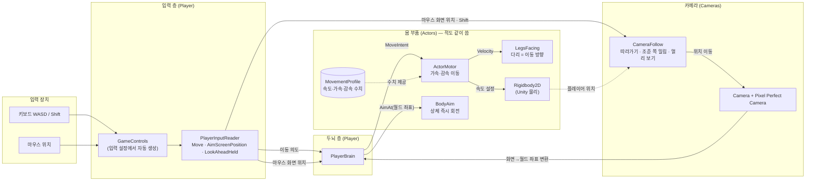
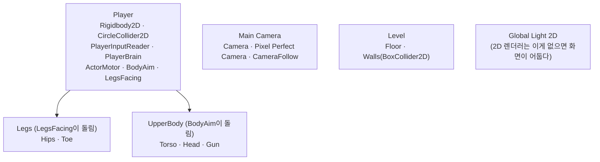

# 코드 구조

나중에 코드를 다시 볼 때 길잡이로 쓰는 문서다. 스크립트가 새로 생기거나 관계가 바뀌면 같이 고친다.
(기획 내용은 `기획서.md`에 쓰고, 여기에는 코드가 어떻게 생겼는지만 쓴다.)

마지막 갱신: 2026-10-06 (페이즈 1 조작감)

## 한눈에 보기

플레이어 캐릭터는 세 층으로 나뉜다.

1. **입력**: 키보드·마우스를 읽는다. Input System을 직접 만지는 곳은 여기 하나뿐이다.
2. **두뇌**: 읽은 입력을 "어디로 가라, 어디를 봐라"는 명령으로 바꿔 몸에 전달한다.
3. **몸 부품**: 명령대로 움직이고 돈다. 누가 명령했는지는 모른다.

몸 부품이 명령한 쪽을 모르게 해 둔 이유는 페이즈 3에서 적을 만들 때 같은 몸 부품을 그대로 쓰기 위해서다. 적은 두뇌 자리에 플레이어 입력 대신 자기 AI를 끼운다.

## 관계도

화살표는 "값을 넘긴다/읽는다"는 뜻이다. 점선은 직접 부르지 않고 데이터나 위치만 참고한다는 뜻이다.

## 한 프레임에 일어나는 순서

- `PlayerInputReader`와 `PlayerBrain`에는 `[DefaultExecutionOrder]`를 붙여 다른 스크립트보다 먼저 돌게 했다. 그래야 다른 스크립트가 이번 프레임 입력을 읽는다.
- 이동은 물리라서 `FixedUpdate`에서, 카메라는 모든 움직임이 끝난 뒤인 `LateUpdate`에서 처리한다.

## 스크립트별 설명

폴더는 `Assets/Scripts/`, 네임스페이스는 `DustScrapper.*`다.

### Player/ — 플레이어 전용

| 스크립트 | 하는 일 | 왜 이렇게 짰나 |
| --- | --- | --- |
| `PlayerInputReader` | `GameControls`에서 이동(0~1 길이), 마우스 화면 좌표, 멀리 보기(Shift)를 매 프레임 읽어 속성으로 내놓는다. | 입력 장치를 다루는 곳을 한 군데로 모았다. 키 바꾸기나 게임패드 지원이 생겨도 여기만 고치면 된다. |
| `PlayerBrain` | 입력을 몸 부품 명령으로 바꾼다. 이동 입력은 `ActorMotor.MoveIntent`로 넣고, 마우스 화면 좌표는 카메라로 월드 좌표로 바꿔 `BodyAim.AimAt`에 넘긴다. | 몸 부품이 입력을 모르게 하는 연결 고리다. 적은 이 자리에 AI 두뇌를 붙인다. |

### Actors/ — 플레이어와 적이 같이 쓰는 몸 부품

| 스크립트 | 하는 일 | 왜 이렇게 짰나 |
| --- | --- | --- |
| `ActorMotor` | `MoveIntent`(가려는 방향·세기)를 받아 `Rigidbody2D` 속도를 목표 속도 쪽으로 가속하거나, 입력이 없으면 감속한다. 벽 충돌은 Unity 물리가 맡는다. | 속도를 즉시 바꾸지 않고 가속·감속을 둬서 무게감을 준다(기획: 핫라인 마이애미보다 덜 빠릿하게). `SetProfile`로 수치 묶음을 통째로 바꿀 수 있다. |
| `MovementProfile` | 최고 속도, 가속, 감속 수치를 담은 데이터 파일(ScriptableObject). | 장비에 따라 이동 무게감을 바꾸기 위해 코드 밖 데이터로 뺐다. 수치 조정도 Inspector에서 바로 할 수 있다. |
| `BodyAim` | `AimAt(월드 좌표)`를 받으면 상체 그림을 그쪽으로 즉시 돌리고, 방향을 `AimDirection`에 기억한다. 너무 가까운 점이면 직전 방향을 유지한다. | 조준은 손에 바로 붙어야 해서 회전 지연이 없다. 페이즈 2의 무기는 `AimDirection`을 읽어 발사 방향으로 쓴다. |
| `LegsFacing` | `ActorMotor.Velocity`를 읽어 다리 그림을 실제로 움직이는 방향으로 돌린다. 도는 속도에 한계(도/초)가 있고, 거의 멈춰 있으면 돌리지 않는다. | 입력이 아니라 실제 움직임을 따라서 벽에 막히거나 밀릴 때도 다리 방향이 맞는다. 나중에 걷기 애니메이션 속도도 이 값으로 정할 수 있다. |

### Cameras/

| 스크립트 | 하는 일 | 왜 이렇게 짰나 |
| --- | --- | --- |
| `CameraFollow` | 플레이어 위치에 "화면 중앙→커서" 방향의 밀림을 더한 곳으로 `SmoothDamp`로 부드럽게 이동한다. Shift를 누르면 밀림 거리와 부드러움을 멀리 보기용 값으로 바꾼다. `SnapToTarget`으로 즉시 이동할 수도 있다. | 밀림을 커서의 **화면** 위치로 계산해서, 카메라가 움직여도 밀림 정도가 다시 바뀌어 화면이 흔들리지 않는다. 화면 짧은 변 기준으로 나눠서 모든 방향에서 밀림 거리가 같다. |

### Controls/

| 파일 | 하는 일 |
| --- | --- |
| `GameControls` | `Assets/Input/GameControls.inputactions`에서 Unity가 자동 생성한 코드다. **손으로 고치지 않는다.** 키를 바꾸려면 `.inputactions` 파일을 고친다. |

## 씬과 데이터

### `Assets/Scenes/Game.unity`의 오브젝트 구성

- 몸통(`Player`)은 회전하지 않고(Rigidbody2D 회전 고정), 그림인 `Legs`와 `UpperBody`만 따로 돈다. 그래서 다리와 상체가 다른 방향을 볼 수 있다.
- **그림은 오른쪽(+X)을 보고 그린다**는 약속이 있다. 회전 계산이 이 약속을 전제로 한다.

### 데이터·에셋

| 경로 | 내용 |
| --- | --- |
| `Assets/Data/Movement/PlayerDefault.asset` | 플레이어 기본 이동 수치 (임시값: 최고 4.5칸/초, 가속 25, 감속 35) |
| `Assets/Data/Physics/ActorNoFriction.physicsMaterial2D` | 마찰 0. 벽에 비비며 걸을 때 달라붙지 않게 한다. |
| `Assets/Art/Placeholder/Square.png` | 임시 네모 그림 (32x32, 32PPU) |
| `Assets/Input/GameControls.inputactions` | 키 배치: Move = WASD, Aim = 마우스 위치, LookAhead = Shift |
| `Assets/Settings/URP-2D.asset`, `Renderer2D.asset` | URP 2D 렌더러 설정 |

## 확장할 때 손댈 곳

- **적 만들기 (페이즈 3)**: `ActorMotor`, `BodyAim`, `LegsFacing`을 그대로 붙이고, `PlayerBrain` 대신 적 AI 스크립트가 `MoveIntent`와 `AimAt`을 부른다.
- **장비로 이동 무게감 바꾸기**: `MovementProfile` 에셋을 새로 만들고 `ActorMotor.SetProfile`로 갈아 끼운다.
- **무기 (페이즈 2)**: `BodyAim.AimDirection`을 읽어 발사 방향으로 쓴다. 새 키(발사, 재장전 등)는 `GameControls.inputactions`에 추가하고 `PlayerInputReader`에서 읽는다.
