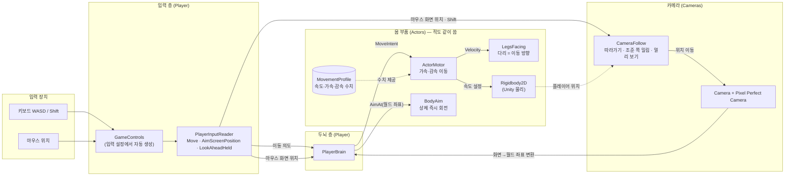
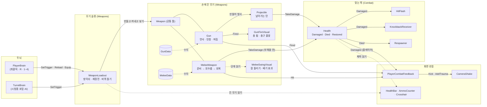
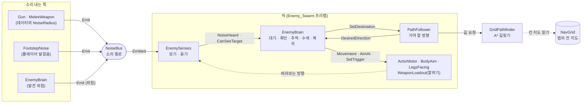
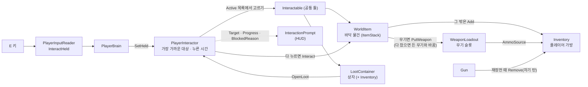
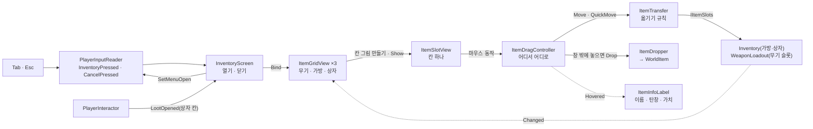
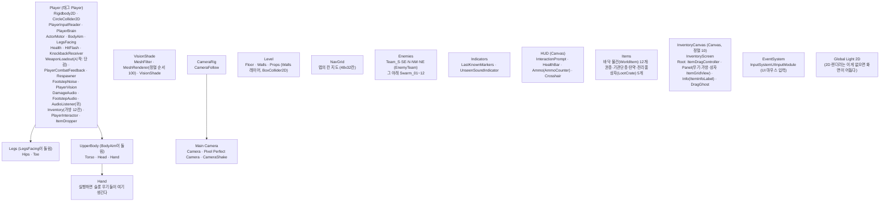

# 코드 구조

나중에 코드를 다시 볼 때 길잡이로 쓰는 문서다. 스크립트가 새로 생기거나 관계가 바뀌면 같이 고친다.
(기획 내용은 `기획서.md`에 쓰고, 여기에는 코드가 어떻게 생겼는지만 쓴다.)

마지막 갱신: 2026-10-08 (페이즈 4 익스트랙션 뼈대 — ① 물건·가방·줍기, ② 가방 화면·상자 뒤지기)

## 한눈에 보기

플레이어 캐릭터는 세 층으로 나뉜다.

1. **입력**: 키보드·마우스를 읽는다. Input System을 직접 만지는 곳은 여기 하나뿐이다.
2. **두뇌**: 읽은 입력을 "어디로 가라, 어디를 봐라"는 명령으로 바꿔 몸에 전달한다.
3. **몸 부품**: 명령대로 움직이고 돈다. 누가 명령했는지는 모른다.

몸 부품이 명령한 쪽을 모르게 해 둔 이유는 적도 같은 몸 부품을 그대로 쓰기 위해서다. 페이즈 3의 적(`EnemyBrain`)은 두뇌 자리에 플레이어 입력 대신 자기 AI를 끼우고, 플레이어와 같은 `ActorMotor`·`BodyAim`·`LegsFacing`·`WeaponLoadout`·`Health`를 쓴다.

페이즈 2에서 두 묶음이 더 생겼다.

- **무기**: 두뇌는 `WeaponLoadout`(무기 슬롯)에 "방아쇠를 당기고 있다 / 재장전 / 몇 번 슬롯"만 알린다. 쏠지 휘두를지는 손에 든 무기(`Gun`, `MeleeWeapon`)가 정한다.
- **전투 공통**: 맞는 쪽은 `Health` 하나로 통일했다. 번쩍임·밀려남·부활 같은 반응은 `Health`의 이벤트를 듣는 작은 스크립트들이 따로 맡는다.

페이즈 3에서 세 묶음이 더 생겼다.

- **소음**: 소리를 내는 쪽(총, 단검, 발걸음, 적의 외침)은 `NoiseBus.Emit`만 부른다. 누가 듣는지 모른다. 듣는 쪽(적의 감각)이 "내게 들리는 거리인가"를 판단한다.
- **길찾기**: 맵에 하나 있는 `NavGrid`가 벽을 칸 지도로 만들고, 적마다 붙은 `PathFollower`가 그 지도로 길을 찾아 "지금 가야 할 방향"만 알려 준다.
- **적**: 감각(`EnemySenses`, 보기·듣기)과 두뇌(`EnemyBrain`, 무엇을 할지)를 나눴다. 적 종류가 늘면 감각은 그대로 쓰고 두뇌만 바꾼다. 적은 **팀**(`EnemyTeam`)으로 묶이고, 경계 중인 팀원끼리 "플레이어를 마지막으로 본 위치"를 공유한다.
- **표시(Indicators)**: 팀이 마지막으로 본 위치의 반투명 플레이어 모습(`LastKnownMarkers`), 시야 밖 발소리 자리의 빨간 원(`UnseenSoundIndicator`). 둘 다 정보를 읽기만 하는 연출이다.
- **소리(효과음)**: 무기·체력·적 두뇌는 소리를 모르고 사건(쏨, 재장전 시작, 휘두르기 단계, 맞음, 죽음, 외침)만 알린다. `Audio/`의 작은 스크립트들이 그 사건을 듣고 `SoundCue`(소리 데이터)를 `SoundPlayer`로 재생한다. 적이 듣는 **소음**(`NoiseBus`, 게임 규칙)과 플레이어 귀에 들리는 **효과음**은 별개다.
- **플레이어 시야**: 판정(`PlayerVision`, "이 지점이 보이는가")과 표현을 나눴다. 시야 밖을 어둡게 덮는 `VisionShade`와 안 보이는 적을 숨기는 `HideOutsideVision`이 같은 판정 하나를 따른다. 시야 모양 수치는 장비로 갈아 끼우는 데이터(`VisionProfile`)다.

페이즈 4에서 두 묶음이 더 생겼다.

- **물건(Items)**: 전리품·탄약·무기가 모두 **물건 데이터**(`ItemData`)다. 탄약(`AmmoData`)과 무기(`WeaponData`)는 이것을 이어받는다. 물건 한 묶음(`ItemStack`)이 가방 한 칸, 바닥 물건(`WorldItem`) 하나다. 가방과 상자는 같은 **칸 보관함**(`Inventory`)을 쓴다. 가방·상자·무기 슬롯은 모두 **칸 창구**(`IItemSlots`)를 따라서, 칸 사이 옮기기 규칙(`ItemTransfer`) 하나로 어디끼리든 옮긴다. 총은 재장전할 때 무기 슬롯에 연결된 가방에서 자기 탄을 꺼낸다(무한 탄약 없음).
- **가방 화면(UI)**: Tab으로 열고(상자를 열면 상자 칸까지), 칸을 끌어 옮기기·겹치기·바꾸기, 창 밖에 놓아 버리기, 우클릭 빠른 옮기기. 열려 있는 동안 입력 층(`PlayerInputReader.MenuOpen`)이 조준·발사·상호작용을 막고 이동만 받는다. 게임은 멈추지 않는다.
- **상호작용(Interaction)**: E를 누르고 있으면 일어나는 것들의 공통 틀(`Interactable`). 플레이어 쪽 `PlayerInteractor`가 손 닿는 가장 가까운 대상을 고르고 누르는 시간을 잰다. 바닥 물건 줍기(`WorldItem`)와 상자 뒤지기(`LootContainer`)가 있고, 탈출구도 같은 틀에 붙인다.

## 관계도

화살표는 "값을 넘긴다/읽는다"는 뜻이다. 점선은 직접 부르지 않고 데이터나 위치만 참고한다는 뜻이다.

### 무기와 전투 (페이즈 2)

### 적과 소음 (페이즈 3)

### 물건과 줍기 (페이즈 4)

### 가방 화면 (페이즈 4)

## 한 프레임에 일어나는 순서

- 적은 `PathFollower`(-60) → `EnemySenses`(-55) → `EnemyBrain`(-50) 순서로 돈다. 두뇌가 이번 프레임에 본 것·들은 것으로 판단하게 하려는 것이다.
- `PlayerInputReader`와 `PlayerBrain`(그리고 `TurretBrain`)에는 `[DefaultExecutionOrder]`를 붙여 다른 스크립트보다 먼저 돌게 했다. 그래야 무기·카메라가 이번 프레임 입력을 읽는다.
- 무기(`Weapon.Update`)는 두뇌 다음에 돈다. 두뇌가 넣은 방아쇠 상태로 "이번 프레임에 새로 눌렀는가"를 무기가 직접 판단한다.
- 화면 흔들림(`CameraShake`)은 카메라 자식에서 `LateUpdate`로 자기 위치만 흔든다. 따라가기(`CameraRig`의 `CameraFollow`)와 서로 위치를 덮어쓰지 않는다.
- 이동은 물리라서 `FixedUpdate`에서, 카메라는 모든 움직임이 끝난 뒤인 `LateUpdate`에서 처리한다.

## 스크립트별 설명

폴더는 `Assets/Scripts/`, 네임스페이스는 `DustScrapper.*`다.

### Player/ — 플레이어 전용

| 스크립트 | 하는 일 | 왜 이렇게 짰나 |
| --- | --- | --- |
| `PlayerInputReader` | `GameControls`에서 이동(0~1 길이), 마우스 화면 좌표, 멀리 보기(Shift), 살금살금(Ctrl, 누르고 있는가), 발사(좌클릭, 누르고 있는가), 재장전(R, 이번 프레임에 눌렀는가), 상호작용(E, 누르고 있는가), 가방(Tab)·취소(Esc, 이번 프레임에 눌렀는가), 슬롯(1~4, 이번 프레임에 누른 번호)을 읽어 속성으로 내놓는다. | 입력 장치를 다루는 곳을 한 군데로 모았다. 키 바꾸기나 게임패드 지원이 생겨도 여기만 고치면 된다. 한 프레임 안에 눌렀다 뗀 짧은 클릭도 놓치지 않게 발사는 "누르고 있음 또는 이번에 눌림"으로 읽는다. 마우스를 쓰는 창(가방 화면)이 `SetMenuOpen`으로 열렸다고 알리면 이동·살금살금·Tab·Esc만 읽고 조준점은 마지막 자리에 멈춘다. 창마다 두뇌·무기·카메라를 따로 막을 필요 없이 입력 한 곳에서 막는다. |
| `PlayerBrain` | 입력을 몸 부품 명령으로 바꾼다. 이동은 `ActorMotor.MoveIntent`로(살금살금 키를 누르면 이동 세기를 `sneakIntent`로 줄임), 조준점은 `BodyAim.AimAt`으로, 발사·재장전·슬롯은 `WeaponLoadout`으로, 상호작용 키(E)는 `PlayerInteractor.SetHeld`로 넘긴다. 꺼질 때(죽을 때) 이동·방아쇠·상호작용 키를 비운다. | 몸 부품이 입력을 모르게 하는 연결 고리다. 적은 이 자리에 AI 두뇌를 붙인다. |
| `PlayerCombatFeedback` | 플레이어가 총을 쏘면 화면을 쏜 반대쪽으로 튕기고(세기는 `GunData.RecoilKick`), 칼로 맞히면 짧게, 맞으면 크게 흔든다. 든 무기가 바뀔 때마다 새 무기의 이벤트로 갈아 탄다. | 적이 쏘거나 맞을 때 화면이 흔들리면 안 되므로 카메라 반응은 플레이어 쪽에만 둔다. 무기 스크립트가 카메라를 알 필요가 없어진다. |

### Actors/ — 플레이어와 적이 같이 쓰는 몸 부품

| 스크립트 | 하는 일 | 왜 이렇게 짰나 |
| --- | --- | --- |
| `ActorMotor` | `MoveIntent`(가려는 방향·세기)를 받아 `Rigidbody2D` 속도를 목표 속도 쪽으로 가속하거나, 입력이 없으면 감속한다. 벽 충돌은 Unity 물리가 맡는다. | 속도를 즉시 바꾸지 않고 가속·감속을 둬서 무게감을 준다(기획: 핫라인 마이애미보다 덜 빠릿하게). `SetProfile`로 수치 묶음을 통째로 바꿀 수 있다. |
| `MovementProfile` | 최고 속도, 가속, 감속 수치를 담은 데이터 파일(ScriptableObject). | 장비에 따라 이동 무게감을 바꾸기 위해 코드 밖 데이터로 뺐다. 수치 조정도 Inspector에서 바로 할 수 있다. |
| `BodyAim` | `AimAt(월드 좌표)`를 받으면 상체 그림을 그쪽으로 즉시 돌리고, 방향을 `AimDirection`에 기억한다. 너무 가까운 점이면 직전 방향을 유지한다. | 조준은 손에 바로 붙어야 해서 회전 지연이 없다. 페이즈 2의 무기는 `AimDirection`을 읽어 발사 방향으로 쓴다. |
| `LegsFacing` | `ActorMotor.Velocity`를 읽어 다리 그림을 실제로 움직이는 방향으로 돌린다. 도는 속도에 한계(도/초)가 있고, 거의 멈춰 있으면 돌리지 않는다. | 입력이 아니라 실제 움직임을 따라서 벽에 막히거나 밀릴 때도 다리 방향이 맞는다. 나중에 걷기 애니메이션 속도도 이 값으로 정할 수 있다. |

### Weapons/ — 무기 (플레이어와 적이 같이 씀)

| 스크립트 | 하는 일 | 왜 이렇게 짰나 |
| --- | --- | --- |
| `WeaponData` | 모든 무기의 공통 수치: 무기 프리팹, 쥐는 방식(한손·두손), 피해, 밀어내기, 꺼내는 시간, 쓸 때 나는 소리가 들리는 거리(`noiseRadius`). 추상 클래스라 직접 만들지 않고 아래 둘을 만든다. 주워서 들고 다니는 물건이라 `ItemData`를 이어받는다(이름·가치·임시 색은 거기에, 겹쳐 담기는 항상 1). | 공통인 것만 묶고 총·칼 고유 수치는 나눴다. 억지로 한 파일에 넣으면 "탄창 없는 무기", "재장전하는 칼" 같은 예외가 쌓인다. 쥐는 방식은 나중에 그림 레이어를 고를 때 쓴다. |
| `GunData` | 총 수치: 연사 방식(단발·연사), 초당 발 수, 한 번에 나가는 탄 수, 탄 프리팹·속도·사거리, 쓰는 탄약(`AmmoData`)·탄창·장전 시간, 퍼짐(기본·한 발마다 증가·최대·회복), 화면 반동 세기. | 새 총은 이 데이터 파일만 새로 만들면 된다. 한 번에 여러 발(샷건)도 수치로 된다. |
| `MeleeData` | 근접 수치: 닿는 거리, 부채꼴 각도, 준비·휘두름·회복 시간. | 단검은 짧고 빠르게, 큰 검은 넓고 느리게를 수치만으로 낸다. |
| `Weapon` | 손에 드는 무기의 공통 틀. 방아쇠 상태를 받아 "이번에 새로 눌렀는가"를 계산하고, 꺼내는 시간 동안은 쓰지 못하게 막는다. 꺼내는 중에 누른 클릭은 기억했다가 다 꺼낸 첫 프레임에 넘긴다. `IsBusy`(꺼내기·재장전·휘두르기 중인가)를 알려 주고, 쓸 때 `EmitUseNoise`로 소음을 낸다. | 두뇌·슬롯은 손에 든 게 총인지 칼인지 몰라도 된다. 곡괭이·지팡이가 생겨도 `Weapon` 종류를 하나 더 만들면 되고 플레이어 코드는 그대로다. |
| `Gun` | 연사 방식대로 탄을 만들어 쏘고, 탄창·재장전·퍼짐을 관리한다. 재장전은 주인의 탄 공급원(`WeaponLoadout.AmmoSource`, 가방)에 이 총의 탄이 있어야 시작하고, 탄은 **장전이 끝날 때** 필요한 만큼 꺼낸다(모자라면 있는 만큼). 탄창이 비면 방아쇠를 당길 때 자동으로 재장전한다. 바꿔 들면 장전은 취소되고 탄은 줄지 않는다. `ReserveAmmo`(가방 속 이 총의 탄 수), `SetMagazine`(주운 총의 탄창을 이어받기). 쏠 때마다 `Fired`, 재장전을 시작하면 `ReloadStarted`를 알린다. | 연출은 하지 않고 이벤트만 알려서 총 자체 연출(`GunFireVisual`)과 화면 반응(`PlayerCombatFeedback`)을 따로 붙인다. 쿨다운을 "설정"이 아니라 "더해서" 프레임 간격과 상관없이 연사 속도가 정확하다. 단발 총은 쿨다운 중 클릭을 잠깐 기억해 연타가 씹히지 않는다. 탄은 캐릭터 중심에서 출발해 총구까지 한 번에 이동한다(벽에 붙어 쏴도 벽을 뚫지 않게). |
| `Projectile` | 날아가는 탄. 매 프레임 갈 거리만큼 앞을 광선으로 검사해 맞으면 `Health`에 피해를 주고, 맞은 자리에 효과를 남기고 사라진다. 쏜 사람 자신은 무시한다. | 탄이 눈에 보여야 쏘는 맛과 피하는 긴장감이 생긴다. 광선 검사라 빠른 탄도 얇은 벽을 뚫지 않는다. 총에 묶지 않고 값만 받아서 적의 탄·마법 투사체도 같은 스크립트를 쓸 수 있다. |
| `MeleeWeapon` | 누르면 준비 → 휘두름 → 회복(단계가 바뀔 때마다 `PhaseChanged`). 휘두름 동안 캐릭터 앞 부채꼴 안의 `Health`를 맞힌다. 한 번 휘두를 때 같은 대상은 한 번만, 벽 너머는 안 맞는다. 휘두르는 중 클릭은 기억했다가 바로 다음 공격으로 잇는다. | 단계를 나눠서 "언제 맞는가"가 분명하다. 대상의 중심이 아니라 가장 가까운 지점으로 각도를 재서 큰 대상의 가장자리도 벨 수 있다. |
| `WeaponLoadout` | 무기 슬롯. 시작할 때 슬롯마다 무기 프리팹을 손(`Hand`)에 만들어 두고 하나만 꺼낸다(시작 무기는 탄창이 가득 참). 슬롯 수 = 배열 칸 수(지금 3칸, 숫자키는 4까지). 판 도중에 `PutWeapon`(빈 슬롯에 넣고 바로 듦, 다 찼으면 든 무기와 바꾸고 빠진 무기를 돌려줌)으로 주운 무기를 넣는다. 칸 창구(`IItemSlots`)를 따라서 가방 화면에서 가방과 같은 방식으로 옮겨진다: `GetSlot`(무기를 물건 묶음으로, 총은 지금 탄창), `CanPlace`(무기만), `TakeSlot`(빼기, 든 무기였으면 남은 첫 무기를 듦), `PlaceInEmptySlot`(넣기, 빈손이면 바로 듦). 넣고 빼면 `Changed`. 꺼지면(죽으면) 무기를 넣고, 켜지면 다시 꺼낸다. 총이 탄을 꺼낼 가방을 `ammoSource`로 연결한다(비우면 탄창 탄만 씀). | 두뇌가 무기를 직접 만지지 않게 하는 창구다. 가방과는 따로이고 탄 공급원으로만 이어진다. 바닥에 떨어뜨리는 일은 부른 쪽(`WorldItem`)이 해서, 슬롯이 바닥 물건을 모른다. 무기를 넣고 빼면 `CurrentChanged`가 불려 화면·카메라 반응이 새 무기로 갈아 탄다. |
| `GunFireVisual` | 쏠 때 총 그림을 뒤로 튀겼다 돌려놓고, 총구 불꽃을 아주 잠깐 보인다. | 무기 프리팹 안의 연출만 맡는다. 무기마다 다른 연출을 프리팹에서 고칠 수 있다. |
| `MeleeSwingVisual` | `MeleeWeapon`의 단계를 읽어 칼을 들어 올렸다 베고 돌아오게 돌린다. 휘두를 때마다 방향을 번갈아 바꾼다. 휘두름 동안 베기 효과를 보인다. | 판정(`MeleeWeapon`)과 모습을 나눠서, 그림이 바뀌어도 판정 코드는 그대로다. |

### Combat/ — 맞는 쪽 (플레이어, 적, 표적, 물건 공통)

| 스크립트 | 하는 일 | 왜 이렇게 짰나 |
| --- | --- | --- |
| `DamageInfo` | 피해 한 번의 정보: 양, 맞은 지점, 들어온 방향, 밀어내는 힘, 준 쪽. | 맞은 쪽 반응은 이 값만 보고 정하므로 무엇에 맞았는지(탄, 칼, 폭발) 몰라도 된다. |
| `Health` | 체력. `TakeDamage`로 깎이고 `Damaged`, 0이 되면 `Died`, 다시 채우면 `Restored` 이벤트를 알린다. 죽은 뒤에는 피해를 무시한다. | 맞는 것은 모두 이것 하나다. 반응은 이벤트를 듣는 다른 스크립트가 맡아서, 표적엔 밀려남을 빼고 포탑엔 부활 시간을 길게 하는 식으로 골라 붙인다. |
| `HitFlash` | 맞으면 몸 그림을 잠깐 흰색으로 번쩍인다. 처음에 모은 그림 중 사라진 것(판 도중에 슬롯에서 빠진 시작 무기)은 건너뛴다. | "맞았다"를 가장 빨리 알려 준다. **주의**: 지금은 흰 네모에 색을 입힌 임시 그림이라 색만 바꿔도 하얘진다. 실제 도트 그림이 들어오면 번쩍임용 셰이더로 바꿔야 한다. |
| `KnockbackReceiver` | 맞으면 들어온 방향으로 충격량을 줘서 밀려난다. | 충격량이라 무거운 대상은 덜 밀린다. `ActorMotor`가 있으면 밀린 속도가 감속 수치대로 자연스럽게 준다. |
| `Respawner` | 죽으면 지정한 스크립트·충돌체·그림을 끄고, 잠시 뒤 처음 자리에서 체력을 채워 되살린다. 되살아날 때 부를 것(카메라 바로 옮기기)을 Inspector에서 연결한다. | 시험용 방의 플레이어·표적·포탑이 쓴다. 페이즈 4에서 "죽으면 잃음"이 생기면 플레이어 쪽은 다른 처리로 바뀐다. |
| `LineOfSight` | 두 점 사이가 벽에 막혔는지 검사한다(자기 자신과 상대는 무시). | 근접 공격(벽 너머 안 베기)과 시험용 포탑이 쓴다. 다른 캐릭터 몸도 가리는 것으로 보므로, 적의 시야는 이것 대신 벽 레이어만 검사한다(`EnemySenses`). |

### Enemies/

| 스크립트 | 하는 일 | 왜 이렇게 짰나 |
| --- | --- | --- |
| `EnemySenses` | 적의 눈과 귀. 눈: 바라보는 방향 부채꼴(거리·각도) + 아주 가까우면 등 뒤도 알아챔, 벽 레이어에 막히면 못 봄. 대상은 `Player` 태그로 찾는다. 귀: `NoiseBus`의 소리 중 들리는 거리 안의 것을 `NoiseHeard`로 알린다. 쫓는 중(`IsTracking`)에는 가까운 거리(`trackingRadius`, 4칸) 안에서만 각도를 무시한다(멀리서 모퉁이를 돌면 놓칠 수 있게). | 보고 듣는 것만 판단하고 무엇을 할지는 두뇌에 맡긴다. 원거리·광역 적이 생겨도 같은 감각을 쓰고 수치(거리·각도·귀 밝기)만 바꾼다. 다른 적의 몸이 시야를 가리지 않게 벽 레이어만 검사한다. |
| `EnemyBrain` | 떼거리 적의 두뇌. 상태 여섯 개: 대기(정해진 쪽을 봄) → 소리를 들으면 확인(걷기, 다른 팀의 외침도 걸어서 — 달려오면 팀이 줄줄이 불려 와 맵 전체가 몰려온다) → 보면 추적(달리기)·닿으면 공격 → 놓치면 팀이 마지막으로 본 곳에서 수색(두리번) → **놓친 뒤 행동**(`lostTargetBehavior`)에 따라 기점으로 복귀 / 놓친 곳을 새 기점으로 삼아 배회(`Roam`) / 놓친 곳 주변을 정해진 시간 배회 후 복귀. 보고 있는 동안 팀에 위치를 알리고(`ReportSighting`), 수색·배회 중 팀이 새로 발견하면 그곳으로 간다. 처음 발견할 때 외침(소음)을 내고 `Alarmed`를 알린다(`shoutsWhenSpotting`을 끄면 외치지 않는 조용한 적). 같은 팀이 외침을 들으면 팀이 본 위치로 달려온다. 경계 중(추적, 놓친 뒤 수색, 시간제 배회)인지를 `IsAlerted`로 알리고 팀에도 알린다. | 플레이어 두뇌 자리에 끼우는 AI라 몸 부품은 플레이어와 같다. 공격은 근접 무기(`MeleeWeapon`)를 그대로 쓰고, 휘두르기 시작하면 방향을 고정하고 멈칫해서 준비 동작을 보고 피할 수 있다. 바라보는 방향을 정해진 빠르기로 돌려서 시야 부채꼴도 그만큼 천천히 돈다(등 뒤로 돌아가는 플레이가 가능). 놓친 뒤 행동을 별도 두뇌로 나누지 않고 설정값으로 둔 이유: 행동 차이가 "수색 뒤 어디로 가는가" 하나라서, 두뇌를 복제하면 같은 코드가 세 벌 생긴다. 설정만 다른 프리팹이 곧 적 유형이다. |
| `EnemyTeam` | 팀. 경계 중인 팀원이 "플레이어를 마지막으로 본 위치·시각"을 여기에 모아 같이 쓴다. 경계 중인 팀원이 하나도 없으면 위치 정보를 지운다(팀 진정). `All`로 씬의 모든 팀을 볼 수 있다. | 씬에서 적들을 팀 물체 아래에 넣으면 한 팀이다. 팀 물체 밖의 적은 두뇌가 스스로 `EnemyTeam`을 붙여 혼자 한 팀이 된다. 다른 팀은 정보를 모르므로, 팀을 어떻게 묶느냐로 "얼마나 몰려오는가"를 맵마다 조절할 수 있다. |
| `TurretBrain` | 시험용 고정 포탑의 두뇌. 대상이 사거리 안에 보이면 정해진 속도로 돌고, 조준이 맞으면 "쉬기 → 쏘기" 주기로 끊어 쏜다. | 페이즈 2에서 "맞는 쪽"을 시험하려고 뒀다. 페이즈 3에서 방에서 뺐고 지금은 씬에서 쓰지 않는다(스크립트·`Gun_Turret`·`TurretGun` 파일만 남음). |

### Vision/ — 플레이어 시야

| 스크립트 | 하는 일 | 왜 이렇게 짰나 |
| --- | --- | --- |
| `VisionProfile` | 시야 모양 수치: 사방으로 보이는 거리, 조준 방향으로 보이는 거리, 부채꼴 각도, 부채꼴 가장자리에서 줄어드는 폭. `RadiusAt(각도)`로 "그 방향으로 보이는 거리"를 계산한다. | 기획상 시야 범위는 장비로 조정한다. `MovementProfile`처럼 장비가 묶음을 통째로 갈아 끼운다(`PlayerVision.SetProfile`). |
| `PlayerVision` | 판정만 한다. `CanSee(지점)` = 그 방향의 시야 거리 안인가 + 사이에 벽(`Walls` 레이어)이 없는가. 조준 방향은 `BodyAim`에서 읽는다. `Active`로 어디서나 찾는다. | 그리기와 숨기기가 이 판정 하나를 따라서 "어두운데 적이 보인다" 같은 어긋남이 없다. 나중에 시야탄(설치하면 주변 적을 보여 줌)도 판정 쪽에 더하면 된다. |
| `VisionShade` | 표현만 한다. 플레이어 둘레로 광선(기본 240개)을 쏴서 각 방향의 보이는 거리(시야 끝 또는 벽)를 구하고, 안쪽은 투명·바깥은 어두운 메시를 매 프레임 만든다. 시야 끝은 서서히 어두워지고, 벽에 닿으면 벽 앞면까지만 밝힌다. 어둠은 85%라 시야 밖 맵 생김새가 희미하게 남는다. | 메시의 삼각형 연결은 한 번만 만들고 매 프레임 점 위치·색만 바꾼다. **주의**: 메시 꼭짓점 색은 자동 색 변환이 없어서, 프로젝트가 선형 색 공간이면 코드에서 직접 바꾼다(안 하면 어둠이 회청색으로 밝게 보인다). |
| `HideOutsideVision` | 적과 바닥 물건에 붙는다. 플레이어 시야 밖이면 자기 그림(손에 든 무기 포함)을 모두 숨긴다. | 그림을 `forceRenderingOff`로 꺼서, 죽었을 때 `renderer.enabled`로 끄는 `Respawner`와 서로 덮어쓰지 않는다. 무기는 `WeaponLoadout.Awake`에서 생기므로 `Start`에서 그림을 모은다. |

### Items/ — 물건 (페이즈 4)

| 스크립트 | 하는 일 | 왜 이렇게 짰나 |
| --- | --- | --- |
| `ItemData` | 모든 물건의 공통 데이터: 이름, 한 칸에 겹쳐 담는 최대 개수, 한 개의 가치, 임시 색. 그대로 만들면 가치만 있는 전리품이다(메뉴 Dust Scrapper/Items/Loot). | 전리품·탄약·무기를 하나의 "물건"으로 묶어서 같은 가방 칸, 같은 바닥 물건으로 다룬다. 페이즈 5의 파츠·마법서도 이것을 이어받으면 줍기·가방 코드를 고치지 않는다. |
| `AmmoData` | 탄약. 고유 수치는 아직 없고 종류만 나눈다(메뉴 Dust Scrapper/Items/Ammo). | `GunData`의 탄약 칸에 탄약만 넣을 수 있게 해서 잘못 연결하는 일을 막는다. 총마다 다른 탄을 쓴다(사용자 결정). |
| `IItemSlots` | 칸 창구: 칸 수, 칸 읽기, 그 칸에 놓일 수 있는가(종류), 칸 비우기(`TakeSlot`), 빈 칸에 놓기(`PlaceInEmptySlot`), 바뀜 알림(`Changed`). `Inventory`와 `WeaponLoadout`이 따른다. | 옮기기 규칙과 가방 화면이 "가방인지 무기 슬롯인지" 몰라도 된다. 장비 칸(방어구·마법서 칸 등)이 생겨도 이 창구만 따르면 화면·옮기기 코드는 그대로다. |
| `ItemTransfer` | 칸 사이 옮기기 규칙(정적). `Move`: 빈 칸이면 옮기고, 같은 물건이면 겹치고(넘친 만큼 제자리), 다르면 서로 바꾼다(양쪽 다 놓일 수 있을 때만, 그래서 탄약은 무기 슬롯에 못 들어간다). `QuickMove`: 같은 물건 묶음부터 채우고 그다음 빈 칸, 못 옮긴 만큼 제자리. | 규칙을 화면에서 떼어 두어서, 나중에 단축키나 자동 정리 같은 다른 입력도 같은 규칙을 쓴다. 칸 창구의 "비우기·놓기" 두 동작만으로 짜서 어떤 칸 묶음끼리도 된다. |
| `LootContainer` | 뒤질 수 있는 상자(`Interactable`). 내용물은 같은 물체의 `Inventory`. 처음엔 오래 뒤지고(`searchTime`, 1.5초, "뒤지기"), 한 번 뒤진 뒤엔 짧게(`holdTime`, 0.2초, "열기"). 비면 이름에 "(빈 상자)". 열면 `PlayerInteractor.OpenLoot`로 칸을 넘기기만 한다. | 물건을 옮기는 건 가방 화면 몫이라 상자는 화면을 모른다. 벽(`Walls`) 레이어라 막히고 길찾기도 피해 간다. |
| `ItemDropper` | 물건 묶음을 이 물체 발밑에 바닥 물건(`WorldItem` 프리팹)으로 내려놓는다. 조금 흩뜨리고, 벽 안이면 발밑에 둔다. 플레이어에 붙는다. | 가방 화면에서 버릴 때 쓴다. 바닥 물건 프리팹을 아는 곳을 한 군데로 모았다. |
| `ItemStack` | 물건 한 묶음: 물건, 개수, (총이면) 탄창에 든 탄 수. 바꿀 때는 새 묶음을 만든다. | 총을 버렸다 다시 주워도 탄창이 그대로다. 값으로 주고받아서 두 칸이 같은 묶음을 나눠 갖다가 한쪽만 바뀌는 일이 없다. |
| `Inventory` | 칸 보관함(`IItemSlots`). `Add`(넣을 수 있는 만큼 넣고 남은 개수를 돌려줌, 겹칠 수 있으면 있던 묶음부터 채움), `Remove`(최대 n개 꺼내고 꺼낸 개수를 돌려줌, 뒤 칸부터), `CountOf`, `HasRoomFor`, `IsEmpty`, 칸 창구(`GetSlot`·`TakeSlot`·`PlaceInEmptySlot`, 어떤 물건이든 놓임). 바뀌면 `Changed`. 처음 내용물(`startingItems`)을 넣을 수 있다. | 플레이어 가방과 상자가 같은 스크립트를 쓴다. 가방 화면(②)·총의 탄 세기는 읽기만 한다. 다른 스크립트가 `Awake`에서 먼저 읽어도 되게 칸은 처음 쓸 때 만든다. |
| `WorldItem` | 바닥에 놓인 물건 한 묶음(`Interactable`). 무기는 무기 슬롯으로(다 찼으면 든 무기와 바꿔 빠진 무기가 이 자리에 남음), 나머지는 가방으로. 가방에 다 안 들어가면 남은 만큼 바닥에 남는다. 가방에 자리가 없으면 "가방이 가득 찼다". | 바꿔 줍기에서 빠진 무기를 새 물체로 만들지 않고 이 바닥 물건의 내용만 바꿔서, 떨어뜨릴 프리팹을 따로 알 필요가 없다. |

### Interaction/ — 상호작용 (페이즈 4)

| 스크립트 | 하는 일 | 왜 이렇게 짰나 |
| --- | --- | --- |
| `Interactable` | E를 누르고 있으면 일어나는 것의 공통 틀: 누르고 있어야 하는 시간(`HoldTime`, 상자처럼 상황에 따라 바꿀 수 있음), 동작 이름(줍기), 대상 이름, 지금 못 하는 이유, 다 눌렀을 때 할 일. 켜져 있는 것들을 `Active` 목록으로 모은다. | 상자 뒤지기·탈출구·문·채굴이 생겨도 이것을 이어받기만 하면 플레이어 쪽 코드는 그대로다. 목록으로 찾아서 충돌체·전용 레이어가 필요 없다. |
| `PlayerInteractor` | 손 닿는 거리(`reach`, 1.2칸) 안이고 벽(`Walls`) 너머가 아닌 대상 중 가장 가까운 것을 고르고, E를 누르고 있는 시간을 잰다. 다 누르면 대상의 `Interact`를 부르고, **키를 뗐다 다시 눌러야** 다음 것을 한다. 대상이 바뀌면 진행이 처음부터. 대상은 이것을 통해 가방(`Inventory`)·무기 슬롯(`WeaponLoadout`)에 접근한다. 상자가 `OpenLoot`를 부르면 `LootOpened`로 알린다. 상자처럼 대상 자신이 벽 레이어에 있으면 벽 검사에서 대상 자신은 막힘으로 치지 않는다. | 입력은 두뇌가 `SetHeld`로 넣어서 입력 장치를 모른다. 다시 누르기를 요구하는 이유: 무기를 바꿔 주울 때 떨어뜨린 무기를 곧바로 다시 주워 바꾸기가 반복되지 않게. |

### Audio/ — 효과음

| 스크립트 | 하는 일 | 왜 이렇게 짰나 |
| --- | --- | --- |
| `SoundCue` | 소리 데이터: 소리 파일 여러 개(무작위로 하나), 크기, 음높이 흔들림 범위, 들리는 거리, 시야 밖이면 빨간 원을 띄울지와 원 크기. `PlayAt(위치)`로 재생한다. | 같은 소리도 매번 조금씩 다르게 들린다. 진짜 소리로 바꿀 때 이 데이터의 파일만 갈아 끼우면 된다. |
| `SoundPlayer` | 월드의 한 자리에서 소리를 낸다(낼 때마다 `Played`를 알림). 처음 쓸 때 재생기 32개를 만들어 돌려 쓰고, 모두 재생 중이면 가장 오래된 것을 끊는다. 거리에 따라 작아지고 좌우로 갈린다(귀 `AudioListener`는 플레이어에 있다). | 기관단총처럼 초당 열 번 넘게 소리가 나도 물체를 새로 만들지 않는다. 적은 프리팹이라 씬 물체 연결 없이 어디서나 부를 수 있게 정적 클래스로 했다. |
| `GunAudio` | 총 프리팹에 붙는다. `Gun.Fired` → 총소리, `Gun.ReloadStarted` → 재장전 소리. | 총 스크립트는 소리를 모른다. 총마다 다른 소리는 프리팹에서 고른다. |
| `MeleeAudio` | 근접 무기 프리팹에 붙는다. 준비 단계 시작 → 준비 소리(할퀴기의 위협음), 휘두름 시작 → 휘두르는 소리. | 준비 소리는 "곧 때린다"는 예고라 보이지 않는 적의 공격도 귀로 피할 수 있다. |
| `DamageAudio` | 맞는 쪽에 붙는다. 맞으면 맞은 자리에서 맞는 소리, 죽으면 죽는 소리(죽는 피해일 때는 맞는 소리를 생략). | |
| `FootstepAudio` | 실제 이동 속도가 일정 이상이면 발소리를 낸다. 빠를수록 간격이 짧다. 플레이어(살금살금이면 조용)와 적에 붙는다. | 적이 듣는 발소리 소음(`FootstepNoise`)과 일부러 따로 뒀다. 하나는 게임 규칙, 하나는 귀에 들리는 연출이라 조정도 따로 한다. |
| `AlarmAudio` | 적에 붙는다. `EnemyBrain.Alarmed`(동료를 부르는 외침을 냈을 때) → 외침 소리. | 시야 밖에서도 "들켰다"를 알 수 있다. |

### Indicators/ — 화면 표시 (월드 위)

| 스크립트 | 하는 일 | 왜 이렇게 짰나 |
| --- | --- | --- |
| `LastKnownMarkers` | 팀마다 반투명 플레이어 모습을 하나씩 두고, 팀이 경계 중이며 지금 아무도 플레이어를 못 볼 때 팀이 마지막으로 본 위치에 서서히 나타나게 한다. 팀이 진정하면 서서히 사라진다. | 팀 정보를 읽기만 한다. 씬에 하나 두면 팀이 몇 개든 알아서 따라간다. 어둠(정렬 100)보다 위(110)에 그려서 시야 밖에서도 보인다. |
| `UnseenSoundIndicator` | `SoundPlayer.Played`를 듣고, 표시를 켠 소리(`SoundCue.ShowWhenUnseen`)가 시야 밖에서 나면 그 자리에 빨간 원이 퍼졌다 사라지게 한다. 가까울수록 진하고, 들리지 않을 만큼 멀면 띄우지 않는다. 원은 미리 만들어 돌려 쓴다. | 소리 내는 쪽은 표시를 모른다. 지금은 적 발소리에만 켰다(서 있는 적은 위치가 드러나면 안 되므로 외침·준비음은 끔). 다른 소리도 데이터에서 켜기만 하면 된다. |

### Noise/ — 소음

| 스크립트 | 하는 일 | 왜 이렇게 짰나 |
| --- | --- | --- |
| `NoiseEvent` | 소리 한 번의 정보: 난 곳, 들리는 거리(칸), 낸 쪽, 동료를 부르는 외침인가. | 듣는 쪽은 이 값만 보므로 무엇이 낸 소리인지 몰라도 된다. |
| `NoiseBus` | 소리 통로. `Emit`으로 퍼뜨리면 `Emitted`를 구독한 쪽이 받는다. 에디터에서는 Scene 창에 소리 범위를 원으로 잠깐 그린다(노랑 = 소음, 빨강 = 외침). | 소리 내는 쪽(총)이 적 목록을 알 필요가 없다. 소음 발생기·마법 소리가 생겨도 `Emit` 한 줄이면 된다. 적 수가 아주 많아지면 이 안에서 거리로 거르는 방식으로 바꿀 수 있다. |
| `FootstepNoise` | 실제 이동 속도가 일정 이상이면 일정 간격으로 발소리 소음을 낸다. 빠를수록 멀리 들리고, 살금살금 속도(조용한 속도 이하)면 소리가 없다. | 입력이 아니라 실제 속도를 보므로 살금살금 키를 따로 알 필요가 없고, 무거운 장비로 느려질 때도 맞다. 지금은 플레이어에만 붙인다. |

### Navigation/ — 길찾기

| 스크립트 | 하는 일 | 왜 이렇게 짰나 |
| --- | --- | --- |
| `NavGrid` | (배회용으로 `TryGetRandomWalkablePoint`: 한 점 주변의 갈 수 있는 곳을 무작위로 고름) 맵 영역을 0.5칸짜리 칸으로 나누고, 벽(`Walls` 레이어)에서 `clearance`만큼 떨어지지 않은 칸을 "못 감"으로 표시한다. `Active`로 어디서나 찾는다. 선택하면 Scene 창에 못 가는 칸이 붉게 보인다. | Unity의 기본 길찾기(NavMesh)는 2D를 바로 지원하지 않아 직접 만들었다. 적은 프리팹이라 씬 물체를 연결할 수 없어 `Active`로 찾는다(맵마다 하나). 문이 여닫히면 `Build`를 다시 부르면 된다. |
| `GridPathfinder` | 칸 지도 위에서 A* 탐색(8방향)으로 길을 찾고, 곧장 걸어갈 수 있는 구간은 건너뛰어 꺾이는 점만 남긴다. 벽 모서리를 대각선으로 뚫지 않는다. | 탐색 상태를 담는 배열을 재사용해서 적이 자주 길을 찾아도 쓰레기(메모리)가 쌓이지 않는다. |
| `PathFollower` | 목적지를 받아 길을 찾고 "지금 가야 할 방향"(`DesiredDirection`)·도착·막힘을 알려 준다. 목적지가 움직이면 일정 간격(또는 많이 움직이면 바로) 다시 찾고, 목적지가 곧장 보이면 경로를 무시하고 바로 간다. 선택하면 Scene 창에 경로가 보인다. | 몸을 직접 움직이지 않아서 걷기·달리기 같은 빠르기는 두뇌가 정한다. 나중에 다른 적이나 동료 AI도 그대로 쓴다. |

### Effects/

| 스크립트 | 하는 일 |
| --- | --- |
| `ShortLivedEffect` | 잠깐 보였다가 줄어들며 사라지는 효과(탄이 맞은 자리의 불똥). 시간이 지나면 스스로 지운다. |

### UI/ — 플레이 화면

| 스크립트 | 하는 일 | 왜 이렇게 짰나 |
| --- | --- | --- |
| `HealthBar` | 체력 막대. 앞 막대는 바로 줄고, 뒤의 밝은 잔상은 잠깐 머물렀다가 따라 줄어든다. | "방금 얼마나 깎였는지"가 보인다. 길이는 RectTransform의 `anchorMax.x`로 조절한다(그림 없이도 동작). |
| `AmmoCounter` | 손에 든 총의 "탄창 안 / 가방 속 남은 탄"과 재장전 진행 막대. 근접 무기를 들면 숨긴다. 탄창이 비면 경고색, 가방 속 탄까지 없으면 흐린 경고색, 장전 중이면 흐리게. | 숨기는 것은 자식 `Display` 묶음이다. 스크립트가 붙은 `Ammo` 자신을 숨기면 스크립트도 멈춰서 다시 보이지 않는다. 숫자가 바뀔 때만 글자를 새로 만든다. |
| `InteractionPrompt` | 손 닿는 대상 위에 대상 이름과 "E  줍기"를 띄우고, 누르는 동안 진행 막대를 채운다. 못 하면 키 안내 대신 이유를 경고색으로. 가방 화면이 열려 있으면 띄우지 않는다. | 상호작용 쪽 정보를 읽기만 한다. 숨기는 것은 자식 `Root` 묶음이다(`AmmoCounter`와 같은 이유). 글자는 내용이 바뀔 때만 새로 만든다. 위치는 캔버스 방식(화면 오버레이·카메라)과 상관없이 부모 기준 좌표로 바꿔 놓는다. |
| `InventoryScreen` | 가방 화면 열고 닫기. Tab으로 무기 슬롯 + 가방을 열고, `LootOpened`가 오면 상자 칸까지 띄운다. Tab·Esc로 닫고, 연 상자에서 1.8칸 넘게 멀어지거나 플레이어가 쓰러지면(상호작용이 꺼지면) 저절로 닫힌다. 열고 닫을 때 `PlayerInputReader.SetMenuOpen`. | 화면은 화면 아래쪽에 둬서 열어도 플레이어 주변이 보인다(게임이 멈추지 않으므로). 숨기는 것은 자식 `Root` 묶음이다. |
| `ItemGridView` | 칸 묶음 하나(`IItemSlots`)를 칸 그림들로 보여 준다. 칸 수만큼 `ItemSlot` 프리팹을 만들고, `Changed`가 오면 다시 그린다. 배치는 `GridLayoutGroup`. 무기 쪽은 칸 번호(숫자키)를 보인다. | 가방·상자·무기 슬롯이 같은 스크립트다. 상자마다 칸 수가 달라도 `Bind`만 하면 된다. |
| `ItemSlotView` | 칸 하나. 물건을 임시 색 네모 + 개수로 그리고, 마우스 동작(올리기, 끌기, 놓기, 우클릭)을 `ItemDragController`에 넘긴다. 끄는 동안 원래 칸을 흐리게. | 칸은 그리기와 입력 전달만 한다. 옮기는 방법은 모른다. |
| `ItemDragController` | 마우스로 물건 다루기. 끌어서 칸에 놓으면 `ItemTransfer.Move`, 창 밖 빈 화면에 놓으면 `ItemDropper.Drop`(창 패널 위에 놓으면 아무 일 없음), 우클릭은 `QuickMove`(상자 ↔ 가방, 무기 슬롯 → 가방, 상자가 없을 때 가방의 무기 → 무기 슬롯). 끄는 동안 커서를 따라다니는 그림. 마우스가 올라간 칸(`Hovered`). | "어디서 어디로"만 정하고 규칙은 `ItemTransfer`에 맡긴다. |
| `ItemInfoLabel` | 마우스를 올린 칸의 물건 정보 한 줄: 이름(개수), 총이면 탄창, 가치. 총의 탄창은 칸 그림이 아니라 칸 묶음에서 바로 읽는다. | 칸에는 이름을 쓸 자리가 없어서 여기서 읽는다. 글자는 물건이 바뀔 때만 새로 만든다. |
| `Crosshair` | 커서 자리의 조준점. 운영체제 커서는 숨긴다. 마우스를 쓰는 창이 열리면 조준점 그림을 숨기고 커서를 보인다. 총을 들면 네 눈금이 지금 퍼짐만큼 벌어진다(커서 거리에서 탄이 떨어질 수 있는 폭). | 연사하면 벌어지고 멈추면 모여서 "끊어 쏘면 정확하다"를 화면에서 바로 읽는다. |

### Cameras/

| 스크립트 | 하는 일 | 왜 이렇게 짰나 |
| --- | --- | --- |
| `CameraShake` | 화면 흔들림. 충격(맞았을 때 사방으로 떨림, 서서히 사라짐)과 튕김(쏠 때 한 방향으로 툭 밀렸다 돌아옴) 두 가지를 받는다. 카메라 자기 로컬 위치만 바꾼다. | 따라가기와 같은 물체에서 위치를 고치면 흔들린 위치를 다시 따라가서 화면이 밀린다. 그래서 `CameraRig`(따라가기) 아래 카메라(흔들림)로 나눴다. 흔들림 크기는 충격의 제곱이라 작은 충격은 약하게, 큰 충격은 확 흔들린다. |
| `CameraFollow` | 플레이어 위치에 "화면 중앙→커서" 방향의 밀림을 더한 곳으로 `SmoothDamp`로 부드럽게 이동한다. Shift를 누르면 밀림 거리와 부드러움을 멀리 보기용 값으로 바꾼다. `SnapToTarget`으로 즉시 이동할 수도 있다. | 밀림을 커서의 **화면** 위치로 계산해서, 카메라가 움직여도 밀림 정도가 다시 바뀌어 화면이 흔들리지 않는다. 화면 짧은 변 기준으로 나눠서 모든 방향에서 밀림 거리가 같다. |

### Controls/

| 파일 | 하는 일 |
| --- | --- |
| `GameControls` | `Assets/Input/GameControls.inputactions`에서 Unity가 자동 생성한 코드다. **손으로 고치지 않는다.** 키를 바꾸려면 `.inputactions` 파일을 고친다. |

## 씬과 데이터

### `Assets/Scenes/Game.unity`의 오브젝트 구성

- 몸통(`Player`)은 회전하지 않고(Rigidbody2D 회전 고정), 그림인 `Legs`와 `UpperBody`만 따로 돈다. 그래서 다리와 상체가 다른 방향을 볼 수 있다.
- **그림은 오른쪽(+X)을 보고 그린다**는 약속이 있다. 회전 계산이 이 약속을 전제로 한다. 무기 프리팹도 오른쪽을 향해 만든다(총구가 +X 끝).
- 플레이어 `Respawner`는 죽어 있는 동안 `PlayerBrain`·`WeaponLoadout`·`ActorMotor`·`LegsFacing`·`PlayerInteractor`를 끄고, 되살아나면 `CameraFollow.SnapToTarget`을 부른다.
- 시험용 방은 방 6개(출발 방은 왼쪽 아래)와 문으로 이어져 있고, 한 바퀴 돌 수 있는 길이 있다. 적 12마리를 방마다 2~3마리씩 놓고 **방 하나가 팀 하나**로 묶었다. 2026-10-08 "너무 많다"는 시험 결과로 6마리는 꺼 두었다(03·05·08·10·11·12, 북동 방은 비어 있음). 켜면 다시 12마리다. 남쪽·남동쪽 팀은 기본(바로 복귀), 북쪽 팀은 눌러앉는 적(남보라색), 북서·북동 팀은 한동안 배회 후 복귀하는 적(갈색)이다. 페이즈 2의 표적·포탑은 뺐다.
- 바닥 물건(페이즈 4 ① 시험용): 출발 방에 권총(탄창 6발)·권총탄 12·고철, 남쪽 방에 권총탄 24·기관단총탄 30, 남동 방에 기관단총탄 45·마법석 조각, 북쪽 방에 기관단총(탄창 10발), 북서 방에 마법석 조각·고철, 북동 방에 권총탄 12·고철. 플레이어는 단검만 들고 시작한다. 상자(6칸) 5개: 출발 방(권총탄 12·고철 2), 남쪽 방(기관단총탄 30·마법석 조각 1), 북쪽 방(권총탄 24·고철 3), 북동 방(마법석 조각 2·기관단총탄 45·빈 권총), 북서 방(고철 5·권총탄 12). 내용물은 AI 임시값.
- **벽과 엄폐물은 `Walls` 레이어**에 둔다. 길찾기(`NavGrid`)와 적의 시야가 이 레이어만 벽으로 본다. 새 벽을 만들면 레이어를 꼭 맞춘다.
- 적은 `Player` **태그**로 대상을 찾는다.
- 어둠 판(`VisionShade`)은 정렬 순서 100으로 모든 그림 위에 그려진다. HUD는 화면 오버레이라 그 위에 나온다. 새 그림의 정렬 순서는 100보다 낮게 둔다(시야 밖에서도 보여야 하는 것만 예외).

### 데이터·에셋

| 경로 | 내용 |
| --- | --- |
| `Assets/Data/Movement/PlayerDefault.asset` | 플레이어 기본 이동 수치 (임시값: 최고 4.5칸/초, 가속 25, 감속 35) |
| `Assets/Data/Physics/ActorNoFriction.physicsMaterial2D` | 마찰 0. 벽에 비비며 걸을 때 달라붙지 않게 한다. |
| `Assets/Art/Placeholder/Square.png` | 임시 네모 그림 (32x32, 32PPU) |
| `Assets/Input/GameControls.inputactions` | 키 배치: Move = WASD, Aim = 마우스 위치, LookAhead = Shift, Sneak = Ctrl, Fire = 좌클릭, Reload = R, Interact = E(누르고 있기), Inventory = Tab, Cancel = Esc, Slot1~4 = 숫자 1~4 |
| `Assets/Data/Weapons/` | 무기 데이터. `SMG`(기관단총), `Pistol`(권총), `Knife`(단검), `Claw`(떼거리 적의 할퀴기), `TurretGun`(포탑 총, 지금 안 씀). 수치는 모두 AI가 넣은 임시값 |
| `Assets/Data/Items/` | 물건 데이터. 탄약 `Ammo_Pistol`(권총탄, 한 칸 60), `Ammo_SMG`(기관단총탄, 한 칸 90), 전리품 `Loot_Scrap`(고철, 한 칸 10, 가치 5), `Loot_ManaShard`(마법석 조각, 한 칸 5, 가치 30). 수치는 모두 AI 임시값 |
| `Assets/Prefabs/Items/WorldItem.prefab` | 바닥 물건. `WorldItem` + `HideOutsideVision`, 자식 `Look`(0.4칸 네모, 정렬 -2, 물건의 임시 색) |
| `Assets/Prefabs/Items/LootCrate.prefab` | 상자. `Walls` 레이어, `BoxCollider2D` 0.8칸, 갈색 네모(정렬 -4), `Inventory`(6칸) + `LootContainer`(뒤지기 1.5초, 다시 열기 0.2초) |
| `Assets/Prefabs/UI/ItemSlot.prefab` | 가방 화면 칸 하나(64x64): 바탕, 물건 네모(`Icon`), 개수(`Count`, 24), 칸 번호(`Number`, 12) + `ItemSlotView` |
| `Assets/Data/Movement/EnemySwarm.asset` | 떼거리 적 이동 수치 (임시값: 최고 4칸/초, 가속 20, 감속 25) |
| `Assets/Prefabs/Weapons/` | 무기 프리팹. `Gun_SMG`, `Gun_Pistol`, `Gun_Turret`(Body·Muzzle·MuzzleFlash), `Knife`·`Claw`(Pivot·Slash) |
| `Assets/Data/Vision/PlayerDefault.asset` | 플레이어 기본 시야 (임시값: 사방 2.5칸, 조준 방향 8칸, 부채꼴 80도, 가장자리 폭 10도) |
| `Assets/Audio/Placeholder/` | **임시** 효과음 20개(wav). AI가 코드로 합성한 소리다. 진짜 소리는 사용자가 직접 구해서 넣고, 넣으면 이 폴더는 지운다 |
| `Assets/Data/Sounds/` | 소리 데이터(`SoundCue`) 12개: 기관단총·권총·재장전·단검·할퀴기 준비·할퀴기·적 외침·적 발소리·플레이어 발소리·적 맞음·플레이어 맞음·적 죽음. 크기·거리는 임시값 |
| `Assets/Prefabs/Enemies/Enemy_Swarm_Settler.prefab`, `Enemy_Swarm_Roamer.prefab` | `Enemy_Swarm`의 변형 프리팹. 놓친 뒤 행동만 다르다(눌러앉아 배회 / 15초 배회 후 복귀). 몸 색은 시험용 구분 |
| `Assets/Prefabs/Indicators/` | `LastKnownGhost`(반투명 플레이어 모습, 정렬 110~111), `SoundRing`(빨간 원, 정렬 105) |
| `Assets/Art/Placeholder/Ring.png` | 원 테두리 그림 (32x32, 32PPU, 임시) |
| `Assets/Art/Materials/SpriteUnlit.mat` | 조명 영향 없는 스프라이트 재질. 표시용 그림이 쓴다 |
| `Assets/Art/Materials/VisionShade.mat` | 어둠 판 재질. 조명 영향을 받지 않는 스프라이트 셰이더(`Sprite-Unlit-Default`)로 꼭짓점 색을 그대로 그린다 |
| `Assets/Prefabs/Enemies/Enemy_Swarm.prefab` | 떼거리 적. 몸 부품 + `EnemySenses`·`PathFollower`·`EnemyBrain` + 할퀴기 1칸 슬롯 + `HideOutsideVision` + 소리(`DamageAudio`·`FootstepAudio`·`AlarmAudio`). 죽으면 12초 뒤 처음 자리에서 되살아남(시험용 방) |
| `Assets/Prefabs/Projectiles/` | `Bullet`(플레이어 탄), `EnemyBullet`(느리고 큰 주황 탄, 피할 수 있게) |
| `Assets/Prefabs/Effects/Impact.prefab` | 탄이 맞은 자리의 불똥 |
| `Assets/Art/Fonts/Galmuri/` | 한글 도트 글꼴 **갈무리11**(`Galmuri11.ttf`, v2.40.4, SIL OFL 1.1 — 라이선스 전문 `OFL.txt`, 게임에 넣어 팔아도 됨). `Galmuri11 Pixel.asset`은 TextMeshPro 글꼴 에셋: 12px로 래스터(흐림 없음), 아틀라스 점 필터, `TextMeshPro/Bitmap` 셰이더, 쓰는 글자를 그때그때 아틀라스에 더하는 동적 방식(빌드할 때 비움). **TextMeshPro 기본 글꼴로 지정**해서 새 글자도 이 글꼴로 나온다. 도트가 고르게 보이려면 글자 크기를 12의 배수로 둔다(지금 HUD: 줍기 안내 24, 탄 숫자 48). 굵게(Bold)는 이 셰이더에서 깨지므로 쓰지 않는다 |
| `Assets/TextMesh Pro/` | TextMeshPro 기본 리소스(글꼴·셰이더). Unity가 만든 것이라 손대지 않는다 |
| `Assets/Settings/URP-2D.asset`, `Renderer2D.asset` | URP 2D 렌더러 설정 |

## 확장할 때 손댈 곳

- **적 팀 만들기**: 빈 물체에 `EnemyTeam`을 붙이고 적들을 그 아래에 넣는다.
- **발견해도 외치지 않는 적**: `EnemyBrain`의 `shoutsWhenSpotting`을 끈다. 경계 중인 팀원과의 위치 공유는 그대로다.
- **놓친 뒤 행동이 다른 적**: 프리팹 변형을 만들고 `EnemyBrain`의 `lostTargetBehavior`(와 배회 거리·시간)만 바꾼다.
- **같은 종류 적의 변형**: `Enemy_Swarm`을 복제해 `EnemySenses`(시야 거리·각도, 귀 밝기), `EnemyBrain`(걷기·달리기 세기, 공격 거리, 외침 거리), 이동 수치·체력·무기 데이터를 바꾼다.
- **새 종류의 적(원거리·광역)**: 몸 부품과 `EnemySenses`·`PathFollower`는 그대로 두고, `EnemyBrain` 대신 그 적의 두뇌를 새로 만든다(예: 거리를 두고 쏘는 두뇌). 무기는 `GunData`나 새 무기 종류로.
- **소리 바꾸기·추가**: 진짜 소리 파일을 넣고 `Assets/Data/Sounds/`의 `SoundCue`에서 파일만 바꾼다. 새 사건에 소리를 붙일 때는 그 사건을 듣는 작은 스크립트를 만들고 `SoundCue.PlayAt`을 부른다.
- **시야 바꾸는 장비**: `VisionProfile` 에셋을 새로 만들고 `PlayerVision.SetProfile`로 갈아 끼운다.
- **시야 밖에서 숨길 것 추가(적 탄, 함정 등)**: `HideOutsideVision`을 붙인다.
- **소리 나는 것 추가(소음 발생기, 마법)**: `NoiseBus.Emit(new NoiseEvent(위치, 거리, 낸 쪽))` 한 줄. 무기는 데이터의 `noiseRadius`만 고친다(소음기 파츠 등).
- **장비로 이동 무게감 바꾸기**: `MovementProfile` 에셋을 새로 만들고 `ActorMotor.SetProfile`로 갈아 끼운다.
- **새 총**: `GunData` 에셋을 만들고(메뉴 Dust Scrapper/Weapons/Gun), 기존 총 프리팹을 복제해 그림·총구 위치를 고친 뒤 데이터의 `prefab`에 넣는다. 샷건은 `pelletsPerShot`을 늘린다.
- **새 근접 무기**: `MeleeData` 에셋 + `Knife` 프리팹 복제.
- **새 종류의 무기(곡괭이, 지팡이 등)**: `Weapon`을 이어받는 스크립트와 그 데이터(`WeaponData`를 이어받음)를 만든다. 슬롯·두뇌는 고치지 않는다.
- **새 물건**: 전리품은 `ItemData` 에셋(메뉴 Dust Scrapper/Items/Loot), 탄약은 `AmmoData` 에셋(메뉴 Dust Scrapper/Items/Ammo)을 만든다. 새 탄약을 쓰는 총은 `GunData`의 `ammo`에 넣는다.
- **바닥에 물건 놓기**: `WorldItem` 프리팹을 놓고 `stack`(물건·개수·총이면 탄창 탄 수)을 채운다.
- **새 상자**: `LootCrate` 프리팹을 놓고 `Inventory`의 칸 수와 `startingItems`를 채운다.
- **새 장비 칸(방어구, 마법서 칸 등)**: 그 칸을 가진 스크립트가 `IItemSlots`를 따르게 하고, 가방 화면에 `ItemGridView`를 하나 더 두어 `Bind`한다.
- **E로 하는 새 것(탈출구, 문)**: `Interactable`을 이어받아 동작 이름·대상 이름·못 하는 이유·`Interact`를 채운다.
- **시작 무기 바꾸기**: 플레이어 `WeaponLoadout`의 `slots`.
- **슬롯 수 바꾸기**: `WeaponLoadout`의 `slots` 칸 수를 바꾼다. 숫자키는 지금 1~4까지 있다.
- **장비에 따른 기본 동작(발차기, 발도술 등, 페이즈 5)**: 무기 데이터에 "이 무기를 들면 생기는 동작"을 붙일 자리로 쓴다. 아직 만들지 않았다.
- **마법(우클릭, 페이즈 5)**: 아직 없다. 탄 모양 마법은 `Projectile`을 그대로 쓸 수 있다.
