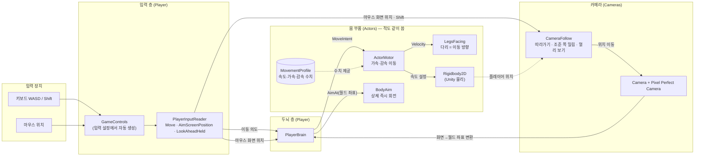
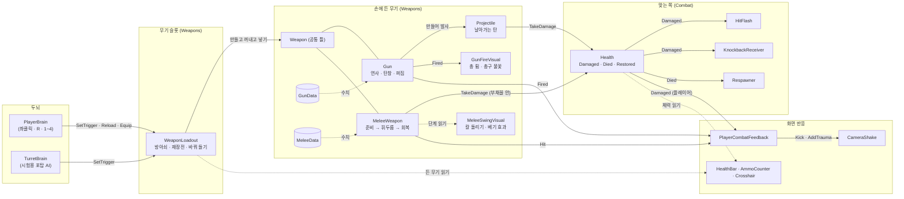
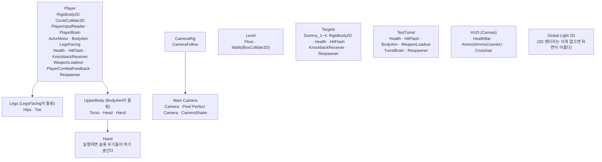

# 코드 구조

나중에 코드를 다시 볼 때 길잡이로 쓰는 문서다. 스크립트가 새로 생기거나 관계가 바뀌면 같이 고친다.
(기획 내용은 `기획서.md`에 쓰고, 여기에는 코드가 어떻게 생겼는지만 쓴다.)

마지막 갱신: 2026-10-06 (페이즈 2 사격감)

## 한눈에 보기

플레이어 캐릭터는 세 층으로 나뉜다.

1. **입력**: 키보드·마우스를 읽는다. Input System을 직접 만지는 곳은 여기 하나뿐이다.
2. **두뇌**: 읽은 입력을 "어디로 가라, 어디를 봐라"는 명령으로 바꿔 몸에 전달한다.
3. **몸 부품**: 명령대로 움직이고 돈다. 누가 명령했는지는 모른다.

몸 부품이 명령한 쪽을 모르게 해 둔 이유는 페이즈 3에서 적을 만들 때 같은 몸 부품을 그대로 쓰기 위해서다. 적은 두뇌 자리에 플레이어 입력 대신 자기 AI를 끼운다. 페이즈 2의 시험용 포탑(`TurretBrain`)이 이미 이 방식으로 플레이어와 같은 무기 부품을 쓴다.

페이즈 2에서 두 묶음이 더 생겼다.

- **무기**: 두뇌는 `WeaponLoadout`(무기 슬롯)에 "방아쇠를 당기고 있다 / 재장전 / 몇 번 슬롯"만 알린다. 쏠지 휘두를지는 손에 든 무기(`Gun`, `MeleeWeapon`)가 정한다.
- **전투 공통**: 맞는 쪽은 `Health` 하나로 통일했다. 번쩍임·밀려남·부활 같은 반응은 `Health`의 이벤트를 듣는 작은 스크립트들이 따로 맡는다.

## 관계도

화살표는 "값을 넘긴다/읽는다"는 뜻이다. 점선은 직접 부르지 않고 데이터나 위치만 참고한다는 뜻이다.

### 무기와 전투 (페이즈 2)

## 한 프레임에 일어나는 순서

- `PlayerInputReader`와 `PlayerBrain`(그리고 `TurretBrain`)에는 `[DefaultExecutionOrder]`를 붙여 다른 스크립트보다 먼저 돌게 했다. 그래야 무기·카메라가 이번 프레임 입력을 읽는다.
- 무기(`Weapon.Update`)는 두뇌 다음에 돈다. 두뇌가 넣은 방아쇠 상태로 "이번 프레임에 새로 눌렀는가"를 무기가 직접 판단한다.
- 화면 흔들림(`CameraShake`)은 카메라 자식에서 `LateUpdate`로 자기 위치만 흔든다. 따라가기(`CameraRig`의 `CameraFollow`)와 서로 위치를 덮어쓰지 않는다.
- 이동은 물리라서 `FixedUpdate`에서, 카메라는 모든 움직임이 끝난 뒤인 `LateUpdate`에서 처리한다.

## 스크립트별 설명

폴더는 `Assets/Scripts/`, 네임스페이스는 `DustScrapper.*`다.

### Player/ — 플레이어 전용

| 스크립트 | 하는 일 | 왜 이렇게 짰나 |
| --- | --- | --- |
| `PlayerInputReader` | `GameControls`에서 이동(0~1 길이), 마우스 화면 좌표, 멀리 보기(Shift), 발사(좌클릭, 누르고 있는가), 재장전(R, 이번 프레임에 눌렀는가), 슬롯(1~4, 이번 프레임에 누른 번호)을 읽어 속성으로 내놓는다. | 입력 장치를 다루는 곳을 한 군데로 모았다. 키 바꾸기나 게임패드 지원이 생겨도 여기만 고치면 된다. 한 프레임 안에 눌렀다 뗀 짧은 클릭도 놓치지 않게 발사는 "누르고 있음 또는 이번에 눌림"으로 읽는다. |
| `PlayerBrain` | 입력을 몸 부품 명령으로 바꾼다. 이동은 `ActorMotor.MoveIntent`로, 조준점은 `BodyAim.AimAt`으로, 발사·재장전·슬롯은 `WeaponLoadout`으로 넘긴다. 꺼질 때(죽을 때) 이동과 방아쇠를 비운다. | 몸 부품이 입력을 모르게 하는 연결 고리다. 적은 이 자리에 AI 두뇌를 붙인다. |
| `PlayerCombatFeedback` | 플레이어가 총을 쏘면 화면을 쏜 반대쪽으로 튕기고(세기는 `GunData.RecoilKick`), 칼로 맞히면 짧게, 맞으면 크게 흔든다. 든 무기가 바뀔 때마다 새 무기의 이벤트로 갈아 탄다. | 적이 쏘거나 맞을 때 화면이 흔들리면 안 되므로 카메라 반응은 플레이어 쪽에만 둔다. 무기 스크립트가 카메라를 알 필요가 없어진다. |

### Actors/ — 플레이어와 적이 같이 쓰는 몸 부품

| 스크립트 | 하는 일 | 왜 이렇게 짰나 |
| --- | --- | --- |
| `ActorMotor` | `MoveIntent`(가려는 방향·세기)를 받아 `Rigidbody2D` 속도를 목표 속도 쪽으로 가속하거나, 입력이 없으면 감속한다. 벽 충돌은 Unity 물리가 맡는다. | 속도를 즉시 바꾸지 않고 가속·감속을 둬서 무게감을 준다(기획: 핫라인 마이애미보다 덜 빠릿하게). `SetProfile`로 수치 묶음을 통째로 바꿀 수 있다. |
| `MovementProfile` | 최고 속도, 가속, 감속 수치를 담은 데이터 파일(ScriptableObject). | 장비에 따라 이동 무게감을 바꾸기 위해 코드 밖 데이터로 뺐다. 수치 조정도 Inspector에서 바로 할 수 있다. |
| `BodyAim` | `AimAt(월드 좌표)`를 받으면 상체 그림을 그쪽으로 즉시 돌리고, 방향을 `AimDirection`에 기억한다. 너무 가까운 점이면 직전 방향을 유지한다. | 조준은 손에 바로 붙어야 해서 회전 지연이 없다. 페이즈 2의 무기는 `AimDirection`을 읽어 발사 방향으로 쓴다. |
| `LegsFacing` | `ActorMotor.Velocity`를 읽어 다리 그림을 실제로 움직이는 방향으로 돌린다. 도는 속도에 한계(도/초)가 있고, 거의 멈춰 있으면 돌리지 않는다. | 입력이 아니라 실제 움직임을 따라서 벽에 막히거나 밀릴 때도 다리 방향이 맞는다. 나중에 걷기 애니메이션 속도도 이 값으로 정할 수 있다. |

### Weapons/ — 무기 (플레이어와 적이 같이 씀)

| 스크립트 | 하는 일 | 왜 이렇게 짰나 |
| --- | --- | --- |
| `WeaponData` | 모든 무기의 공통 수치: 이름, 무기 프리팹, 쥐는 방식(한손·두손), 피해, 밀어내기, 꺼내는 시간. 추상 클래스라 직접 만들지 않고 아래 둘을 만든다. | 공통인 것만 묶고 총·칼 고유 수치는 나눴다. 억지로 한 파일에 넣으면 "탄창 없는 무기", "재장전하는 칼" 같은 예외가 쌓인다. 쥐는 방식은 나중에 그림 레이어를 고를 때 쓴다. |
| `GunData` | 총 수치: 연사 방식(단발·연사), 초당 발 수, 한 번에 나가는 탄 수, 탄 프리팹·속도·사거리, 탄창·장전 시간, 퍼짐(기본·한 발마다 증가·최대·회복), 화면 반동 세기. | 새 총은 이 데이터 파일만 새로 만들면 된다. 한 번에 여러 발(샷건)도 수치로 된다. |
| `MeleeData` | 근접 수치: 닿는 거리, 부채꼴 각도, 준비·휘두름·회복 시간. | 단검은 짧고 빠르게, 큰 검은 넓고 느리게를 수치만으로 낸다. |
| `Weapon` | 손에 드는 무기의 공통 틀. 방아쇠 상태를 받아 "이번에 새로 눌렀는가"를 계산하고, 꺼내는 시간 동안은 쓰지 못하게 막는다. 꺼내는 중에 누른 클릭은 기억했다가 다 꺼낸 첫 프레임에 넘긴다. | 두뇌·슬롯은 손에 든 게 총인지 칼인지 몰라도 된다. 곡괭이·지팡이가 생겨도 `Weapon` 종류를 하나 더 만들면 되고 플레이어 코드는 그대로다. |
| `Gun` | 연사 방식대로 탄을 만들어 쏘고, 탄창·재장전·퍼짐을 관리한다. 탄창이 비면 방아쇠를 당길 때 자동으로 재장전한다. 바꿔 들면 장전은 취소된다. 쏠 때마다 `Fired` 이벤트를 알린다. | 연출은 하지 않고 이벤트만 알려서 총 자체 연출(`GunFireVisual`)과 화면 반응(`PlayerCombatFeedback`)을 따로 붙인다. 쿨다운을 "설정"이 아니라 "더해서" 프레임 간격과 상관없이 연사 속도가 정확하다. 단발 총은 쿨다운 중 클릭을 잠깐 기억해 연타가 씹히지 않는다. 탄은 캐릭터 중심에서 출발해 총구까지 한 번에 이동한다(벽에 붙어 쏴도 벽을 뚫지 않게). |
| `Projectile` | 날아가는 탄. 매 프레임 갈 거리만큼 앞을 광선으로 검사해 맞으면 `Health`에 피해를 주고, 맞은 자리에 효과를 남기고 사라진다. 쏜 사람 자신은 무시한다. | 탄이 눈에 보여야 쏘는 맛과 피하는 긴장감이 생긴다. 광선 검사라 빠른 탄도 얇은 벽을 뚫지 않는다. 총에 묶지 않고 값만 받아서 적의 탄·마법 투사체도 같은 스크립트를 쓸 수 있다. |
| `MeleeWeapon` | 누르면 준비 → 휘두름 → 회복. 휘두름 동안 캐릭터 앞 부채꼴 안의 `Health`를 맞힌다. 한 번 휘두를 때 같은 대상은 한 번만, 벽 너머는 안 맞는다. 휘두르는 중 클릭은 기억했다가 바로 다음 공격으로 잇는다. | 단계를 나눠서 "언제 맞는가"가 분명하다. 대상의 중심이 아니라 가장 가까운 지점으로 각도를 재서 큰 대상의 가장자리도 벨 수 있다. |
| `WeaponLoadout` | 무기 슬롯. 시작할 때 슬롯마다 무기 프리팹을 손(`Hand`)에 만들어 두고 하나만 꺼낸다. 슬롯 수 = 배열 칸 수(지금 3칸, 숫자키는 4까지). 꺼지면(죽으면) 무기를 넣고, 켜지면 다시 꺼낸다. | 두뇌가 무기를 직접 만지지 않게 하는 창구다. 주운 물건을 담는 가방(페이즈 4)과는 따로다. |
| `GunFireVisual` | 쏠 때 총 그림을 뒤로 튀겼다 돌려놓고, 총구 불꽃을 아주 잠깐 보인다. | 무기 프리팹 안의 연출만 맡는다. 무기마다 다른 연출을 프리팹에서 고칠 수 있다. |
| `MeleeSwingVisual` | `MeleeWeapon`의 단계를 읽어 칼을 들어 올렸다 베고 돌아오게 돌린다. 휘두를 때마다 방향을 번갈아 바꾼다. 휘두름 동안 베기 효과를 보인다. | 판정(`MeleeWeapon`)과 모습을 나눠서, 그림이 바뀌어도 판정 코드는 그대로다. |

### Combat/ — 맞는 쪽 (플레이어, 적, 표적, 물건 공통)

| 스크립트 | 하는 일 | 왜 이렇게 짰나 |
| --- | --- | --- |
| `DamageInfo` | 피해 한 번의 정보: 양, 맞은 지점, 들어온 방향, 밀어내는 힘, 준 쪽. | 맞은 쪽 반응은 이 값만 보고 정하므로 무엇에 맞았는지(탄, 칼, 폭발) 몰라도 된다. |
| `Health` | 체력. `TakeDamage`로 깎이고 `Damaged`, 0이 되면 `Died`, 다시 채우면 `Restored` 이벤트를 알린다. 죽은 뒤에는 피해를 무시한다. | 맞는 것은 모두 이것 하나다. 반응은 이벤트를 듣는 다른 스크립트가 맡아서, 표적엔 밀려남을 빼고 포탑엔 부활 시간을 길게 하는 식으로 골라 붙인다. |
| `HitFlash` | 맞으면 몸 그림을 잠깐 흰색으로 번쩍인다. | "맞았다"를 가장 빨리 알려 준다. **주의**: 지금은 흰 네모에 색을 입힌 임시 그림이라 색만 바꿔도 하얘진다. 실제 도트 그림이 들어오면 번쩍임용 셰이더로 바꿔야 한다. |
| `KnockbackReceiver` | 맞으면 들어온 방향으로 충격량을 줘서 밀려난다. | 충격량이라 무거운 대상은 덜 밀린다. `ActorMotor`가 있으면 밀린 속도가 감속 수치대로 자연스럽게 준다. |
| `Respawner` | 죽으면 지정한 스크립트·충돌체·그림을 끄고, 잠시 뒤 처음 자리에서 체력을 채워 되살린다. 되살아날 때 부를 것(카메라 바로 옮기기)을 Inspector에서 연결한다. | 시험용 방의 플레이어·표적·포탑이 쓴다. 페이즈 4에서 "죽으면 잃음"이 생기면 플레이어 쪽은 다른 처리로 바뀐다. |
| `LineOfSight` | 두 점 사이가 벽에 막혔는지 검사한다(자기 자신과 상대는 무시). | 근접 공격(벽 너머 안 베기)과 AI(보이는가)가 같이 쓴다. 페이즈 3 적의 시야 판단에도 쓸 수 있다. |

### Enemies/

| 스크립트 | 하는 일 | 왜 이렇게 짰나 |
| --- | --- | --- |
| `TurretBrain` | 시험용 고정 포탑의 두뇌. 대상이 사거리 안에 보이면 정해진 속도로 돌고, 조준이 맞으면 "쉬기 → 쏘기" 주기로 끊어 쏜다. | 페이즈 2에서 "맞는 쪽"을 시험하려고 뒀다. 플레이어와 같은 `BodyAim`·`WeaponLoadout`·`Gun`을 쓰고 두뇌만 다르다. 페이즈 3에서 진짜 적이 생기면 방에서 뺀다. |

### Effects/

| 스크립트 | 하는 일 |
| --- | --- |
| `ShortLivedEffect` | 잠깐 보였다가 줄어들며 사라지는 효과(탄이 맞은 자리의 불똥). 시간이 지나면 스스로 지운다. |

### UI/ — 플레이 화면

| 스크립트 | 하는 일 | 왜 이렇게 짰나 |
| --- | --- | --- |
| `HealthBar` | 체력 막대. 앞 막대는 바로 줄고, 뒤의 밝은 잔상은 잠깐 머물렀다가 따라 줄어든다. | "방금 얼마나 깎였는지"가 보인다. 길이는 RectTransform의 `anchorMax.x`로 조절한다(그림 없이도 동작). |
| `AmmoCounter` | 손에 든 총의 "탄창 안 / 탄창 크기"와 재장전 진행 막대. 근접 무기를 들면 숨긴다. 탄이 0이면 경고색, 장전 중이면 흐리게. | 숨기는 것은 자식 `Display` 묶음이다. 스크립트가 붙은 `Ammo` 자신을 숨기면 스크립트도 멈춰서 다시 보이지 않는다. 숫자가 바뀔 때만 글자를 새로 만든다. 글꼴은 TextMeshPro 기본 글꼴(LiberationSans, 영문·숫자만)이다. 한글이 필요해지면 한글 글꼴을 따로 넣어야 한다. |
| `Crosshair` | 커서 자리의 조준점. 운영체제 커서는 숨긴다. 총을 들면 네 눈금이 지금 퍼짐만큼 벌어진다(커서 거리에서 탄이 떨어질 수 있는 폭). | 연사하면 벌어지고 멈추면 모여서 "끊어 쏘면 정확하다"를 화면에서 바로 읽는다. |

### Cameras/

| 스크립트 | 하는 일 | 왜 이렇게 짰나 |
| --- | --- | --- |
| `CameraShake` | 화면 흔들림. 충격(맞았을 때 사방으로 떨림, 서서히 사라짐)과 튕김(쏠 때 한 방향으로 툭 밀렸다 돌아옴) 두 가지를 받는다. 카메라 자기 로컬 위치만 바꾼다. | 따라가기와 같은 물체에서 위치를 고치면 흔들린 위치를 다시 따라가서 화면이 밀린다. 그래서 `CameraRig`(따라가기) 아래 카메라(흔들림)로 나눴다. 흔들림 크기는 충격의 제곱이라 작은 충격은 약하게, 큰 충격은 확 흔들린다. |
| `CameraFollow` | 플레이어 위치에 "화면 중앙→커서" 방향의 밀림을 더한 곳으로 `SmoothDamp`로 부드럽게 이동한다. Shift를 누르면 밀림 거리와 부드러움을 멀리 보기용 값으로 바꾼다. `SnapToTarget`으로 즉시 이동할 수도 있다. | 밀림을 커서의 **화면** 위치로 계산해서, 카메라가 움직여도 밀림 정도가 다시 바뀌어 화면이 흔들리지 않는다. 화면 짧은 변 기준으로 나눠서 모든 방향에서 밀림 거리가 같다. |

### Controls/

| 파일 | 하는 일 |
| --- | --- |
| `GameControls` | `Assets/Input/GameControls.inputactions`에서 Unity가 자동 생성한 코드다. **손으로 고치지 않는다.** 키를 바꾸려면 `.inputactions` 파일을 고친다. |

## 씬과 데이터

### `Assets/Scenes/Game.unity`의 오브젝트 구성

- 몸통(`Player`)은 회전하지 않고(Rigidbody2D 회전 고정), 그림인 `Legs`와 `UpperBody`만 따로 돈다. 그래서 다리와 상체가 다른 방향을 볼 수 있다.
- **그림은 오른쪽(+X)을 보고 그린다**는 약속이 있다. 회전 계산이 이 약속을 전제로 한다. 무기 프리팹도 오른쪽을 향해 만든다(총구가 +X 끝).
- 플레이어 `Respawner`는 죽어 있는 동안 `PlayerBrain`·`WeaponLoadout`·`ActorMotor`·`LegsFacing`을 끄고, 되살아나면 `CameraFollow.SnapToTarget`을 부른다.
- 포탑은 칸막이(`Divider`) 오른쪽 위에 있어서, 칸막이 왼쪽에 있으면 보이지 않는다. 엄폐 시험용이다.

### 데이터·에셋

| 경로 | 내용 |
| --- | --- |
| `Assets/Data/Movement/PlayerDefault.asset` | 플레이어 기본 이동 수치 (임시값: 최고 4.5칸/초, 가속 25, 감속 35) |
| `Assets/Data/Physics/ActorNoFriction.physicsMaterial2D` | 마찰 0. 벽에 비비며 걸을 때 달라붙지 않게 한다. |
| `Assets/Art/Placeholder/Square.png` | 임시 네모 그림 (32x32, 32PPU) |
| `Assets/Input/GameControls.inputactions` | 키 배치: Move = WASD, Aim = 마우스 위치, LookAhead = Shift, Fire = 좌클릭, Reload = R, Slot1~4 = 숫자 1~4 |
| `Assets/Data/Weapons/` | 무기 데이터. `SMG`(기관단총), `Pistol`(권총), `Knife`(단검), `TurretGun`(포탑 총). 수치는 모두 AI가 넣은 임시값 |
| `Assets/Prefabs/Weapons/` | 무기 프리팹. `Gun_SMG`, `Gun_Pistol`, `Gun_Turret`(Body·Muzzle·MuzzleFlash), `Knife`(Pivot·Slash) |
| `Assets/Prefabs/Projectiles/` | `Bullet`(플레이어 탄), `EnemyBullet`(느리고 큰 주황 탄, 피할 수 있게) |
| `Assets/Prefabs/Effects/Impact.prefab` | 탄이 맞은 자리의 불똥 |
| `Assets/TextMesh Pro/` | TextMeshPro 기본 리소스(글꼴·셰이더). Unity가 만든 것이라 손대지 않는다 |
| `Assets/Settings/URP-2D.asset`, `Renderer2D.asset` | URP 2D 렌더러 설정 |

## 확장할 때 손댈 곳

- **적 만들기 (페이즈 3)**: `ActorMotor`, `BodyAim`, `LegsFacing`, `Health`와 반응 스크립트, 필요하면 `WeaponLoadout`을 붙이고, `PlayerBrain` 대신 적 AI 스크립트가 `MoveIntent`·`AimAt`·`SetTrigger`를 부른다. `TurretBrain`이 그 예다. 시야는 `LineOfSight`를 쓸 수 있다.
- **장비로 이동 무게감 바꾸기**: `MovementProfile` 에셋을 새로 만들고 `ActorMotor.SetProfile`로 갈아 끼운다.
- **새 총**: `GunData` 에셋을 만들고(메뉴 Dust Scrapper/Weapons/Gun), 기존 총 프리팹을 복제해 그림·총구 위치를 고친 뒤 데이터의 `prefab`에 넣는다. 샷건은 `pelletsPerShot`을 늘린다.
- **새 근접 무기**: `MeleeData` 에셋 + `Knife` 프리팹 복제.
- **새 종류의 무기(곡괭이, 지팡이 등)**: `Weapon`을 이어받는 스크립트와 그 데이터(`WeaponData`를 이어받음)를 만든다. 슬롯·두뇌는 고치지 않는다.
- **슬롯 수 바꾸기**: `WeaponLoadout`의 `slots` 칸 수를 바꾼다. 숫자키는 지금 1~4까지 있다.
- **장비에 따른 기본 동작(발차기, 발도술 등, 페이즈 5)**: 무기 데이터에 "이 무기를 들면 생기는 동작"을 붙일 자리로 쓴다. 아직 만들지 않았다.
- **마법(우클릭, 페이즈 5)**: 아직 없다. 탄 모양 마법은 `Projectile`을 그대로 쓸 수 있다.
