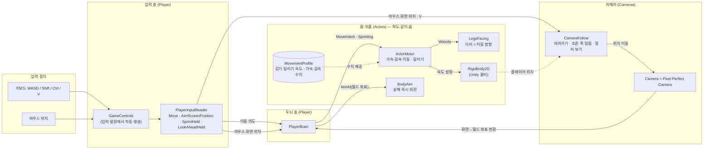
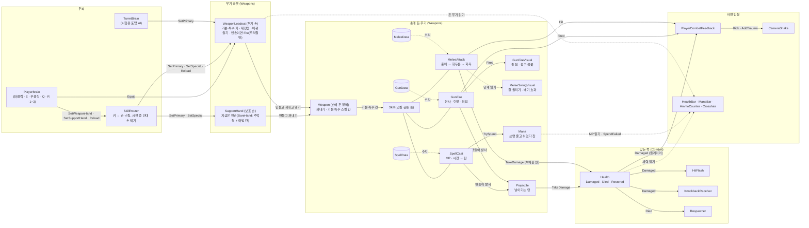
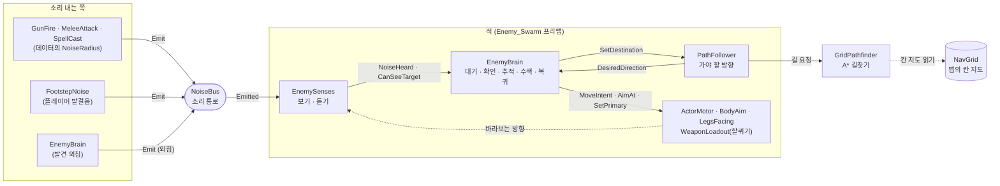
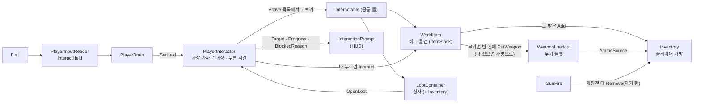
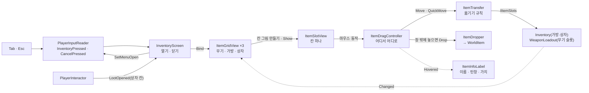
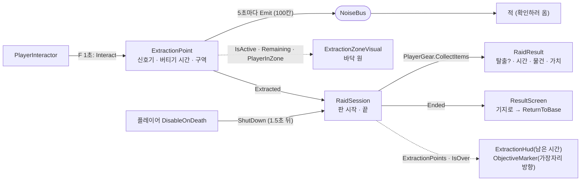
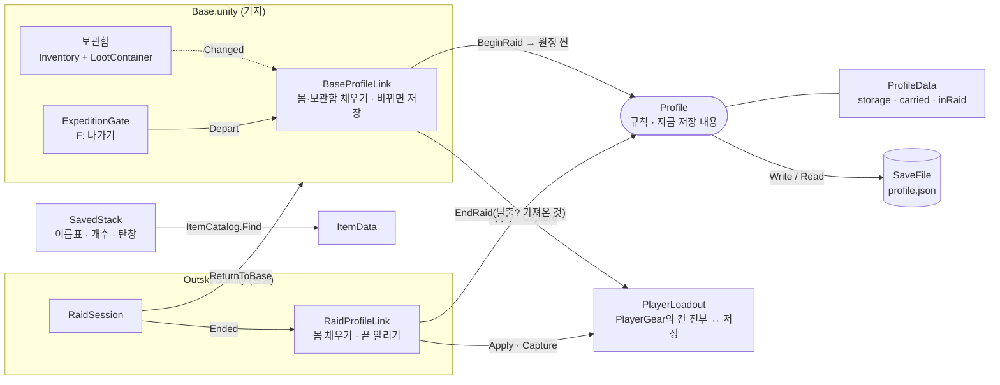
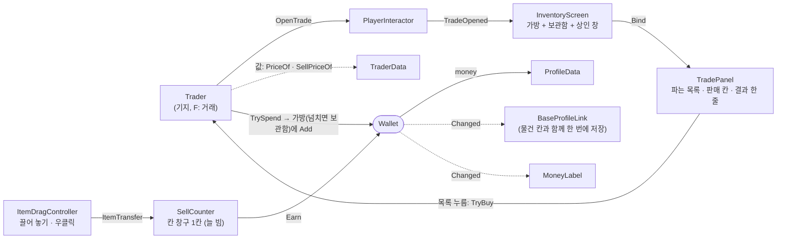
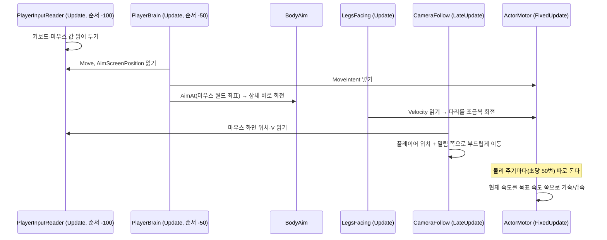
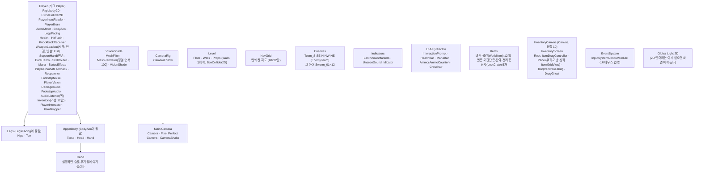

# 코드 구조

나중에 코드를 다시 볼 때 길잡이로 쓰는 문서다. 스크립트가 새로 생기거나 관계가 바뀌면 같이 고친다.
(기획 내용은 `기획서.md`에 쓰고, 여기에는 코드가 어떻게 생겼는지만 쓴다.)

마지막 갱신: 2026-10-14 (페이즈 7 글로우 고리: 글로우병·채굴·제작·소모품·단축 칸·급한 충전·연막)

## 한눈에 보기

플레이어 캐릭터는 세 층으로 나뉜다.

1. **입력**: 키보드·마우스를 읽는다. Input System을 직접 만지는 곳은 여기 하나뿐이다.
2. **두뇌**: 읽은 입력을 "어디로 가라, 어디를 봐라"는 명령으로 바꿔 몸에 전달한다.
3. **몸 부품**: 명령대로 움직이고 돈다. 누가 명령했는지는 모른다.

몸 부품이 명령한 쪽을 모르게 해 둔 이유는 적도 같은 몸 부품을 그대로 쓰기 위해서다. 페이즈 3의 적(`EnemyBrain`)은 두뇌 자리에 플레이어 입력 대신 자기 AI를 끼우고, 플레이어와 같은 `ActorMotor`·`BodyAim`·`LegsFacing`·`WeaponLoadout`·`Health`를 쓴다.

페이즈 2에서 두 묶음이 더 생겼다.

- **무기**: 손에 든 장비(`Weapon`)는 **기본 스킬·특수 스킬 칸**을 가지고, 실제 동작은 그 칸에 끼운 **스킬**(`Skill`: 총 쏘기 `GunFire`, 근접 공격 `MeleeAttack`, 마법 탄 `SpellCast`)이 한다. 장비 프리팹에 스킬 부품을 붙여 조합한다. 적의 두뇌는 `WeaponLoadout`에 "기본 스킬 키를 누르고 있다 / 재장전 / 몇 번 슬롯"만 알린다. 플레이어는 손이 둘(무기 손 `WeaponLoadout`, 보조 손 `SupportHand`)이라, 두뇌가 다섯 키를 **스킬 고르는 곳**(`SkillRouter`)에 넘기고 거기서 어느 손의 어느 스킬인지 정한다.
- **마법(Magic, 페이즈 5)**: MP(`Mana`)는 체력처럼 따로 떼어 둔 부품이다. 마법 스킬(`SpellCast`)은 마법 수치(`SpellData`)대로 MP를 쓰고 시전한 뒤 총과 같은 탄(`Projectile`)을 쏜다. 한 손이 시전하는 동안 반대 손은 공격하지 못한다(`SkillRouter`, 기획 잠정).
- **디버프(페이즈 5)**: 피해 정보(`DamageInfo.Effect`)에 디버프 데이터(`StatusEffectData`)를 실어 보내면, 맞은 쪽의 `StatusEffects`가 걸고 시간이 지나면 푼다. 이동은 몸(`ActorMotor`)의 속도 배율로, 공격은 장비를 든 쪽이 `AttacksSuppressed`로 막는다. 첫 디버프는 샷건 발차기의 비틀거림(`Stagger`).
- **몸 장비(Equipment, 페이즈 5)**: 몸 장비 데이터(`BodyGearData`)는 부위와 능력치 보너스 목록(`StatModifier`: 무엇을 얼마나 더하나)을 가진다. 몸 장비 칸(`BodyEquipment`, 8칸)이 낀 장비의 보너스를 능력치마다 더해 쓰는 쪽에 알린다: 최대 MP·회복 → `Mana.SetBonuses`, 가방 칸 → `Inventory.SetExtraSlots`. 칸 창구(`IItemSlots`)라 가방 화면·옮기기·판 결과가 그대로 붙는다.
- **전투 공통**: 맞는 쪽은 `Health` 하나로 통일했다. 번쩍임·밀려남·부활 같은 반응은 `Health`의 이벤트를 듣는 작은 스크립트들이 따로 맡는다.

페이즈 3에서 세 묶음이 더 생겼다.

- **소음**: 소리를 내는 쪽(총, 단검, 발걸음, 적의 외침)은 `NoiseBus.Emit`만 부른다. 누가 듣는지 모른다. 듣는 쪽(적의 감각)이 "내게 들리는 거리인가"를 판단한다. 구역 경계를 넘는 소리는 거리가 줄어든다(`MapZone.NoiseFactor`).
- **구역(Zones)**: 맵 안의 상점·경찰서 같은 구역(`MapZone`, 사각 영역). 어느 지점이 어느 구역인지 알려 주고, 구역 경계를 넘는 소리를 줄여서 구역 안 싸움이 밖이나 다른 구역으로 번지지 않게 한다. 구역에 딸린 적 팀·상자는 구역 물체 아래에 둔다. 바깥문이 열리거나 유리창이 깨지면(`IZoneOpening`) 소리가 더 샌다.
- **구조물(Structures)**: 문(`Door` + 문짝 `DoorLeaf` + 문 종류 `DoorData`, 2026-10-17 배그식: F를 바로 눌러 누른 사람 반대쪽으로 90도 열고 닫음, 열린 문은 90도에 고정, 움직이는 문짝은 사람을 통과하고 멈춘 문짝은 막음, 문간 어디서나 F가 닿음, 폭 3칸 이상은 양쪽 문 — 짝마다 따로 여는 문 두 개, 적은 다가오면 스스로 엶, 걷어차면 문 종류에 따라 아주 빠르게 열리거나 문짝이 날아가고 쓸린 몸이 쓰러짐)과 유리창(`Window`, 쏘면 깨짐). **레이어 셋**으로 보이는 것·막히는 것을 나눈다: `Walls`(벽·문짝·키 큰 가구: 다 막음) / `Glass`(유리창: 못 지나가지만 플레이어는 너머를 보고, 적은 경계 중일 때만 봄) / `Cover`(책상·차 같은 낮은 엄폐물: 못 지나가고 총알도 막지만 시야는 안 막음).
- **길찾기**: 맵에 하나 있는 `NavGrid`가 벽을 칸 지도로 만들고, 적마다 붙은 `PathFollower`가 그 지도로 길을 찾아 "지금 가야 할 방향"만 알려 준다.
- **유리 너머 (2026-10-16)**: `EnemySenses.SeesThroughGlass`를 두뇌가 경계 중일 때만 켠다. 꺼져 있으면 `Glass` 레이어 너머의 플레이어를 못 알아챈다(사용자 기획: 유리로 미리 살피는 의미가 있게).
- **적**: 감각(`EnemySenses`, 보기·듣기)과 두뇌(`EnemyBrain`, 무엇을 할지)를 나눴다. 적 종류가 늘면 감각은 그대로 쓰고 두뇌만 바꾼다. 적은 **팀**(`EnemyTeam`)으로 묶이고, 경계 중인 팀원끼리 "플레이어를 마지막으로 본 위치"를 공유한다. 두뇌의 **성격**(`Temperament`)으로 구역 안의 공격적인 적과 구역 밖의 덜 위협적인 몹(맞으면 반격 / 달아남)을 가른다.
- **표시(Indicators)**: 팀이 마지막으로 본 위치의 반투명 플레이어 모습(`LastKnownMarkers`), 시야 밖 발소리 자리의 빨간 원(`UnseenSoundIndicator`). 둘 다 정보를 읽기만 하는 연출이다.
- **소리(효과음)**: 무기·체력·적 두뇌는 소리를 모르고 사건(쏨, 재장전 시작, 휘두르기 단계, 맞음, 죽음, 외침)만 알린다. `Audio/`의 작은 스크립트들이 그 사건을 듣고 `SoundCue`(소리 데이터)를 `SoundPlayer`로 재생한다. 적이 듣는 **소음**(`NoiseBus`, 게임 규칙)과 플레이어 귀에 들리는 **효과음**은 별개다.
- **플레이어 시야**: 판정(`PlayerVision`, "이 지점이 보이는가")과 표현을 나눴다. 시야 밖을 어둡게 덮는 `VisionShade`와 안 보이는 적을 숨기는 `HideOutsideVision`이 같은 판정 하나를 따른다. 시야 모양 수치는 장비로 갈아 끼우는 데이터(`VisionProfile`)다.

페이즈 4에서 두 묶음이 더 생겼다.

- **물건(Items)**: 전리품·탄약·무기가 모두 **물건 데이터**(`ItemData`)다. 탄약(`AmmoData`)과 무기(`WeaponData`)는 이것을 이어받는다. 물건 한 묶음(`ItemStack`)이 가방 한 칸, 바닥 물건(`WorldItem`) 하나다. 가방과 상자는 같은 **칸 보관함**(`Inventory`)을 쓴다. 가방·상자·무기 슬롯은 모두 **칸 창구**(`IItemSlots`)를 따라서, 칸 사이 옮기기 규칙(`ItemTransfer`) 하나로 어디끼리든 옮긴다. 총은 재장전할 때 무기 슬롯에 연결된 가방에서 자기 탄을 꺼낸다(무한 탄약 없음).
- **한 판(Raid)**: `RaidSession`이 판의 시작·끝을 맡는다. 탈출 지점(`ExtractionPoint`)이 "다 버텼다"를, 플레이어의 `DisableOnDeath`가 "쓰러졌다"를 알리면 들고 있던 물건으로 결과(`RaidResult`)를 만들고 게임 시간을 멈춘다. 다시 시작은 씬을 다시 불러온다. 판 관리와 판 화면(버티기 시간, 탈출 방향 표시, 결과 화면)은 `RaidSystems` 프리팹 하나라서 맵마다 놓기만 하면 된다.
- **가방 화면(UI)**: Tab으로 열고(상자를 열면 상자 칸까지), 칸을 끌어 옮기기·겹치기·바꾸기, 창 밖에 놓아 버리기, 우클릭 빠른 옮기기. 열려 있는 동안 입력 층(`PlayerInputReader.MenuOpen`)이 조준·발사·상호작용을 막고 이동만 받는다. 게임은 멈추지 않는다.
- **상호작용(Interaction)**: F를 누르고 있으면 일어나는 것들의 공통 틀(`Interactable`). 플레이어 쪽 `PlayerInteractor`가 손 닿는 가장 가까운 대상을 고르고 누르는 시간을 잰다. 바닥 물건 줍기(`WorldItem`)와 상자 뒤지기(`LootContainer`)가 있고, 탈출구도 같은 틀에 붙인다.

페이즈 6에서 한 묶음이 더 생겼다.

- **진행·저장(Progress)**: 원정 밖에서 남는 것(보관함, 몸에 지닌 것, 원정 중인지)은 저장 내용 `ProfileData` 하나에 담기고, `Profile`이 규칙(출발·탈출·사망·원정 중에 끔)대로 바꾸고 `SaveFile`이 파일에 쓴다. **기지와 원정은 서로를 모르고 `Profile`을 통해서만 물건을 주고받는다**: 기지 쪽 `BaseProfileLink`가 출발을, 원정 쪽 `RaidProfileLink`가 끝을 알린다. 플레이어의 네 칸 묶음(무기·보조·몸 장비·가방)을 한 번에 읽고 쓰는 일은 `PlayerLoadout` 한 곳에서 한다. 저장 파일에는 물건 데이터 대신 이름표(`ItemData.SaveId`)를 적고, 불러올 때 물건 목록(`ItemCatalog`)에서 찾는다.
- **돈과 상인(Trade)**: 돈은 계좌(`ProfileData.money`)이고 바꾸는 길은 `Wallet` 하나다. 상인(`Trader`)의 판매 칸(`SellCounter`)은 **늘 비어 있는 칸 하나짜리 칸 창구(`IItemSlots`)**라서, 가방 화면의 끌어 놓기·우클릭 옮기기가 코드 수정 없이 그대로 "팔기"가 된다. 무엇을 얼마에 파는지는 데이터(`TraderData`).
- **기지 시설(Station)**: 상인·충전대처럼 F로 여는 기지 시설은 `Station`을 이어받는다. 열면 가방 화면이 그 시설을 보여 줄 수 있는 창(`StationPanel`: `TradePanel`, `ChargePanel`)을 골라 띄우고, 시설에 연결된 보관함도 같이 연다. 새 시설은 `Station` 하나 + `StationPanel` 하나를 만들어 가방 화면 목록에 넣으면 된다.
- **기지 업그레이드**: 지은 시설·업그레이드 단계는 `ProfileData.upgrades`에 남고(죽어도 안 잃음), 바꾸는 길은 `BaseUpgrades` 하나다. 업그레이드는 데이터(`BaseUpgradeData`: 이름·효과 한 줄·단계별 값)이고, 효과는 그것을 보는 쪽이 낸다: 시설·보급품 켜기 `UpgradeUnlocks`, 보관함 칸 `BaseProfileLink`. 건설판(`BuildBoard` + `BuildPanel`)에서 돈으로 산다.
- **글로우 고리(페이즈 7)**: 글로우병(`GlowSickness`, 0~100%, 100이면 죽음)은 저장에 남고 죽으면 0. 소모품(`ConsumableData`)은 효과 목록(`UseEffect`: MP 채우기·글로우병·던지기)을 조합한 데이터이고, `ItemUser`가 단축 칸(`QuickSlots`, 키 4·5·6)이나 가방 우클릭으로 쓴다. 가루를 마법진 장비 위에 끌어 놓으면 급한 충전(`ItemUser.ChargeGear`). C키 제작은 몸에 지닌 시설(`Workbench`, `Station` 틀 재사용) + 제작법 데이터(`RecipeData`, 배워야 하는 것은 업그레이드로 해금). 원정 맵의 광맥(`GlowVein`)에서 원석을 캐면 소리가 난다. 연막(`SmokeCloud`)은 적의 시선을 막는다.
- **마법진 내구도**: 내구도가 있는 몸 장비(`BodyGearData.maxDurability`)는 물건 묶음(`ItemStack`)에 **닳은 양(`Wear`)**을 들고 다닌다. `Mana`가 "썼다"(`Spent`)를 알리면 `BodyEquipment`가 쓴 양을 MP 장비들에 몫대로 나눠 닳게 하고, 다 닳은 장비는 보너스에서 뺀다. 충전대(`ChargeStation`)가 정제된 글로우를 받고 닳은 양을 0으로 되돌린다.

## 관계도

화살표는 "값을 넘긴다/읽는다"는 뜻이다. 점선은 직접 부르지 않고 데이터나 위치만 참고한다는 뜻이다.

### 무기와 전투 (페이즈 2)

### 적과 소음 (페이즈 3)

### 물건과 줍기 (페이즈 4)

### 가방 화면 (페이즈 4)

### 한 판 (페이즈 4)

### 기지와 원정 (페이즈 6)

### 돈과 상인 (페이즈 6)

## 폴더 연관표 (2026-10-16 정리, 2026-10-17 장착 칸 묶음 뒤 갱신)

스크립트 153개(약 11,200줄, 자동 생성 `GameControls` 제외)가 서로 어떤 폴더의 타입을 쓰는지 코드에서 뽑아 폴더 단위로 묶었다. 숫자는 "그 폴더의 스크립트 → 저 폴더의 스크립트" 연결 수다.

**층** — 아래 층은 위 층을 모른다. 화면(UI)은 부르기만 하고 아무도 UI를 부르지 않는다.

| 층 | 폴더 |
| --- | --- |
| 4 화면 | `UI` |
| 3 판·기지 | `Raid` · `Progress` · `Trade` · `Crafting` |
| 2 행동·규칙 | `Player` · `Enemies` · `Weapons` · `Magic` · `Items` · `Equipment` · `Interaction` · `Glow` · `Structures` · `Audio` · `Indicators` · `Cameras` |
| 1 감각·전투 바탕 | `Combat` · `Noise` · `Vision` |
| 0 바탕 (아무것도 안 부름) | `Actors` · `Navigation` · `Zones` · `Effects` · `Controls` |

| 폴더 (스크립트 수·줄) | 부르는 폴더 (연결 수) |
| --- | --- |
| `UI` (24·1717) | Items 24 · Interaction 17 · Progress 9 · Weapons 7 · Raid 6 · Player 5 · Trade 4 · Equipment 3 · Combat 2 · Crafting 2 · Glow 1 · Magic 1 |
| `Progress` (17·967) | Items 14 · Interaction 8 · Combat 2 · Glow 2 · Magic 2 · Raid 2 · Equipment 1 · Player 1 (`PlayerLoadout` → `PlayerGear`) |
| `Raid` (4·276) | Interaction 3 · Items 2 · Noise 2 · Combat 1 · Player 1 (`RaidSession` → `PlayerGear`. 2026-10-17 전에는 저장 폴더의 `PlayerLoadout`을 불렀다) |
| `Trade` (3·144) | Items 7 · Interaction 2 · Progress 2 |
| `Crafting` (2·87) | Items 3 · Interaction 2 · Progress 2 |
| `Player` (4·503) | Weapons 10 · Items 8 · Actors 2 · Combat 2 · Cameras 1 · Controls 1 · Equipment 1 · Interaction 1 · Magic 1 (`PlayerGear`가 칸 종류를 아는 한 곳이라 늘었다) |
| `Enemies` (4·801) | Combat 5 · Actors 4 · Noise 4 · Weapons 3 · Navigation 2 · Glow 1 (연막) · Zones 1 |
| `Weapons` (16·1684) | Items 12 · Combat 9 · Magic 5 · Actors 3 · Noise 2 · Vision 1 (소총 조준) |
| `Magic` (4·307) | Weapons 4 |
| `Items` (21·1013) | Interaction 4 · Equipment 2 · Glow 2 · Actors 1 · Combat 1 · Magic 1 · Player 1 · Weapons 1 (`WorldItem`이 무기 칸·보조 칸·몸 장비를 모르게 되어 줄었다) |
| `Equipment` (4·285) | Items 6 · Magic 1 |
| `Interaction` (3·187) | Items 3 · Player 1 (`PlayerInteractor` → `PlayerGear`) |
| `Glow` (4·212) | Items 3 · Combat 2 · Interaction 2 · Noise 2 |
| `Structures` (2·243) | Combat 6 · Noise 4 · Interaction 2 · Navigation 2 · Zones 2 · Enemies 1 (문이 적을 알아봄) |
| `Audio` (8·367) | Combat 2 · Weapons 2 · Actors 1 · Enemies 1 · Magic 1 |
| `Indicators` (2·187) | Audio 2 · Enemies 1 · Vision 1 |
| `Cameras` (2·179) | Player 1 · Vision 1 |
| `Combat` (12·604) | Actors 1 (상태 효과가 이동을 늦춤) |
| `Noise` (3·152) | Actors 2 |
| `Vision` (4·303) | Actors 1 |
| `Actors` · `Navigation` · `Zones` · `Effects` | 없음 |

**많이 불리는 스크립트** (부르는 스크립트 수): `ItemStack` 35 · `PlayerInteractor` 23 · `Inventory` 20 · `Health` 18 · `IItemSlots` 16 · `DamageInfo` 16 · `ItemData` 14 · `Station` 14 · `Weapon` 13. `PlayerInteractor`가 많은 이유는 상호작용 대상(`Interactable`·`Station`과 그 자식들)이 모두 `Interact(PlayerInteractor)`를 받기 때문이다. 2026-10-17부터 이것이 내주는 것은 칸 묶음 `Gear` 하나다(전에는 가방·무기 칸·보조 칸·몸 장비를 하나씩 내줬다).

**서로 부르는 폴더 쌍**: Items ↔ Weapons(무기도 물건 / 던진 칼이 탄을 탐), Items ↔ Equipment, Items ↔ Interaction, Items ↔ Glow, Weapons ↔ Magic. 한 어셈블리라 컴파일 문제는 없다.

## 한 프레임에 일어나는 순서

- 적은 `PathFollower`(-60) → `EnemySenses`(-55) → `EnemyBrain`(-50) 순서로 돈다. 두뇌가 이번 프레임에 본 것·들은 것으로 판단하게 하려는 것이다.
- `PlayerInputReader`와 `PlayerBrain`(그리고 `TurretBrain`)에는 `[DefaultExecutionOrder]`를 붙여 다른 스크립트보다 먼저 돌게 했다. 그래야 무기·카메라가 이번 프레임 입력을 읽는다.
- 스킬 고르는 곳(`SkillRouter`, 순서 -40)은 두뇌(-50) 다음, 장비(0) 전에 돌아서 "반대 손이 시전 중이면 막기"를 이번 프레임 장비 동작에 바로 건다. 장비(`Weapon.Update`)는 그다음에 돌고, 두뇌가 넣은 키 상태로 "이번 프레임에 새로 눌렀는가"를 스킬(`Skill.Step`)이 직접 판단한다.
- 화면 흔들림(`CameraShake`)은 카메라 자식에서 `LateUpdate`로 자기 위치만 흔든다. 따라가기(`CameraRig`의 `CameraFollow`)와 서로 위치를 덮어쓰지 않는다.
- 이동은 물리라서 `FixedUpdate`에서, 카메라는 모든 움직임이 끝난 뒤인 `LateUpdate`에서 처리한다.

## 스크립트별 설명

폴더는 `Assets/Scripts/`, 네임스페이스는 `DustScrapper.*`다.

### Player/ — 플레이어 전용

| 스크립트 | 하는 일 | 왜 이렇게 짰나 |
| --- | --- | --- |
| `PlayerInputReader` | `GameControls`에서 이동(0~1 길이), 마우스 화면 좌표, 멀리 보기(V), 달리기(Shift, 누르고 있는가), 살금살금(Ctrl, 누르고 있는가), 발사(좌클릭, 누르고 있는가), 재장전(R, 이번 프레임에 눌렀는가), 무기 손 특수(E)·보조 손 기본(우클릭)·보조 손 특수(Q), 상호작용(F, 누르고 있는가), 가방(Tab)·취소(Esc, 이번 프레임에 눌렀는가), 슬롯(1~3, 이번 프레임에 누른 번호)을 읽어 속성으로 내놓는다. | 입력 장치를 다루는 곳을 한 군데로 모았다. 키 바꾸기나 게임패드 지원이 생겨도 여기만 고치면 된다. 한 프레임 안에 눌렀다 뗀 짧은 클릭도 놓치지 않게 발사는 "누르고 있음 또는 이번에 눌림"으로 읽는다. 마우스를 쓰는 창(가방 화면, 결과 화면)이 `SetMenuOpen(자기 자신, 열림)`으로 알리면 이동·달리기·살금살금·Tab·Esc만 읽고 조준점은 마지막 자리에 멈춘다. 창마다 따로 기억해서 한 창이 닫혀도 다른 창이 열려 있으면 계속 막는다. 창마다 두뇌·무기·카메라를 따로 막을 필요 없이 입력 한 곳에서 막는다. |
| `PlayerBrain` | 입력을 몸 부품 명령으로 바꾼다. 이동은 `ActorMotor.MoveIntent`로(살금살금 키를 누르면 이동 세기를 `sneakIntent`로 줄임), 달리기 키는 `ActorMotor.Sprinting`으로(살금살금 키와 같이 누르면 살금살금이 이김), 조준점은 `BodyAim.AimAt`으로, 스킬 키(좌클릭·E·우클릭·Q)와 재장전은 `SkillRouter`로, 슬롯은 `WeaponLoadout`으로, 상호작용 키(F)는 `PlayerInteractor.SetHeld`로 넘긴다. 꺼질 때(죽을 때) 이동·달리기·스킬 키·상호작용 키를 비운다. | 몸 부품이 입력을 모르게 하는 연결 고리다. 적은 이 자리에 AI 두뇌를 붙인다. 어느 손의 어느 스킬인지는 두뇌가 아니라 `SkillRouter`가 정해서, 손 사이 규칙이 늘어도 두뇌는 그대로다. |
| `PlayerGear` | 플레이어가 지닌 칸 전부(가방 `Bag`, 무기 칸 `Weapons`, 보조 칸 `Support`, 몸 장비 `Body`, 단축 칸 `Quick`)를 모은 목록(2026-10-17). `EquipOrder`: 주운 장비를 끼울 칸을 보는 순서(무기 칸 → 보조 칸 → 몸 장비), `FindEquipSlot(묶음)`: 지금 바로 낄 수 있는 첫 칸. `SaveOrder`: 저장·판 결과에 들어가는 칸과 이름표(`Keys`), 불러오는 순서(몸 장비 → 가방 → 무기 → 보조 → 단축). `Holds(칸)`, `CollectItems`(판 결과). | 칸의 종류를 아는 곳을 여기 하나로 모았다. 전에는 줍기·빠른 옮기기·상호작용·가방 화면·저장이 칸을 하나씩 이름으로 알아서, 칸 하나(랜턴)를 더하면 다섯 곳을 고쳐야 했다. 이제 칸 스크립트 + 여기 목록 + 가방 화면 칸 그림 하나면 된다. 시설·충전처럼 특정 칸이 필요한 곳은 `Gear.Body`·`Gear.Bag`처럼 이름으로 꺼낸다. |
| `PlayerCombatFeedback` | 플레이어가 총을 쏘면 화면을 쏜 반대쪽으로 튕기고(세기는 `GunData.RecoilKick`), 칼로 맞히면 짧게, 맞으면 크게 흔든다. 든 무기가 바뀔 때마다 새 무기의 이벤트로 갈아 탄다. | 적이 쏘거나 맞을 때 화면이 흔들리면 안 되므로 카메라 반응은 플레이어 쪽에만 둔다. 무기 스크립트가 카메라를 알 필요가 없어진다. |

### Actors/ — 플레이어와 적이 같이 쓰는 몸 부품

| 스크립트 | 하는 일 | 왜 이렇게 짰나 |
| --- | --- | --- |
| `ActorMotor` | `MoveIntent`(가려는 방향·세기)를 받아 `Rigidbody2D` 속도를 목표 속도 쪽으로 가속하거나, 입력이 없으면 감속한다. `Sprinting`이 켜져 있으면 최고 속도가 걷기 대신 달리기 속도다(`CurrentMaxSpeed`). 다른 부품이 `SetSpeedModifier(건 쪽, 배율, 달리기 막기)`로 느리게 하기를 걸고 `ClearSpeedModifier`로 푼다(조준 스킬, 디버프). 여러 곳이 걸면 곱하고, 건 쪽마다 따로 기억한다. 벽 충돌은 Unity 물리가 맡는다. | 속도를 즉시 바꾸지 않고 가속·감속을 둬서 무게감을 준다(기획: 핫라인 마이애미보다 덜 빠릿하게). `SetProfile`로 수치 묶음을 통째로 바꿀 수 있다. 달리기를 키가 아니라 "달리고 싶다"는 의도 하나로 받아서, 적 AI도 같은 값을 켜면 달린다. |
| `MovementProfile` | 걷기 최고 속도, 달리기 최고 속도(걷기보다 낮으면 걷기 속도), 가속, 감속 수치를 담은 데이터 파일(ScriptableObject). | 장비에 따라 이동 무게감을 바꾸기 위해 코드 밖 데이터로 뺐다. 수치 조정도 Inspector에서 바로 할 수 있다. |
| `BodyAim` | `AimAt(월드 좌표)`를 받으면 상체 그림을 그쪽으로 즉시 돌리고, 방향을 `AimDirection`에 기억한다. 너무 가까운 점이면 직전 방향을 유지한다. | 조준은 손에 바로 붙어야 해서 회전 지연이 없다. 페이즈 2의 무기는 `AimDirection`을 읽어 발사 방향으로 쓴다. |
| `LegsFacing` | `ActorMotor.Velocity`를 읽어 다리 그림을 실제로 움직이는 방향으로 돌린다. 도는 속도에 한계(도/초)가 있고, 거의 멈춰 있으면 돌리지 않는다. | 입력이 아니라 실제 움직임을 따라서 벽에 막히거나 밀릴 때도 다리 방향이 맞는다. 나중에 걷기 애니메이션 속도도 이 값으로 정할 수 있다. |

### Weapons/ — 무기 (플레이어와 적이 같이 씀)

| 스크립트 | 하는 일 | 왜 이렇게 짰나 |
| --- | --- | --- |
| `WeaponData` | 손에 드는 모든 장비의 공통 수치: 장비 프리팹(`Weapon`), 쥐는 방식(한손·두손), 피해·밀어내기(총 쏘기·근접 공격이 씀), 꺼내는 시간, 쓸 때 나는 소리가 들리는 거리(`noiseRadius`), **칸 규칙**(`slotRule`: 무기 칸만 / 보조 칸만 / 둘 다 → `FitsWeaponSlot`·`FitsSupportSlot`), **두손 무기와 같이 못 씀**(`conflictsWithTwoHanded`, 스태프), **자기 속성**(`element`, 비우면 무속성). 수치가 모두 스킬 쪽에 있는 마법 장비(오른손 빈손, 나중에 글러브·스태프)는 이것을 그대로 만든다(메뉴 Dust Scrapper/Weapons/Hand Item). 주워서 들고 다니는 물건이라 `ItemData`를 이어받는다(이름·가치·임시 색은 거기에, 겹쳐 담기는 항상 1). | 공통인 것만 묶고 총·칼 고유 수치는 나눴다. 억지로 한 파일에 넣으면 "탄창 없는 무기", "재장전하는 칼" 같은 예외가 쌓인다. 쥐는 방식은 나중에 그림 레이어를 고를 때 쓴다. |
| `GunData` | 총 수치: 연사 방식(단발·연사), 초당 발 수, 한 번에 나가는 탄 수, 탄 프리팹·속도·사거리, 쓰는 탄약(`AmmoData`)·탄창·장전 시간, 퍼짐(기본·한 발마다 증가·최대·회복), 화면 반동 세기. | 새 총은 이 데이터 파일만 새로 만들면 된다. 한 번에 여러 발(샷건)도 수치로 된다. |
| `MeleeData` | 근접 수치: 닿는 거리, 부채꼴 각도, 준비·휘두름·회복 시간, 맞혔을 때 거는 디버프(`hitEffect`, 예: 발차기의 비틀거림). | 단검은 짧고 빠르게, 큰 검은 넓고 느리게를 수치만으로 낸다. |
| `Weapon` | 손에 든 장비 하나. 꺼내기·집어넣기·꺼내는 시간을 맡고, **기본 스킬 칸**(`primary`)과 **특수 스킬 칸**(`special`)에 같은 프리팹의 스킬 부품을 끼운다. 키 상태(`SetPrimary`·`SetSpecial`)와 R(`Reload`, 지금은 기본 스킬의 재장전)을 스킬에 넘기고, `IsBusy`(꺼내기·스킬이 바쁜가), `IsCasting`(시전 중인가), `AttackBlocked`(반대 손 시전으로 막힘, 든 쪽의 `AttacksSuppressed`(디버프)도 함께 본다), `Interrupt`(하던 동작 끊기, 공격을 막는 디버프가 걸리는 순간), `OppositeElement`(반대 손 속성, SkillRouter가 넣음), `FindSkill<T>`(예: 탄 표시가 총 쏘기를 찾을 때)를 알려 준다. `Weapon.Spawn`으로 데이터의 프리팹을 손에 만든다(왼손·오른손이 같은 방법). 어느 키인지는 든 쪽이 정한다(무기 손 = 좌클릭·E, 보조 손 = 우클릭·Q). | 빈손처럼 서로 다른 두 동작(주먹질 + 마법)을 한 장비가 갖게 하려고 "장비 = 스킬 조합"으로 나눴다. 새 장비는 대부분 코드 없이 프리팹에 스킬 부품을 조합해 만든다. 두뇌·슬롯은 손에 든 게 무엇인지 몰라도 된다. |
| `Skill` | 스킬 하나의 공통 틀. 키 상태를 받아 "이번에 새로 눌렀는가"를 한 곳에서 계산하고(`Step`), 꺼내는 중에 누른 클릭은 기억했다가 다 꺼낸 첫 프레임에 넘긴다. 반대 손 시전으로 막힌 동안은 누름을 버리되 재장전처럼 하던 일은 계속 돌린다. 꺼낼 때 이미 누르고 있던 키는 한 번 뗐다 눌러야 새로 눌림이 된다. 든 쪽 창구(`IWeaponHolder`)로 조준 방향·자기 몸·탄·MP를 얻고, `EmitNoise`로 소음을 낸다. | 키 처리·꺼내기 대기·막기를 스킬마다 다시 짜지 않게 공통으로 뒀다. 스킬은 "무엇을 할지"(`Tick`)만 쓴다. |
| `IWeaponHolder` | 장비를 든 쪽(`WeaponLoadout`, `SupportHand`)이 장비에 알려 주는 것: 캐릭터(자기 탄에 안 맞게·소음의 주인), 조준 방향, 탄 공급원, MP, 디버프로 공격이 막혔나(`AttacksSuppressed`), 손에서 놓기(`TryRelease`, 칼 던지기: 무기 손은 슬롯에서 빼고 빈손이 된다, 보조 손은 아직 놓을 것이 없어 false). | 같은 장비를 어느 손에 들든 스킬 코드가 똑같게 하려는 창구다. |
| `SupportHand` | 보조 손(오른손잡이 기준 왼손)과 **보조 칸 1칸**(`IItemSlots`). 보조 칸에 낀 장비를 `SupportHand` 위치에 들고, 기본 스킬 = 우클릭, 특수 스킬 = Q. 칸이 비었거나 `SetForcedBare`(SkillRouter가 정함)면 빈손 장비(`bareHand` = `BareHand`: 우클릭 주먹질 + Q 기본 공격 마법)를 든다. 낀 장비는 그동안에도 칸에 그대로 있다. `CanPlace` = 보조 칸에 맞는 장비만, `PutItem`(바닥에서 주울 때 빈 칸이면 끼움, 차 있으면 그대로 돌려줌), `EquippedData`. 꺼졌다 켜지면 다시 꺼낸다. | 무기 손과 같은 방법(`Weapon.Spawn`, `IWeaponHolder`)으로 장비를 들고, 같은 칸 창구라 가방 화면·옮기기 규칙·판 결과가 그대로 붙는다. 빈손이어도 손마다 동작이 달라서(기획: 무기 손 빈손은 E 없음) 손마다 빈손 장비를 따로 넣는다. "스태프 + 두손 무기" 규칙은 손 사이 규칙이라 여기가 아니라 SkillRouter에 두고, 여기서는 따르기만 한다. |
| `SkillRouter` | 키마다 어느 손의 어느 스킬이 나갈지 정하는 한 곳. 좌클릭·E·R → 무기 손, 우클릭·Q → 보조 손. 매 프레임 ① 무기 손이 두손 무기이고 보조 칸 장비가 "두손 무기와 같이 못 씀"이면 보조 손을 빈손으로(`SupportHand.SetForcedBare`), ② 각 손 장비에 반대 손에 지금 든 장비의 속성(`Weapon.OppositeElement`, 양방향), ③ 한 손이 시전 중이면 반대 손 장비의 `AttackBlocked`를 켠다(기획 잠정: 시전 중 발사 불가, 재장전은 계속). | 손 사이 규칙을 한 곳에 모았다. 속성에 따라 이펙트를 어떻게 바꿀지는 여기가 아니라 장비의 마법 스킬(`SpellCast.reactsTo`)이 정한다. 여기는 "반대 손에 무엇이 있나"만 알린다. 적은 손이 하나라 이것 없이 `WeaponLoadout`에 바로 요청한다. |
| `AimSkill` | 조준 스킬(소총 E). 누르고 있는 동안 같은 장비의 `GunFire.SpreadMultiplier`를 낮추고(집탄율), 몸에 느리게 하기(달리기 막음)를 걸고, `PlayerVision.AimRangeBonus`로 바라보는 쪽 시야를 늘린다. 떼거나 집어넣거나 끊기면 되돌린다. 수치(퍼짐 배율 0.1, 속도 0.5, 시야 +6칸)는 프리팹의 이 부품에. | 이 장비 하나만 쓰는 값이라 데이터 파일 대신 부품에 뒀다. 여러 장비가 나눠 쓰게 되면 데이터로 뺀다. 적이 써도 시야가 없으면 시야는 건드리지 않는다. |
| `ThrowSkill` | 던지기 스킬(칼 E). 누르면 짧게 준비한 뒤 `IWeaponHolder.TryRelease`로 장비를 손에서 놓고(빈손이 됨), 그 물건을 실은 탄(`KnifeThrown`)을 조준 방향으로 쏜다. 피해·속도·사거리는 프리팹의 이 부품에(지금 피해 40). | 날아가기·맞히기는 탄을 그대로 쓰고, 멈춘 뒤 물건으로 돌아가는 일은 `ThrownItem`이 맡아서 이 스킬은 "놓고 던지기"만 한다. |
| `GunFire` | 총 쏘기 스킬. 수치는 장비 데이터(`GunData`)에서 읽는다. 연사 방식대로 탄을 만들어 쏘고, 탄창·재장전·퍼짐을 관리한다. 재장전은 든 쪽의 탄 공급원(`IWeaponHolder.AmmoSource`, 가방)에 이 총의 탄이 있어야 시작하고, 탄은 **장전이 끝날 때** 필요한 만큼 꺼낸다(모자라면 있는 만큼). 탄창이 비면 쏘려 할 때 자동으로 재장전한다. 바꿔 들면 장전은 취소되고 탄은 줄지 않는다. `SpreadMultiplier`(퍼짐 배율, 조준 스킬이 바꿈, `CurrentSpread` = 벌어진 퍼짐 × 배율), `ReserveAmmo`(가방 속 이 총의 탄 수), `SetMagazine`(주운 총의 탄창을 이어받기). 쏠 때마다 `Fired`, 재장전을 시작하면 `ReloadStarted`를 알린다. | 연출은 하지 않고 이벤트만 알려서 총 자체 연출(`GunFireVisual`)과 화면 반응(`PlayerCombatFeedback`)을 따로 붙인다. 쿨다운을 "설정"이 아니라 "더해서" 프레임 간격과 상관없이 연사 속도가 정확하다. 단발 총은 쿨다운 중 클릭을 잠깐 기억해 연타가 씹히지 않는다. 탄은 캐릭터 중심에서 출발해 총구까지 한 번에 이동한다(벽에 붙어 쏴도 벽을 뚫지 않게). |
| `Projectile` | 날아가는 탄. 멈추면(맞았거나 사거리 끝) `Stopped`로 멈춘 자리를 알리고 사라진다(던진 칼을 떨어뜨릴 때). 매 프레임 갈 거리만큼 앞을 광선으로 검사해 맞으면 `Health`에 피해를 주고, 맞은 자리에 효과를 남기고 사라진다. 쏜 사람 자신은 무시한다. | 탄이 눈에 보여야 쏘는 맛과 피하는 긴장감이 생긴다. 광선 검사라 빠른 탄도 얇은 벽을 뚫지 않는다. 총에 묶지 않고 값만 받아서 적의 탄·마법 투사체도 같은 스크립트를 쓸 수 있다. |
| `MeleeAttack` | 근접 공격 스킬(베기·주먹질·할퀴기). 누르면 준비 → 휘두름 → 회복(단계가 바뀔 때마다 `PhaseChanged`). 휘두름 동안 캐릭터 앞 부채꼴 안의 `Health`를 맞힌다. 한 번 휘두를 때 같은 대상은 한 번만, 벽 너머는 안 맞는다. 휘두르는 중 클릭은 기억했다가 바로 다음 공격으로 잇는다. 수치는 `stats`(비우면 장비 데이터의 `MeleeData`). | 단계를 나눠서 "언제 맞는가"가 분명하다. 대상의 중심이 아니라 가장 가까운 지점으로 각도를 재서 큰 대상의 가장자리도 벨 수 있다. `stats`를 따로 둔 이유: 빈손 장비(`BareHand`)처럼 장비 데이터가 근접 무기가 아닌데 주먹질을 가질 때 주먹 수치(`Fist`)를 그대로 쓰려고. |
| `MeleeAttack` (걷어차기, 2026-10-16) | 장비 데이터가 걷어차기(`MeleeData.bashes`, 지금은 `Kick`)면, 부채꼴 안의 `IBashable`(문)을 체력 대상보다 먼저 찾아 `Bash`를 부른다(한 번 휘두를 때 한 번). 차기 세기는 `MeleeData.bashForce`(2026-10-17, `Kick` = 10). | 문은 체력이 없어 `Health`로 맞힐 수 없다. 공격 쪽은 "걷어찼다"만 알리고 문이 어떻게 반응할지는 문이 정한다. 나중에 부서지는 상자 같은 것도 같은 창구로 붙일 수 있다. |
| `WeaponLoadout` | 무기 손(오른손잡이 기준 오른손)의 무기 슬롯. 든 무기의 기본 스킬 = 좌클릭, 특수 스킬 = E(`SetPrimary`·`SetSpecial`). `IWeaponHolder`를 따라 조준 방향·탄 공급원·MP를 장비에 준다. 시작할 때 슬롯마다 무기 프리팹을 손(`Hand`)에 만들어 두고 하나만 꺼낸다(시작 무기는 탄창이 가득 참). 슬롯 수 = 배열 칸 수(지금 3칸, 숫자키는 1~3). 아무 슬롯도 들지 않은 상태가 **빈손**이고, `unarmed`(빈손일 때 쓸 장비, 플레이어는 `Fist`: 좌클릭 주먹질, E 없음)가 있으면 그것을 꺼내 든다. 빈손 장비는 슬롯에 들어가지 않아 가방 화면·결과에 나오지 않는다. `Equip`으로 빈 슬롯 번호를 누르면 든 무기를 집어넣고 빈손이 된다. `CurrentIndex`는 빈손이면 -1, `Current`는 빈손이면 빈손 장비. 판 도중에 `PutWeapon`(빈 슬롯에 넣고 바로 듦, 빈 슬롯이 없으면 넣지 않고 돌려줌 — 주운 무기는 부른 쪽이 가방에 넣음)으로 주운 무기를 넣는다. 칸 창구(`IItemSlots`)를 따라서 가방 화면에서 가방과 같은 방식으로 옮겨진다: `GetSlot`(무기를 물건 묶음으로, 총은 지금 탄창), `CanPlace`(무기만), `TakeSlot`(빼기, 든 무기였으면 남은 첫 무기를, 없으면 빈손을 듦. 일부러 빈손이던 중에 다른 칸을 빼면 빈손 그대로), `PlaceInEmptySlot`(넣기, 빈손이면 바로 듦). 넣고 빼면 `Changed`. 꺼지면(죽으면) 무기를 넣고, 켜지면 다시 꺼낸다. 총이 탄을 꺼낼 가방을 `ammoSource`로 연결한다(비우면 탄창 탄만 씀). | 두뇌가 무기를 직접 만지지 않게 하는 창구다. 가방과는 따로이고 탄 공급원으로만 이어진다. 바닥에 떨어뜨리는 일은 부른 쪽(`WorldItem`)이 해서, 슬롯이 바닥 물건을 모른다. 무기를 넣고 빼면 `CurrentChanged`가 불려 화면·카메라 반응이 새 무기로 갈아 탄다. 빈손을 따로 기능으로 만들지 않고 "빈손일 때의 장비"로 둔 이유: 휘두르기·맞히기·소음·타격감·조준점을 근접 무기 코드 그대로 쓰고, 칼을 던지는 등 손이 비면 저절로 빈손 장비를 든다. 적은 이 칸을 비워 두면 예전과 같다. |
| `GunFireVisual` | 쏠 때 총 그림을 뒤로 튀겼다 돌려놓고, 총구 불꽃을 아주 잠깐 보인다. | 무기 프리팹 안의 연출만 맡는다. 무기마다 다른 연출을 프리팹에서 고칠 수 있다. |
| `MeleeSwingVisual` | `MeleeAttack`의 단계를 읽어 칼(주먹)을 들어 올렸다 베고 돌아오게 돌린다. 휘두를 때마다 방향을 번갈아 바꾼다. 휘두름 동안 베기 효과를 보인다(주먹은 없음). | 판정(`MeleeAttack`)과 모습을 나눠서, 그림이 바뀌어도 판정 코드는 그대로다. |

### Magic/ — 마법 (페이즈 5)

| 스크립트 | 하는 일 | 왜 이렇게 짰나 |
| --- | --- | --- |
| `Mana` | MP. 최대치·회복 속도 = 기본값 + 장비 보너스(`SetBonuses`, 더하기). 최대치가 올라도 지금 MP는 그대로, 내려가면 넘치는 만큼 잘린다. `TrySpend`로 쓰고(모자라면 `SpendFailed`를 알리고 쓰지 않음, 썼으면 `Spent(양)` — 마법진 장비가 닳는 신호), 쓴 뒤 `regenDelay`(초) 쉬었다가 `regenPerSecond`로 다시 찬다. 쉬는 시간이 0이면 늘 같은 속도로 찬다. | 체력(`Health`)처럼 따로 떼어서, 마법 스킬은 "쓸 수 있나"만 묻는다. 몸 장비가 최대치·회복 속도를 올리는 것은 여기에 더한다. |
| `ElementData` | 속성 하나(불, 어둠): 이름, 색(지금은 탄 색). 메뉴 Dust Scrapper/Magic/Element. | 속성을 늘릴 때 코드가 아니라 이 파일을 만든다. 장비는 `WeaponData.element`로 자기 속성을 갖는다(비우면 무속성). |
| `SpellData` | 탄을 쏘는 마법 하나의 수치: MP, 시전 시간, 다음 시전까지 기다리는 시간, 탄 프리팹·속도·사거리·피해·밀어내기·탄 크기 배율(`projectileScale`), 소음 거리. 메뉴 Dust Scrapper/Magic/Spell. | 물건이 아니라 스킬 수치라 `ItemData`를 잇지 않는다. 같은 마법을 여러 장비(빈손·글러브·스태프)가 나눠 쓸 수 있다. |
| `SpellCast` | 마법 탄 스킬. 한 장비에 둘(기본·특수) 붙을 수 있다. **이펙트**: 반대 손 속성이 `reactsTo`에 있으면 그 속성 색, 아니면 장비 자기 속성 색, 둘 다 없으면 탄 프리팹 그대로(`CurrentElement`). 탄 크기는 `SpellData.projectileScale`. 누르면 MP를 쓰고 시전(`IsCasting`) → 탄 발사(`Released`) → 기다리기 순서. 누르고 있으면 기다림이 끝날 때마다 계속 나간다. MP가 모자라면 나가지 않고, 새로 누른 클릭(기다리는 중 눌러 기억해 둔 것 포함)이 실패할 때만 `Mana.SpendFailed`가 간다. 탄은 총과 같은 `Projectile`이고 캐릭터 중심에서 손까지 한 번에 이동해서 출발한다. | 누르고만 있을 때 매 프레임 경고가 깜빡이지 않게, 그러면서 MP가 차면 누른 그대로 나가게 했다. 시전 시간 동안 반대 손이 막히는 규칙은 `SkillRouter`가 `IsCasting`을 읽어 건다. "스태프는 속성 영향을 많이, 글러브는 적게"(기획)는 `reactsTo`를 얼마나 채우느냐로 정한다(데이터). 속성이 이펙트 말고 스킬 동작을 바꾸게 되면 이 표를 "속성별 스킬"로 넓힌다. |

### Equipment/ — 몸 장비 (페이즈 5)

| 스크립트 | 하는 일 | 왜 이렇게 짰나 |
| --- | --- | --- |
| `BodySlot` | 부위: 모자, 상의, 하의, 망토, 신발, 악세서리, 가방. | 칸마다 끼는 부위를 정하는 값. |
| `StatModifier` | 능력치 보너스 한 줄(`StatType` 최대 MP·MP 회복·가방 칸 + 더하는 양). | 능력치가 늘면 `StatType`에 하나 더하고 그 능력치를 쓰는 쪽에서 받는다. 기획상 배율도 만들 예정이라, 그때 "더하기/배율" 칸을 더하고 모으는 쪽에서 더하기 → 배율 순으로 계산한다. |
| `BodyGearData` | 몸 장비 데이터(`ItemData`를 이어받음): 부위, 보너스 목록, `Sum(능력치)`, 마법진 내구도(`maxDurability`, 0이면 안 닳음)와 새것 충전 값(`fullChargeCost`, 정제된 글로우 개수). `DurabilityOf`, `IsBroken`, `ChargeCostOf`(닳은 비율만큼, 최소 1). 메뉴 Dust Scrapper/Items/Body Gear. | 장비를 늘릴 때 코드 없이 파일만 만든다. 줍기·가방·상자가 그대로 된다. |
| `BodyEquipment` | 몸 장비 8칸(모자·상의·하의·망토·신발·악세서리 2·가방, `slotKinds`). 부위가 맞는 장비만 놓인다(`CanPlace`). 바뀔 때마다 보너스를 더해 `Mana`·`Inventory`에 알린다. `TryEquip`(바닥에서 주울 때 빈 칸에 끼기), `HasEmptySlotFor`, 칸 이름(`ISlotLabels`). **가방(배낭)은 늘려 준 칸이 비어 있어야 벗을 수 있다**(`CanTake`). `Mana.Spent`를 듣고 쓴 MP를 MP 장비(내구도 있고 안 닳은 것)들이 몫대로 나눠 닳는다: 몫 = 최대 MP 보너스 + 회복 보너스 × `regenShareSeconds`(10초). 다 닳은 장비는 칸에 남지만 보너스에서 빠진다. | 늘어난 칸의 물건을 어떻게 할지는 기획 빈칸이라 물건이 사라지지 않게 잠정으로 막았다. 벗은 가방이 자기가 늘려 준 칸에 들어가면 함께 사라지므로 옮기기 규칙(`ItemTransfer`)이 그 칸을 뺀다(`BagSlotsGrantedBy`). |

### Combat/ — 맞는 쪽 (플레이어, 적, 표적, 물건 공통)

| 스크립트 | 하는 일 | 왜 이렇게 짰나 |
| --- | --- | --- |
| `DamageInfo` | 피해 한 번의 정보: 양, 맞은 지점, 들어온 방향, 함께 거는 디버프(`Effect`, 없으면 null), 밀어내는 힘, 준 쪽. | 맞은 쪽 반응은 이 값만 보고 정하므로 무엇에 맞았는지(탄, 칼, 폭발) 몰라도 된다. |
| `Health` | 체력. `TakeDamage`로 깎이고 `Damaged`, 0이 되면 `Died`, 다시 채우면 `Restored` 이벤트를 알린다. 죽은 뒤에는 피해를 무시한다. | 맞는 것은 모두 이것 하나다. 반응은 이벤트를 듣는 다른 스크립트가 맡아서, 표적엔 밀려남을 빼고 포탑엔 부활 시간을 길게 하는 식으로 골라 붙인다. |
| `HitFlash` | 맞으면 몸 그림을 잠깐 흰색으로 번쩍인다. 처음에 모은 그림 중 사라진 것(판 도중에 슬롯에서 빠진 시작 무기)은 건너뛴다. | "맞았다"를 가장 빨리 알려 준다. **주의**: 지금은 흰 네모에 색을 입힌 임시 그림이라 색만 바꿔도 하얘진다. 실제 도트 그림이 들어오면 번쩍임용 셰이더로 바꿔야 한다. |
| `KnockbackReceiver` | 맞으면 들어온 방향으로 충격량을 줘서 밀려난다. | 충격량이라 무거운 대상은 덜 밀린다. `ActorMotor`가 있으면 밀린 속도가 감속 수치대로 자연스럽게 준다. |
| `StatusEffectData` | 디버프 하나의 수치: 시간, 움직이지 못함, 공격 못 함(걸리는 순간 하던 공격도 끊김), 이동 속도 배율, 머리 위 표시 색. 메뉴 Dust Scrapper/Combat/Status Effect. | 디버프를 늘릴 때 코드가 아니라 이 파일을 만든다. 화상처럼 시간에 따른 피해가 필요해지면 여기에 수치를 더하고 `StatusEffects`에서 처리한다. |
| `StatusEffects` | 이 대상에 걸린 디버프들. `Health.Damaged`의 `DamageInfo.Effect`를 받아 건다(다시 걸리면 남은 시간이 긴 쪽으로, 쌓이지 않음). 걸린 것을 모아 `CanAttack`, 몸의 느리게 하기(`ActorMotor.SetSpeedModifier`), 표시 색을 정한다. 공격을 막는 디버프가 새로 걸리면 `AttacksStopped`를 알려 든 쪽이 하던 공격을 끊게 한다. 죽거나 꺼지면 모두 푼다. 플레이어와 적이 같이 쓴다. | 디버프를 거는 쪽(발차기, 나중에 불 마법 등)은 피해 정보에 실어 보내기만 하고, 맞은 쪽이 어떻게 되는지는 모른다. 밀려남(`KnockbackReceiver`)과 같은 방식이다. |
| `StatusIndicator` | 디버프가 걸려 있는 동안 머리 위(0.7칸)에 작은 네모를 디버프 색으로 띄우고 돌린다. 몸 회전을 따라 돌지 않게 월드 기준으로 맞춘다. | "지금 저 적은 공격하지 못한다"를 글자 없이 읽게 하는 게임 정보다. 번쩍임(`HitFlash`)이 몸 색을 바꾸므로 색 대신 따로 표시한다. |
| `DamageLog` | 맞을 때마다 피해·남은 체력·밀어내기·디버프·때린 쪽을 **콘솔**에 남긴다. 사격장 표적에만 붙인다. | 수치 확인용 디버그 정보라 플레이 화면이 아니라 콘솔에 둔다(UI 원칙). |
| `DisableOnDeath` | 죽으면 지정한 스크립트(조작·무기·AI)와 충돌체·그림을 모두 끄고 `ShutDown`을 알린다. `Revive`로 되돌리고 체력을 채운다. 플레이어와 적 프리팹에 붙어 있다. | "쓰러짐"과 "되살리기"를 나눴다. 한 판 맵에서는 죽으면 판이 끝나고 적은 되살아나지 않으므로, 쓰러짐만 공통으로 두고 그 뒤 일은 듣는 쪽이 정한다. |
| `Respawner` | `DisableOnDeath.ShutDown`을 듣고 잠시 뒤 처음 자리에서 `Revive`한다. 되살아날 때 부를 것(카메라 바로 옮기기)을 Inspector에서 연결한다. | **시험장(`Game.unity`)에만** 씬에서 덧붙인다(플레이어 2초, 적 12초). 프리팹에는 없다. |
| `IBashable` | 걷어차기에 반응하는 것의 창구: `Bash(찬 곳, 방향, 세기, 찬 캐릭터)`. 지금은 `Door`만. | 체력 없는 것이 근접 공격에 반응하는 길. 근접 공격이 문을 몰라도 된다. 세기를 넘기는 이유(2026-10-17): 같은 발차기라도 문 종류에 따라 세게 열리거나 날아가게, 센 발차기 장비가 나오면 그 값만 바꾸면 되게. |
| `LineOfSight` | 두 점 사이가 벽에 막혔는지 검사한다(자기 자신과 상대는 무시). | 근접 공격(벽 너머 안 베기)과 시험용 포탑이 쓴다. 다른 캐릭터 몸도 가리는 것으로 보므로, 적의 시야는 이것 대신 벽 레이어만 검사한다(`EnemySenses`). |

### Enemies/

| 스크립트 | 하는 일 | 왜 이렇게 짰나 |
| --- | --- | --- |
| `EnemySenses` | 적의 눈과 귀. 눈: 바라보는 방향 부채꼴(거리·각도) + 아주 가까우면 등 뒤도 알아챔, 벽 레이어에 막히면 못 봄. 대상은 `Player` 태그로 찾는다. 귀: `NoiseBus`의 소리 중 들리는 거리 안의 것을 `NoiseHeard`로 알린다. 쫓는 중(`IsTracking`)에는 가까운 거리(`trackingRadius`, 4칸) 안에서만 각도를 무시한다(멀리서 모퉁이를 돌면 놓칠 수 있게). | 보고 듣는 것만 판단하고 무엇을 할지는 두뇌에 맡긴다. 원거리·광역 적이 생겨도 같은 감각을 쓰고 수치(거리·각도·귀 밝기)만 바꾼다. 다른 적의 몸이 시야를 가리지 않게 벽 레이어만 검사한다. |
| `EnemyBrain` | 떼거리 적의 두뇌. 상태 여섯 개: 대기(정해진 쪽을 봄) → 소리를 들으면 확인(걷기, 다른 팀의 외침도 걸어서 — 달려오면 팀이 줄줄이 불려 와 맵 전체가 몰려온다) → 보면 추적(달리기)·닿으면 공격 → 놓치면 팀이 마지막으로 본 곳에서 수색(두리번) → **놓친 뒤 행동**(`lostTargetBehavior`)에 따라 기점으로 복귀 / 놓친 곳을 새 기점으로 삼아 배회(`Roam`) / 놓친 곳 주변을 정해진 시간 배회 후 복귀. 보고 있는 동안 팀에 위치를 알리고(`ReportSighting`), 수색·배회 중 팀이 새로 발견하면 그곳으로 간다. 처음 발견할 때 외침(소음)을 내고 `Alarmed`를 알린다(`shoutsWhenSpotting`을 끄면 외치지 않는 조용한 적). 같은 팀이 외침을 들으면 팀이 본 위치로 달려온다. 경계 중(추적, 놓친 뒤 수색, 시간제 배회)인지를 `IsAlerted`로 알리고 팀에도 알린다. | 플레이어 두뇌 자리에 끼우는 AI라 몸 부품은 플레이어와 같다. 공격은 근접 공격 스킬(`MeleeAttack`, 할퀴기)을 그대로 쓰고, 휘두르기 시작하면 방향을 고정하고 멈칫해서 준비 동작을 보고 피할 수 있다. 바라보는 방향을 정해진 빠르기로 돌려서 시야 부채꼴도 그만큼 천천히 돈다(등 뒤로 돌아가는 플레이가 가능). 놓친 뒤 행동을 별도 두뇌로 나누지 않고 설정값으로 둔 이유: 행동 차이가 "수색 뒤 어디로 가는가" 하나라서, 두뇌를 복제하면 같은 코드가 세 벌 생긴다. 설정만 다른 프리팹이 곧 적 유형이다. |
| `EnemyBrain` (성격, 2026-10-16) | **성격**(`temperament`): `Aggressive`(위 설명 그대로, 구역 안의 적) / `Retaliates`(보거나 들어도 덤비지 않음, 맞으면 `provoked`가 켜져 때린 곳을 팀에 알리고 쫓아옴, 놓치고 평소 상태로 돌아가면 풀림) / `Skittish`(덤비지 않음, 맞거나 대상이 `fleeTriggerRadius` 안에 보이면 반대쪽으로 `fleeDistance`만큼 달아나고(`Flee` 상태) 그 자리를 새 기점으로 진정). **평소 행동**(`calmBehavior`): `StandStill`(대기) / `Wander`(기점 주변 배회). `IsHostile` = 공격적이거나 화가 난 동안. 얌전한 몹은 소리를 확인하러 오지 않는다. 맞은 것은 `Health.Damaged`로 안다. | 구역 밖 몹을 따로 두뇌로 짜지 않고 같은 두뇌의 설정으로 뒀다. 쫓기·공격·수색·복귀는 그대로 쓰고 "언제 덤비는가"만 다르기 때문이다. 프리팹: `Enemy_Drifter`(떠돌이, Retaliates + Wander, 외치지 않음, 흐린 회녹색), `Enemy_Skitter`(겁쟁이, Skittish + Wander, 체력 15, 0.7배 크기, 옅은 색) — 둘 다 `Enemy_Swarm`의 변형 프리팹. 붉은색 = 덤비는 적으로 읽히게 색을 갈랐다. |
| `EnemyTeam` | 팀. 경계 중인 팀원이 "플레이어를 마지막으로 본 위치·시각"을 여기에 모아 같이 쓴다. 경계 중인 팀원이 하나도 없으면 위치 정보를 지운다(팀 진정). `All`로 씬의 모든 팀을 볼 수 있다. | 씬에서 적들을 팀 물체 아래에 넣으면 한 팀이다. 팀 물체 밖의 적은 두뇌가 스스로 `EnemyTeam`을 붙여 혼자 한 팀이 된다. 다른 팀은 정보를 모르므로, 팀을 어떻게 묶느냐로 "얼마나 몰려오는가"를 맵마다 조절할 수 있다. |
| `TurretBrain` | 시험용 고정 포탑의 두뇌. 대상이 사거리 안에 보이면 정해진 속도로 돌고, 조준이 맞으면 "쉬기 → 쏘기" 주기로 끊어 쏜다. | 페이즈 2에서 "맞는 쪽"을 시험하려고 뒀다. 페이즈 3에서 방에서 뺐고 지금은 씬에서 쓰지 않는다. 스크립트·`Gun_Turret`·`TurretGun` 파일은 **나중에 설치형 아이템(포탑)으로 쓰려고 남겨 둔다**(사용자 결정, 2026-10-09). 쓸 때는 `TurretGun`에 탄약(`AmmoData`)을 정하거나 탄 공급원을 붙여야 한다(지금은 탄창 탄만 쏘고 재장전하지 못한다). |

### Vision/ — 플레이어 시야

| 스크립트 | 하는 일 | 왜 이렇게 짰나 |
| --- | --- | --- |
| `VisionProfile` | 시야 모양 수치(`RadiusAt(각도, 부채꼴 보너스)`): 사방으로 보이는 거리, 조준 방향으로 보이는 거리, 부채꼴 각도, 부채꼴 가장자리에서 줄어드는 폭. `RadiusAt(각도)`로 "그 방향으로 보이는 거리"를 계산한다. | 기획상 시야 범위는 장비로 조정한다. `MovementProfile`처럼 장비가 묶음을 통째로 갈아 끼운다(`PlayerVision.SetProfile`). |
| `PlayerVision` | 판정만 한다. `AimRangeBonus`(조준 스킬이 넣는 부채꼴 보너스, 칸)를 시야 거리에 더한다. `CanSee(지점)` = 그 방향의 시야 거리 안인가 + 사이에 벽(`Walls` 레이어)이 없는가. 조준 방향은 `BodyAim`에서 읽는다. `Active`로 어디서나 찾는다. | 그리기와 숨기기가 이 판정 하나를 따라서 "어두운데 적이 보인다" 같은 어긋남이 없다. 나중에 시야탄(설치하면 주변 적을 보여 줌)도 판정 쪽에 더하면 된다. |
| `VisionShade` | 표현만 한다. 플레이어 둘레로 광선(기본 240개)을 쏴서 각 방향의 보이는 거리(시야 끝 또는 벽)를 구하고, 안쪽은 투명·바깥은 어두운 메시를 매 프레임 만든다. 시야 끝은 서서히 어두워지고, 벽에 닿으면 벽 앞면까지만 밝힌다. 어둠은 85%라 시야 밖 맵 생김새가 희미하게 남는다. | 메시의 삼각형 연결은 한 번만 만들고 매 프레임 점 위치·색만 바꾼다. **주의**: 메시 꼭짓점 색은 자동 색 변환이 없어서, 프로젝트가 선형 색 공간이면 코드에서 직접 바꾼다(안 하면 어둠이 회청색으로 밝게 보인다). |
| `HideOutsideVision` | 적과 바닥 물건에 붙는다. 플레이어 시야 밖이면 자기 그림(손에 든 무기 포함)을 모두 숨긴다. | 그림을 `forceRenderingOff`로 꺼서, 죽었을 때 `renderer.enabled`로 끄는 `DisableOnDeath`와 서로 덮어쓰지 않는다. 무기는 `WeaponLoadout.Awake`에서 생기므로 `Start`에서 그림을 모은다. |

### Items/ — 물건 (페이즈 4)

| 스크립트 | 하는 일 | 왜 이렇게 짰나 |
| --- | --- | --- |
| `ItemData` | 모든 물건의 공통 데이터: 이름, 한 칸에 겹쳐 담는 최대 개수, 한 개의 가치, 임시 색. 그대로 만들면 가치만 있는 전리품이다(메뉴 Dust Scrapper/Items/Loot). | 전리품·탄약·무기를 하나의 "물건"으로 묶어서 같은 가방 칸, 같은 바닥 물건으로 다룬다. 페이즈 5의 파츠·마법서도 이것을 이어받으면 줍기·가방 코드를 고치지 않는다. |
| `AmmoData` | 탄약. 고유 수치는 아직 없고 종류만 나눈다(메뉴 Dust Scrapper/Items/Ammo). | `GunData`의 탄약 칸에 탄약만 넣을 수 있게 해서 잘못 연결하는 일을 막는다. 총마다 다른 탄을 쓴다(사용자 결정). |
| `IItemSlots` | 칸 창구: 칸 수, 칸 읽기, 그 칸에 놓일 수 있는가(종류), 칸 비우기(`TakeSlot`), 지금 뺄 수 있나(`CanTake`, 기본은 늘 됨 — 가방(배낭)만 따로 막음), 빈 칸에 놓기(`PlaceInEmptySlot`), 바뀜 알림(`Changed`). `Inventory`·`WeaponLoadout`·`SupportHand`·`BodyEquipment`·`QuickSlots`·`SellCounter`가 따른다. 끼우는 칸은 `IEquipSlots`로 한 단계 더 나간다. | 옮기기 규칙과 가방 화면이 "가방인지 무기 슬롯인지" 몰라도 된다. 장비 칸(방어구·마법서 칸 등)이 생겨도 이 창구만 따르면 화면·옮기기 코드는 그대로다. |
| `IEquipSlots` | 끼우는 칸 창구(`IItemSlots` + 둘): `CanAutoEquip`(이 물건을 지금 바로 낄 빈 칸이 있나 — 차 있는 칸과 맞바꾸지 않음), `AutoEquip`(맞는 빈 칸에 끼우고 남은 것을 돌려줌). `WeaponLoadout`(넣고 바로 듦)·`SupportHand`·`BodyEquipment`가 따른다. | 줍기와 빠른 옮기기가 칸 종류를 몰라도 되게(2026-10-17). 칸마다 끼우는 규칙(무기는 바로 꺼내 듦, 몸 장비는 부위 칸)은 그 칸이 안다. |
| `ISlotLabels` | 칸마다 이름이 있는 칸 묶음(몸 장비)이 따른다. 가방 화면이 빈 칸에도 무엇을 끼는 칸인지 보여 준다. | 이름 없는 칸 묶음(가방, 상자, 무기 칸)은 따르지 않아도 된다. |
| `ItemTransfer` | 칸 사이 옮기기 규칙(정적). `Move`: 빈 칸이면 옮기고, 같은 물건이면 겹치고(넘친 만큼 제자리), 다르면 서로 바꾼다(양쪽 다 놓일 수 있을 때만, 그래서 탄약은 무기 슬롯에 못 들어간다). `QuickMove`: 같은 물건 묶음부터 채우고 그다음 빈 칸, 못 옮긴 만큼 제자리. | 규칙을 화면에서 떼어 두어서, 나중에 단축키나 자동 정리 같은 다른 입력도 같은 규칙을 쓴다. 칸 창구의 "비우기·놓기" 두 동작만으로 짜서 어떤 칸 묶음끼리도 된다. |
| `LootTable` | 상자·바닥에서 나올 물건 표: 항목(물건·무게·개수 최소~최대), 뽑는 횟수(최소~최대). `Roll`(여러 묶음), `RollOne`. 메뉴 Dust Scrapper/Items/Loot Table. | 판마다 새로 뽑아 같은 맵이어도 나오는 게 다르다. 구역마다 표를 달리해 "멀수록 좋은 물건"을 데이터로 정한다. |
| `ConsumableData` | 써서 없어지는 물건(`ItemData`): 효과 목록(`effects`), 장비에 끌어 놓았을 때 채우는 내구도·오르는 글로우병(`chargeDurability`·`chargeSickness`). | 새 소모품은 효과를 조합해 데이터로 만든다. |
| `UseEffect` (Items/Use/) | 소모품 효과 하나의 틀(`Apply(쓴 쪽)`). `RestoreManaEffect`(MP 채우기), `GlowSicknessEffect`(글로우병 오르기), `ThrowEffect`(조준한 자리 최대 거리까지, 벽 앞에서 멈춰 물체를 놓음 — 연막). | 새 종류의 효과는 이것을 이어받아 `Apply`만 쓴다. |
| `ItemUser` | 플레이어가 소모품을 쓴다: `Use(칸 묶음, 번호)`(효과를 내고 하나 줄임, 죽었으면 못 씀), `ChargeGear`(가루를 닳은 마법진 장비에: 닳은 양 -60, 글로우병 +5, 가루 -1). | 무슨 효과인지는 데이터가, "쓰고 줄이기"는 여기서. |
| `QuickSlots` | 소모품 단축 칸 3칸(키 4·5·6, `ISlotLabels`로 "4·5·6"). 소모품만 놓인다. `PlayerLoadout`·저장에 들어간다. | 칸 창구라 가방 화면·판 결과·저장이 그대로 붙는다. |
| `RandomFloorLoot` | 바닥 물건 자리. `Awake`에서 표로 하나 뽑아 같은 물체의 `WorldItem`에 넣는다. `emptyChance`(0.3) 확률로 비운다. | `WorldItem.Start`가 빈 묶음을 지우기 전에 채운다. |
| `LootContainer` | 뒤질 수 있는 상자(`Interactable`). 내용물은 같은 물체의 `Inventory`. 표(`table`)가 있으면 `Awake`에서 처음 물건을 비우고 표로 새로 뽑는다(보관함은 표 없음). 처음엔 오래 뒤지고(`searchTime`, 1.5초, "뒤지기"), 한 번 뒤진 뒤엔 짧게(`holdTime`, 0.2초, "열기"). 비면 이름에 "(빈 상자)". 열면 `PlayerInteractor.OpenLoot`로 칸을 넘기기만 한다. | 물건을 옮기는 건 가방 화면 몫이라 상자는 화면을 모른다. 벽(`Walls`) 레이어라 막히고 길찾기도 피해 간다. |
| `ItemDropper` | 물건 묶음을 이 물체 발밑에 바닥 물건(`WorldItem` 프리팹)으로 내려놓는다. 조금 흩뜨리고, 벽 안이면 발밑에 둔다. 플레이어에 붙는다. | 가방 화면에서 버릴 때 쓴다. 바닥 물건 프리팹을 아는 곳을 한 군데로 모았다. |
| `ThrownItem` | 던진 물건을 실은 탄에 붙는다. 탄이 멈추면(`Projectile.Stopped`) 그 자리에서 날아온 쪽으로 0.3칸 물러난 곳에 실은 물건을 바닥 물건으로 떨어뜨린다(벽 안이면 더 물러남). | 다시 주우면 `WorldItem`이 무기 칸으로 돌려보낸다. 던지기 스킬과 바닥 물건 사이를 잇는 일만 한다. |
| `ItemStack` | 물건 한 묶음: 물건, 개수, (총이면) 탄창에 든 탄 수, (마법진 장비면) 닳은 양(`Wear`). `WithCount`·`WithWear`, `SameAs`(물건별 상태까지 같은가). 바꿀 때는 새 묶음을 만든다. "남은 내구도"가 아니라 "닳은 양"을 들고 있어서 새로 만든 물건(상자·상인·바닥)은 따로 채우지 않아도 새것이다. | 총을 버렸다 다시 주워도 탄창이 그대로다. 값으로 주고받아서 두 칸이 같은 묶음을 나눠 갖다가 한쪽만 바뀌는 일이 없다. |
| `Inventory` | 가방 장비가 칸을 늘리고 줄인다(`SetExtraSlots`, 기본 칸 수 `BaseCapacity`). 줄어들 칸에 물건이 있으면 줄이지 않는다(마지막 안전장치), `IsEmptyFrom`. 칸 보관함(`IItemSlots`). `Add`(넣을 수 있는 만큼 넣고 남은 개수를 돌려줌, 겹칠 수 있으면 있던 묶음부터 채움), `Remove`(최대 n개 꺼내고 꺼낸 개수를 돌려줌, 뒤 칸부터), `CountOf`, `HasRoomFor`, `IsEmpty`, 칸 창구(`GetSlot`·`TakeSlot`·`PlaceInEmptySlot`, 어떤 물건이든 놓임). 바뀌면 `Changed`. 처음 내용물(`startingItems`)을 넣을 수 있다. | 플레이어 가방과 상자가 같은 스크립트를 쓴다. 가방 화면(②)·총의 탄 세기는 읽기만 한다. 다른 스크립트가 `Awake`에서 먼저 읽어도 되게 칸은 처음 쓸 때 만든다. |
| `WorldItem` | 바닥에 놓인 물건 한 묶음(`Interactable`). 장비는 맞는 빈 칸이 있으면 바로 낀다: 어느 칸을 먼저 보는지는 `PlayerGear.FindEquipSlot`(무기 칸 빈자리(넣고 바로 듦) → 보조 칸 빈자리 → 몸 장비 그 부위 빈 칸). 칸 이름을 모른다(2026-10-17). **맞는 칸이 다 차 있으면 주운 장비는 가방으로** 간다(들고 있거나 낀 장비와 맞바꾸지 않는다). 나머지 물건도 가방으로. 가방에 다 안 들어가면 남은 만큼 바닥에 남고, 가방에 자리가 아예 없으면 "가방이 가득 찼다". | 기획(2026-10-10 사용자 정정): 무기 칸이 다 차 있으면 주운 무기를 가방에. 몸 장비·보조 칸 장비도 같은 규칙으로 맞췄다. 나중에 장비가 상위·하위로 나뉘면 "상위면 갈아입고 하위면 가방" 규칙을 여기에 더한다. |

### Interaction/ — 상호작용 (페이즈 4)

| 스크립트 | 하는 일 | 왜 이렇게 짰나 |
| --- | --- | --- |
| `Interactable` | F를 누르고 있으면 일어나는 것의 공통 틀: 지금 고를 수 있는가(`IsAvailable`, 이미 켠 신호기는 false), 누르고 있어야 하는 시간(`HoldTime`, 상자처럼 상황에 따라 바꿀 수 있음), 동작 이름(줍기), 대상 이름, 지금 못 하는 이유, 다 눌렀을 때 할 일. 켜져 있는 것들을 `Active` 목록으로 모은다. (2026-10-17) `ClosestPoint(어디서)`: 손이 닿는지 잴 지점, 기본은 대상 가운데 — 문처럼 넓은 것이 덮어쓴다. | 상자 뒤지기·탈출구·문·채굴이 생겨도 이것을 이어받기만 하면 플레이어 쪽 코드는 그대로다. 목록으로 찾아서 충돌체·전용 레이어가 필요 없다. |
| `Station` | 기지 시설의 공통 틀(`Interactable`). 같이 열 보관함(`storage`), 우클릭 대상(`QuickMoveTarget`, 기본 없음). `Interact` → `PlayerInteractor.OpenStation`. | 시설마다 다른 것은 "무엇을 하는지"뿐이라, 열고 닫기·거리·보관함 같이 열기는 여기와 가방 화면이 한 번만 맡는다. |
| `PlayerInteractor` | 손 닿는 거리(`reach`, 1.2칸) 안이고 벽(`Walls`) 너머가 아닌 대상 중 가장 가까운 것을 고르고(거리와 벽 너머는 대상의 `ClosestPoint`까지로 잰다), F를 누르고 있는 시간을 잰다. 다 누르면 대상의 `Interact`를 부르고, **키를 뗐다 다시 눌러야** 다음 것을 한다. 대상이 바뀌면 진행이 처음부터. 대상은 이것의 `Gear`(`PlayerGear`)를 통해 플레이어가 지닌 칸(가방·무기 칸·몸 장비 …)에 접근한다(2026-10-17: 칸을 하나씩 내주던 `Inventory`·`Loadout`·`SupportHand`·`Body` 대신). 상자가 `OpenLoot`를 부르면 `LootOpened`로 알린다. 상자처럼 대상 자신이 벽 레이어에 있으면 벽 검사에서 대상 자신은 막힘으로 치지 않는다. | 입력은 두뇌가 `SetHeld`로 넣어서 입력 장치를 모른다. 다시 누르기를 요구하는 이유: 무기를 바꿔 주울 때 떨어뜨린 무기를 곧바로 다시 주워 바꾸기가 반복되지 않게. |

### Raid/ — 한 판 (페이즈 4)

| 스크립트 | 하는 일 | 왜 이렇게 짰나 |
| --- | --- | --- |
| `ExtractionPoint` | 버티기 탈출 지점(`Interactable`, "신호기 켜기" 1초). 켜면 `HoldOutStarted`, 플레이어가 구역(`zoneRadius` 4칸) 안에 있는 동안만 남은 시간(`holdOutDuration` 30초)이 줄고 밖이면 멈춘다. 다 버티면 `Extracted`. 켜져 있는 동안 `beaconNoiseInterval`(5초)마다 `beaconNoiseRadius`(100칸, 맵 거의 전역) 소음을 낸다. 켠 뒤에는 다시 고를 수 없다. | 판을 끝내는 일은 모르고 알리기만 한다. 적을 새로 불러내는 방식(사용자 결정: 나중에)은 `HoldOutStarted`를 듣는 장치를 따로 붙이면 된다. |
| `ExtractionZoneVisual` | 구역 범위를 바닥 원으로 그린다. 꺼져 있으면 흐리게, 켜지면 깜빡이고, 플레이어가 밖이면 경고색. | 판정은 `ExtractionPoint`, 모습은 여기. |
| `RaidSession` | 판의 시작·끝. 씬에서 탈출 지점들을 찾고, 플레이어는 `Player` 태그로 찾는다. `Extracted` → 탈출 성공, 플레이어 `DisableOnDeath.ShutDown` → 1.5초 뒤 사망. 끝나면 지닌 물건(`PlayerGear.CollectItems`)으로 `RaidResult`를 만들어 `Ended`로 알리고, 시간을 멈추고(`timeScale` 0), 플레이어 상호작용을 끈다(가방 화면도 닫힘). `ReturnToBase`는 기지 씬(`baseScene`, 기본 "Base")을 연다. | 맵에 연결할 것이 없어서 `RaidSystems` 프리팹을 놓기만 하면 된다. 저장은 모른다 — 가져온 것을 저장에 넘기는 일은 `RaidProfileLink`가 `Ended`를 듣고 한다. |
| `RaidResult` | 끝난 판의 결과: 탈출했는가, 판 시간, 들고 있던 물건 목록, 가치 합계. | 결과 화면이 읽고, 나중에 보관함이 "가져온 것"을 받을 자리다. |

### Progress/ — 기지·저장 (페이즈 6)

| 스크립트 | 하는 일 | 왜 이렇게 짰나 |
| --- | --- | --- |
| `ItemCatalog` | 모든 물건 데이터 목록(`Assets/Resources/ItemCatalog.asset`). 이름표(`ItemData.SaveId`)로 데이터를 찾는다(`Find`). 이름표가 겹치면 경고. | 저장 파일에는 Unity 데이터 파일을 그대로 쓸 수 없어서 이름표로 적고 되찾는다. 씬마다 연결하지 않게 Resources에서 하나를 같이 쓴다. |
| `SavedStack` | 저장용 물건 한 묶음: 이름표·개수·탄창 탄 수. `From(ItemStack)` / `ToStack()`. 목록에 없는 물건은 경고하고 버린다. | `ItemStack`에 물건별 상태(내구도 등)가 늘면 여기에도 칸을 늘린다. |
| `LoadoutData` | 몸에 지닌 것 저장용: 칸마다 이름표(`PlayerGear.Keys`) + 내용 한 줄(`SavedSlots`) 목록, 칸 번호를 지키려고 빈 칸도 둔다. `Get(이름표)`·`Set`. 옛 형식(칸마다 따로 있던 `weapons`·`support`·`body`·`bag`·`quick`)은 읽기만 한다 — 새 형식에 그 줄이 없으면 옛 칸에서 찾는다. | 새 칸(랜턴 등)이 생겨도 줄이 하나 늘 뿐이라 저장 형식을 안 바꾼다(2026-10-17, 저장 형식 2). 옛 저장 파일은 그대로 읽히고, 다음 저장부터 새 형식으로 써진다. |
| `ProfileData` | 저장 파일 한 개의 내용: `version`, 보관함(`storage`), 몸에 지닌 것(`carried`), 원정 중인지(`inRaid`). | 돈·기지 시설·업그레이드처럼 영구히 남는 것이 생기면 여기에 칸을 늘린다. |
| `SaveFile` | `persistentDataPath/profile.json`을 읽고 쓰기만 한다. 옆 파일(`.tmp`)에 다 쓴 뒤 바꿔 끼운다. | 쓰는 도중에 꺼져도 옛 저장이 깨지지 않게. |
| `Profile` | 지금 저장 내용(`Current`, 처음 쓸 때 파일에서 읽음)과 규칙. `BeginRaid`(지닌 것을 들고 나감, `inRaid` 켜고 저장), `EndRaid`(탈출이면 가져온 것을 몸에 남김, 사망이면 비움), `ResolveAbandonedRaid`(원정 중에 꺼졌던 저장이면 사망 처리). `DepartedThisRun`: 이번 실행에서 기지를 거쳐 나왔는가. | 씬이 바뀌어도 남아야 해서 정적 클래스다. 기지와 원정이 서로를 모르게 하는 유일한 통로라서, 맵·기지가 늘어도 연결할 곳이 여기 하나다. 에디터에서 원정 맵을 바로 켜면 `DepartedThisRun`이 false라서 저장을 건드리지 않는다(시험용). |
| `PlayerLoadout` | `PlayerGear.SaveOrder`의 칸 전부를 저장 형식으로: `Capture`(저장용으로 읽기), `Apply`(모두 치우고 저장대로 채우기 — 프리팹 시작 무기도 치움), `Changed`(어느 칸이든 바뀌면). | 저장 변환만 맡는다(판 결과용 `CollectItems`는 2026-10-17 `PlayerGear`로 옮김 — 판(Raid)이 저장 폴더를 부르지 않게). 어떤 칸이 있는지는 `PlayerGear`가 정해서 칸이 늘어도 여기는 그대로다. `SaveOrder` 순서로 채우고 거꾸로 치운다(배낭이 가방 칸을 늘리므로 몸 장비 → 가방). 저장된 칸에 못 놓으면 가방에 넣어 물건이 사라지지 않게 한다. |
| `BaseProfileLink` | 기지 씬에 하나. 열리면 원정 중에 꺼졌던 저장을 처리하고, 몸과 보관함(`storage`)을 저장대로 채우고 MP를 가득 채운다. 보관함 칸 = 기본 30 + 보관함 확장 단계 × `storageSlotsPerLevel`(15) — 저장된 물건을 채우기 전에, 업그레이드할 때마다 다시 정한다. 칸이 바뀌면 그 프레임 끝(`LateUpdate`)에 한 번 저장. `Depart(씬)`: 저장하고 `BeginRaid` 후 원정 씬을 연다. | 저장 시점을 "바뀔 때마다"로 해서 언제 꺼져도 기지 상태가 남는다. 여러 칸을 한꺼번에 옮겨도 한 번만 쓴다. |
| `ExpeditionGate` | 기지의 출발 문(`Interactable`, "나가기" 0.5초). `BaseProfileLink.Depart(raidScene)`. | 위험한 곳 고르기가 생기면 문이 여럿이 되거나 고르는 창이 붙는다. |
| `Wallet` | 돈(`ProfileData.money`)을 늘리고 줄이는 유일한 길: `Earn`, `TrySpend`, `CanAfford`, `Changed`. 저장은 하지 않고 알리기만 한다. | 기지(`BaseProfileLink`)가 `Changed`를 듣고 물건 칸과 같은 프레임 끝에 한 번에 저장해서, "물건은 팔렸는데 돈은 저장 안 됨" 같은 어긋남이 없다. ⑤의 시설 짓기도 여기서 돈을 꺼낸다. |
| `RaidProfileLink` | 원정 씬의 `RaidSystems`에 하나. 기지에서 나왔으면(`DepartedThisRun`) 몸을 저장대로 채우고, `RaidSession.Ended`에 `EndRaid`(탈출이면 지금 지닌 것). 바로 켠 원정이면 저장을 건드리지 않는다. 어느 쪽이든 시작할 때 MP를 가득 채운다(장비 보너스가 붙은 뒤). |
| `RefineStation` | 기지 정제 시설(`Station`, "정제"). 원석(`input`) `inputPerOutput`개(2) → 정제된 글로우(`output`) 1개. `TryRefine(개수)`: 원석은 가방 → 보관함 순서로 꺼내고, 결과는 가방 → 넘치면 보관함. 원석·자리가 모자라면 이유를 돌려줌. `MaxBatches`. | 지금은 바로 바뀐다. 시간이 걸리게 하려면(기획 빈칸) 여기서 "맡겨 두고 시간이 지나면 받기"로 바꾼다. |
| `BaseUpgradeData` | 업그레이드 하나: 이름표(`saveId`), 이름, 효과 한 줄, 단계별 값(`prices`, 길이 = 단계 수). `PriceAt(지금 단계)`(다 지었으면 -1). 메뉴 Dust Scrapper/Progress/Base Upgrade. | 새 업그레이드는 데이터 + 건설판 목록에 넣기. |
| `BaseUpgrades` | 업그레이드 단계 읽기(`LevelOf`)·올리기(`TryUpgrade`: `Wallet.TrySpend` 후 단계 +1, `Changed`). 저장은 안 하고 알리기만. | `Wallet`과 같은 방식 — 기지가 듣고 한 번에 저장. |
| `UpgradeUnlocks` | 기지의 `BaseSystems`에 하나. 목록(업그레이드·최소 단계·켤 물체)대로 물체를 켜고 끈다(충전대, 정제 시설, 벽의 보급 마력 부적). | 꺼진 물체는 스스로 다시 켜지지 못해서, 늘 켜져 있는 곳에서 관리한다. |
| `BuildBoard` | 기지 건설판(`Station`, "건설"). 보일 업그레이드 목록(`upgrades`). | 사는 규칙은 `BaseUpgrades`, 창은 `BuildPanel`. |
| `ChargeStation` | 기지 충전대(`Station`, "충전"). 몸·가방·보관함의 내구도 있는 장비를 찾고(`FindGear`), `TryCharge`: 드는 정제된 글로우(`ChargeCostOf`)를 가방 → 보관함 순서로 꺼내고 닳은 양을 0으로(칸에서 뺐다 다시 놓아서 몸 장비면 보너스가 다시 계산됨). 재료는 `chargeMaterial`. | 장비를 충전 칸에 옮길 필요 없이 어디 있든 충전한다(칸에 맡겨 둔 채 기지를 떠나 잃는 일이 없게). | `RaidSession`이 저장을 모르게 떼어 놓았다. |

### Trade/ — 상인 (페이즈 6)

| 스크립트 | 하는 일 | 왜 이렇게 짰나 |
| --- | --- | --- |
| `TraderData` | 상인 한 명의 장사 데이터: 이름, 파는 목록(`Offer`: 물건·한 번에 받는 개수·값, 값 0이면 가치 × 개수 × `buyPriceMultiplier`), 사들일 때 배율(`sellPriceMultiplier`). `PriceOf`, `SellPriceOf`(0이면 못 팖). | 상인을 늘리거나 목록·값을 바꿀 때 코드를 고치지 않는다. |
| `SellCounter` | 판매 칸. 칸 창구(`IItemSlots`) 1칸이고 늘 비어 있다. 물건이 놓이는 순간 `Wallet.Earn`하고 `Sold`로 알린다. 값이 0이면 놓이지 않는다. | 끌어 놓기·우클릭 옮기기(`ItemTransfer`)를 새로 짜지 않고 그대로 팔기로 쓴다. |
| `Trader` | 기지의 상인(`Station`, "거래"). 우클릭 대상(`QuickMoveTarget`)이 판매 칸이다. `TryBuy`: 돈이 모자라거나 가방 + 보관함에 다 안 들어가면 안 산다(이유를 돌려줌), 사면 가방부터 채우고 남으면 보관함. 연결한 보관함(`storage`)은 거래 중에 같이 열린다. | 사는 규칙과 넣을 곳은 상인이, 화면은 `TradePanel`이 맡는다. |

### Glow/ — 글로우병·채굴·연막 (페이즈 7)

| 스크립트 | 하는 일 | 왜 이렇게 짰나 |
| --- | --- | --- |
| `GlowSickness` | 글로우병 0~`lethal`(100)%. `Add`(100이 되면 `Health`에 남은 체력 이상 피해 → 죽음), `Load`(저장값), `Reduce`(치료 — 기획 빈칸이라 아직 부르는 곳 없음), `Changed`. | 표시·발광은 듣는 쪽이 따로. 치료를 붙일 때 `Reduce`만 부르면 된다. |
| `GlowHalo` | 글로우병 비율만큼 몸 주위 빛 원(`GlowHalo` 자식, 원 그림)이 진해지고 커지고, 높을수록 깜빡인다. | 발광이 게임에 주는 영향은 기획 빈칸 — 지금은 보이기만. |
| `GlowVein` | 원정 맵의 광맥(`Interactable`, "캐기" 2.5초). 원석 1~2개를 가방에, 캘 때마다 `noiseRadius`(9칸) 소음, 3번 캐면 다 떨어져 흐려지고 고를 수 없음. | 캐는 소리가 적을 불러 "캘까 말까" 고민이 생기게. |
| `SmokeCloud` | 연막 구름(반지름 2.2칸, 8초, 퍼지고 흐려짐). 켜진 구름 목록으로 `Blocks(a, b)`: 선분이 구름 원을 지나면 true. `EnemySenses`가 시선 검사에 쓴다. | 충돌체·레이어 없이 판정해서 시선 검사 쪽은 한 줄만 더했다. |

### Crafting/ — C키 제작 (페이즈 7)

| 스크립트 | 하는 일 | 왜 이렇게 짰나 |
| --- | --- | --- |
| `RecipeData` | 제작법: 재료(물건·개수) → 결과(물건·개수), 해금 업그레이드(`unlock`, 비우면 처음부터 앎). `IsKnown`. 메뉴 Dust Scrapper/Crafting/Recipe. | 배우는 방법을 기지 업그레이드로 묶어 ⑤ 구조(건설판·저장)를 그대로 쓴다. |
| `Workbench` | 플레이어에 붙은 제작(`Station`, `IsAvailable` false라 F 대상이 아님). `recipes`, `HasInputs`, `TryCraft`(재료를 가방에서 빼고 결과를 가방에, 안 들어가면 되돌림). C로 가방 화면과 함께 열린다. | 시설 창 틀을 그대로 써서 C키 창을 따로 만들지 않았다. 제작 시간·소음은 기획 빈칸이라 바로 만든다. |

### Audio/ — 효과음

| 스크립트 | 하는 일 | 왜 이렇게 짰나 |
| --- | --- | --- |
| `SoundCue` | 소리 데이터: 소리 파일 여러 개(무작위로 하나), 크기, 음높이 흔들림 범위, 들리는 거리, 시야 밖이면 빨간 원을 띄울지와 원 크기. `PlayAt(위치)`로 재생한다. | 같은 소리도 매번 조금씩 다르게 들린다. 진짜 소리로 바꿀 때 이 데이터의 파일만 갈아 끼우면 된다. |
| `SoundPlayer` | 월드의 한 자리에서 소리를 낸다(낼 때마다 `Played`를 알림). 처음 쓸 때 재생기 32개를 만들어 돌려 쓰고, 모두 재생 중이면 가장 오래된 것을 끊는다. 거리에 따라 작아지고 좌우로 갈린다(귀 `AudioListener`는 플레이어에 있다). | 기관단총처럼 초당 열 번 넘게 소리가 나도 물체를 새로 만들지 않는다. 적은 프리팹이라 씬 물체 연결 없이 어디서나 부를 수 있게 정적 클래스로 했다. |
| `GunAudio` | 총 프리팹에 붙는다. `GunFire.Fired` → 총소리, `GunFire.ReloadStarted` → 재장전 소리. | 총 스크립트는 소리를 모른다. 총마다 다른 소리는 프리팹에서 고른다. |
| `MeleeAudio` | 근접 무기 프리팹에 붙는다. 준비 단계 시작 → 준비 소리(할퀴기의 위협음), 휘두름 시작 → 휘두르는 소리. | 준비 소리는 "곧 때린다"는 예고라 보이지 않는 적의 공격도 귀로 피할 수 있다. |
| `SpellAudio` | 마법 스킬이 붙은 장비 프리팹에 붙는다. 시전 시작 → `castStart`(지금 없음), 탄 발사 → `release`(지금은 단검 휘두르는 소리를 빌려 씀). | 마법 스크립트는 소리를 모른다. 진짜 소리는 사용자가 넣는다. |
| `DamageAudio` | 맞는 쪽에 붙는다. 맞으면 맞은 자리에서 맞는 소리, 죽으면 죽는 소리(죽는 피해일 때는 맞는 소리를 생략). | |
| `FootstepAudio` | 실제 이동 속도가 일정 이상이면 발소리를 낸다. 빠를수록 간격이 짧다. 플레이어(살금살금이면 조용)와 적에 붙는다. | 적이 듣는 발소리 소음(`FootstepNoise`)과 일부러 따로 뒀다. 하나는 게임 규칙, 하나는 귀에 들리는 연출이라 조정도 따로 한다. |
| `AlarmAudio` | 적에 붙는다. `EnemyBrain.Alarmed`(동료를 부르는 외침을 냈을 때) → 외침 소리. | 시야 밖에서도 "들켰다"를 알 수 있다. |

### Indicators/ — 화면 표시 (월드 위)

| 스크립트 | 하는 일 | 왜 이렇게 짰나 |
| --- | --- | --- |
| `LastKnownMarkers` | 팀마다 반투명 플레이어 모습을 하나씩 두고, 팀이 경계 중이며 지금 아무도 플레이어를 못 볼 때 팀이 마지막으로 본 위치에 서서히 나타나게 한다. 팀이 진정하면 서서히 사라진다. | 팀 정보를 읽기만 한다. 씬에 하나 두면 팀이 몇 개든 알아서 따라간다. 어둠(정렬 100)보다 위(110)에 그려서 시야 밖에서도 보인다. |
| `UnseenSoundIndicator` | `SoundPlayer.Played`를 듣고, 표시를 켠 소리(`SoundCue.ShowWhenUnseen`)가 시야 밖에서 나면 그 자리에 빨간 원이 퍼졌다 사라지게 한다. 가까울수록 진하고, 들리지 않을 만큼 멀면 띄우지 않는다. 원은 미리 만들어 돌려 쓴다. | 소리 내는 쪽은 표시를 모른다. 지금은 적 발소리에만 켰다(서 있는 적은 위치가 드러나면 안 되므로 외침·준비음은 끔). 다른 소리도 데이터에서 켜기만 하면 된다. |

### Structures/ — 문·유리창 (2026-10-16)

| 스크립트 | 하는 일 | 왜 이렇게 짰나 |
| --- | --- | --- |
| `Door` | 문 하나(`Interactable`, F를 **바로 누름** — `HoldTime` 0). 문짝들(`leaves`, 한 짝 또는 양쪽 문 두 짝)을 묶어 바깥과 잇는다: F → 남은 문짝이 모두 닫혀 있거나 닫히는 중이면 누른 사람 반대쪽으로 `Open`, 아니면 `Close`(도는 도중에 눌러도 바로 반대로, 소음 `DoorData.noiseRadius`). **손이 닿는 곳**(`ClosestPoint`): 문간(닫힌 자리) 선과 지금 문짝 중 가장 가까운 지점 — 문간 선은 플레이어 쪽 벽면까지(`doorwayDepth`/2) 당겨서, 문 옆에 서 있어도 닿고 문틀 모서리에 막히지 않는다. 0.1초마다 문이 닫혀 있고 문 가운데 1.3칸 안에 움직이는 적(대기·두리번 아닌 적)이 있으면 그 반대쪽으로 연다. `Bash(찬 곳, 방향, 세기, 찬 사람)`: 문짝마다 `Kick`, 소음 `kickNoiseRadius`. `IsOpen`(문짝 하나라도 열렸거나 떨어짐)을 구역에 알린다. 문짝이 다 떨어지면 F 대상에서 빠진다. 문짝이 떨어지면 `NavGrid.RebuildArea`. `NavPassable`이 붙어 길찾기는 문간을 지나갈 수 있는 곳으로 본다. | 문짝 하나의 움직임은 `DoorLeaf`, 문 전체의 규칙(F·적·발차기·구역·손 닿는 곳)은 여기로 나눴다. 적이 문을 여는 판단을 적 두뇌가 아니라 문에 둬서, 두뇌는 문을 몰라도 된다. 2026-10-17 첫 물리 문(돌쩌귀 관절·모터·걸쇠)은 흔들리고 사람을 밀어서 사용자 정정("열리고 닫히는 게 물리적이라는 거지 문이 흐물거리는 게 아니다")으로 이렇게 다시 짰다. |
| `DoorLeaf` | 문짝 한 짝(돌쩌귀 물체 `Hinge*`에 붙음, Kinematic `Rigidbody2D` + 자식 `Panel`의 충돌체, `Walls` 레이어). 닫힌 자리 = 처음 놓인 자리. **각도는 스크립트가 정한다**: 목표는 0(닫힘) 또는 ±`openAngle`(90), 목표까지 `swingSpeed`로 `MoveRotation`하고 도착하면 고정. `Open(쪽)`·`Close()`·`Kick(쪽, 방향, 세기, 찬 사람)`. **사람 통과**: 도는 동안 근처의 움직이는 몸과 `IgnoreCollision` → 문짝이 밀지도 막히지도 않는다. 멈추면 다시 막는다. 멈춘 순간 문짝에 끼인 사람은 몸 중심이 있는 쪽으로 초당 4칸 밀어내고, 밀리는 동안 문을 뚫는 쪽 속도를 지워서 끼인 채 통과하지 못한다(2026-10-17 사용자 지시). 사람 이동(`ActorMotor`)이 정한 속도를 고쳐야 해서 `[DefaultExecutionOrder(100)]`로 이동 스크립트 뒤에 돈다. 시야·총알은 도는 중에도 각도대로 막힌다. **발차기**: 세기 < `kickResistance`면 `kickSwingSpeed`(1400도/초)로 열며, 이번 물리 프레임에 쓸고 지나간 부채꼴(몸 크기만큼 넓힘)에 든 사람에게 피해·밀어내기(문짝이 도는 쪽)·`Knockdown`(한 번 차기에 한 번씩). 세기 ≥ 버팀이면 돌쩌귀가 떨어져(문 위로 부모가 바뀜, `NavPassable`을 붙여 길찾기가 벽으로 보지 않음) Dynamic 몸으로 날아가고, 날아가는 동안 3칸/초 넘게 빠르면 닿은 사람이 맞는다. 느려지면 **소품**이 된다: `Cover` 레이어(몸·총알은 막고 시야는 안 막음), 그대로 Dynamic이라 몸으로 밀면 밀리고(감쇠 6), 더는 맞히지 않는다(2026-10-17 사용자: 고정하지 말고 프롭처럼). `ClosestPoint(어디서, 문간 깊이 절반)`. | 물리는 '막기'와 '날아간 문짝'에만 쓰고 여닫기 각도는 스크립트로 정해서, 각 방향 90도에서 정확히 멈추고 흔들리지 않는다(기획: 배그처럼). Kinematic 몸이라 고정된 벽·다른 문짝과는 부딪히지 않아 문틀 처리가 필요 없다. 맞히기를 물리 충돌 대신 '쓸고 지나간 부채꼴'로 재는 이유: 움직이는 문짝은 사람을 통과해야 해서 충돌이 일어나지 않고, 아주 빠르게 돌 때 한 프레임에 몸을 건너뛰지 않게. 날아간 문짝이 밀리는 소품이 되는 건 사용자 지시(2026-10-17). |
| `DoorData` | 문 종류의 수치(메뉴 Dust Scrapper/Door Data): 여닫기(빠르기 420도/초, 열린 각도 90, 열린 문으로 치는 각도 15), 발차기(버티는 힘, 열리는 빠르기 1400도/초, 날아가는 빠르기, 소음 10), 부딪힘(피해 10·밀어내기 10·디버프), 소음 3. | "문에 따라 세게 열리거나 문짝이 날아간다"(기획)를 데이터 파일 하나로. 새 문 종류는 파일만 만들어 문에 넣으면 된다. |
| `Window` | 유리창(`Glass` 레이어 + `Health` 1). 맞아서 쓰러지면(`Died`) 충돌체를 끄고, 깨진 색으로 바꾸고, 소음 10칸, `NavGrid.RebuildArea`로 그 자리를 갈 수 있게, `IsOpen` = 깨짐을 구역에 알린다. | 깨지는 판정을 따로 짜지 않고 체력을 붙여서 총·칼·마법이 모두 그대로 깬다. |

### Zones/ — 맵 안의 구역 (2026-10-16)

| 스크립트 | 하는 일 | 왜 이렇게 짰나 |
| --- | --- | --- |
| `IZoneOpening` | 구역 바깥벽의 구멍(바깥문·유리창): `IsOpen`. | 구역은 무엇이 열렸는지만 묻고 문인지 창인지 모른다. |
| `MapZone` | (2026-10-16 추가: 바깥문·유리창 목록 `openings`. 하나라도 열렸거나 깨졌으면(`IsBreached`) `openNoiseLeak` 0.6, 아니면 `noiseLeak` 0.3을 `CurrentNoiseLeak`으로 쓴다. 안쪽 방 사이 문은 목록에 넣지 않는다.) 구역 하나(이름 `displayName`, 영역 `size`, 가운데 = 물체 위치). `Find(지점)`: 그 지점의 구역(밖이면 null). `NoiseFactor(소리 난 곳, 듣는 곳)`: 같은 구역이거나 둘 다 밖이면 1, 구역 경계를 넘을 때마다 그 구역의 `noiseLeak`(기본 0.3)을 곱한다. `EnemySenses`가 들리는 거리에 곱한다. Scene 창에 영역을 하늘색 테두리로 그린다. | 사용자 기획: 구역 안 싸움이 다른 구역이나 밖으로 번지지 않게 소음을 작게. 모든 무기 소음 수치를 줄이면 구역 밖 싸움까지 조용해지므로, 경계를 넘을 때만 줄인다. 벽마다 소리를 막는 계산(광선)보다 싸고, 구역 단위로 조절할 수 있다. 구역마다 규칙(위험도, 이름 표시 등)이 생기면 여기에 붙인다. |

### Noise/ — 소음

| 스크립트 | 하는 일 | 왜 이렇게 짰나 |
| --- | --- | --- |
| `NoiseEvent` | 소리 한 번의 정보: 난 곳, 들리는 거리(칸), 낸 쪽, 동료를 부르는 외침인가. | 듣는 쪽은 이 값만 보므로 무엇이 낸 소리인지 몰라도 된다. |
| `NoiseBus` | 소리 통로. `Emit`으로 퍼뜨리면 `Emitted`를 구독한 쪽이 받는다. 에디터에서는 Scene 창에 소리 범위를 원으로 잠깐 그린다(노랑 = 소음, 빨강 = 외침). | 소리 내는 쪽(총)이 적 목록을 알 필요가 없다. 소음 발생기·마법 소리가 생겨도 `Emit` 한 줄이면 된다. 적 수가 아주 많아지면 이 안에서 거리로 거르는 방식으로 바꿀 수 있다. |
| `FootstepNoise` | 실제 이동 속도가 일정 이상이면 일정 간격으로 발소리 소음을 낸다. 빠를수록 멀리 들리고, 살금살금 속도(조용한 속도 이하)면 소리가 없다. 거리는 두 구간으로 키운다: 조용한 속도 → 걷기 최고 속도(`radiusAtWalkSpeed`), 걷기 최고 속도 → 달리기 최고 속도(`radiusAtSprintSpeed`). | 입력이 아니라 실제 속도를 보므로 살금살금 키를 따로 알 필요가 없고, 무거운 장비로 느려질 때도 맞다. 지금은 플레이어에만 붙인다. |

### Navigation/ — 길찾기

| 스크립트 | 하는 일 | 왜 이렇게 짰나 |
| --- | --- | --- |
| `NavPassable` | 표시만 하는 부품. 붙은 물체(또는 부모)의 충돌체는 벽 레이어여도 길찾기에서 갈 수 있는 칸으로 본다(문). | 문은 닫혀 있어도 적이 지나갈 길이어야 한다. 문 전용 레이어를 따로 두면 시야·총알·손 닿기 마스크를 모두 고쳐야 해서, 길찾기 한 곳만 예외로 했다. |
| `NavGrid` | (2026-10-16: 칸 검사는 `IsCellClear` — 아무것도 없으면 빠르게 통과, 무언가 있으면 그것이 전부 `NavPassable`일 때만 갈 수 있음. `RebuildArea(범위)`로 그 근처 칸만 다시 만든다(깨진 유리창).) (배회용으로 `TryGetRandomWalkablePoint`: 한 점 주변의 갈 수 있는 곳을 무작위로 고름) 맵 영역을 0.5칸짜리 칸으로 나누고, 벽(`Walls` 레이어)에서 `clearance`만큼 떨어지지 않은 칸을 "못 감"으로 표시한다. `Active`로 어디서나 찾는다. 선택하면 Scene 창에 못 가는 칸이 붉게 보인다. | Unity의 기본 길찾기(NavMesh)는 2D를 바로 지원하지 않아 직접 만들었다. 적은 프리팹이라 씬 물체를 연결할 수 없어 `Active`로 찾는다(맵마다 하나). 문이 여닫히면 `Build`를 다시 부르면 된다. |
| `GridPathfinder` | 칸 지도 위에서 A* 탐색(8방향)으로 길을 찾고, 곧장 걸어갈 수 있는 구간은 건너뛰어 꺾이는 점만 남긴다. 벽 모서리를 대각선으로 뚫지 않는다. | 탐색 상태를 담는 배열을 재사용해서 적이 자주 길을 찾아도 쓰레기(메모리)가 쌓이지 않는다. |
| `PathFollower` | 목적지를 받아 길을 찾고 "지금 가야 할 방향"(`DesiredDirection`)·도착·막힘을 알려 준다. 목적지가 움직이면 일정 간격(또는 많이 움직이면 바로) 다시 찾고, 목적지가 곧장 보이면 경로를 무시하고 바로 간다. 선택하면 Scene 창에 경로가 보인다. | 몸을 직접 움직이지 않아서 걷기·달리기 같은 빠르기는 두뇌가 정한다. 나중에 다른 적이나 동료 AI도 그대로 쓴다. |

### Effects/

| 스크립트 | 하는 일 |
| --- | --- |
| `ShortLivedEffect` | 잠깐 보였다가 줄어들며 사라지는 효과(탄이 맞은 자리의 불똥). 시간이 지나면 스스로 지운다. |

### UI/ — 플레이 화면

| 스크립트 | 하는 일 | 왜 이렇게 짰나 |
| --- | --- | --- |
| `HealthBar` | 체력 막대. 앞 막대는 바로 줄고, 뒤의 밝은 잔상은 잠깐 머물렀다가 따라 줄어든다. | "방금 얼마나 깎였는지"가 보인다. 길이는 RectTransform의 `anchorMax.x`로 조절한다(그림 없이도 동작). |
| `ManaBar` | MP 막대(체력 막대 바로 아래, 파랑). 길이는 `anchorMax.x`. MP가 모자라 마법이 안 나가면(`SpendFailed`) 막대 배경이 잠깐 경고색으로 깜빡인다. | 모자랄 때는 채운 막대가 거의 비어 있어서 배경을 깜빡인다. "왜 안 나갔는지"를 문구 없이 바로 알게. |
| `AmmoCounter` | 손에 든 총의 "탄창 안 / 가방 속 남은 탄"과 재장전 진행 막대. 근접 무기를 들면 숨긴다. 탄창이 비면 경고색, 가방 속 탄까지 없으면 흐린 경고색, 장전 중이면 흐리게. | 숨기는 것은 자식 `Display` 묶음이다. 스크립트가 붙은 `Ammo` 자신을 숨기면 스크립트도 멈춰서 다시 보이지 않는다. 숫자가 바뀔 때만 글자를 새로 만든다. |
| `InteractionPrompt` | 손 닿는 대상 위에 대상 이름과 "F  줍기"를 띄우고, 누르는 동안 진행 막대를 채운다. 못 하면 키 안내 대신 이유를 경고색으로. 가방 화면이 열려 있으면 띄우지 않는다. | 상호작용 쪽 정보를 읽기만 한다. 숨기는 것은 자식 `Root` 묶음이다(`AmmoCounter`와 같은 이유). 글자는 내용이 바뀔 때만 새로 만든다. 위치는 캔버스 방식(화면 오버레이·카메라)과 상관없이 부모 기준 좌표로 바꿔 놓는다. |
| `InventoryScreen` | 가방 화면 열고 닫기. Tab으로 무기 슬롯 + 보조 칸(칸 번호 없음) + 몸 장비(4×2, 칸 이름) + 단축 칸 + 가방을 열고(칸은 모두 `PlayerGear`에서 받아 칸 그림에 붙인다), `LootOpened`가 오면 상자 칸까지 띄운다(제목은 상자 이름, 예: 보관함). `TradeOpened`가 오면 상인 창(`TradePanel`)과 상인의 보관함 칸을 띄운다(`Trader`). Tab·Esc로 닫고, 연 상자·상인에서 1.8칸 넘게 멀어지거나 플레이어가 쓰러지면(상호작용이 꺼지면) 저절로 닫힌다. 열고 닫을 때 `PlayerInputReader.SetMenuOpen`. | 화면은 화면 아래쪽에 둬서 열어도 플레이어 주변이 보인다(게임이 멈추지 않으므로). 숨기는 것은 자식 `Root` 묶음이다. |
| `StationPanel` | 시설 창의 공통 틀: `Shows(시설)`, `Bind(시설, 플레이어)`, `Redraw()`. 가방 화면(`stationPanels`)이 연 시설을 보여 줄 수 있는 창 하나만 켠다. 창마다 같은 일은 여기서 한다: 결과 한 줄(`ShowMessage`, 실제 시간 2초 뒤 지움), 못 쓰는 줄·버튼 흐리기(`SetUsable`), 지켜보는 칸(`Watch`)이 바뀌거나 `MarkDirty`를 부르면 그 프레임 끝(`LateUpdate`)에 한 번만 `Redraw`. | 새 시설 창은 이것을 이어받아 "무엇을 보여 주고 누르면 무엇을 하나"만 쓴다. 다시 그리기를 프레임 끝으로 미루므로 줄의 버튼이 눌린 그 순간에 자기 줄을 지우지 않는다. |
| `ButtonRows` | 견본 버튼(꺼 둠, 자식에 글자 하나)을 복제해 세로 목록을 만든다: `Clear`, `Add(글자, 누르면 할 일)`. 건설·제작·충전·상인 창이 쓴다. | MonoBehaviour가 아니다(창이 `Awake`에서 만든다). |
| `BuildPanel` | 건설 창: "건설판" + 돈, 업그레이드 줄("이름 단계  효과   값" 또는 "완료", 누르면 짓기, 못 하면 흐림), 결과 한 줄. 돈·단계가 바뀌면 다시 만든다. | 공통 틀은 `StationPanel`·`ButtonRows`. |
| `CraftPanel` | 제작 창: 제작법 줄("결과 ← 재료 N, …", 모르는 것은 "(건설판에서 배움)", 못 하면 흐림), 누르면 만듦, 결과 한 줄. 가방·업그레이드가 바뀌면 다시 씀. | |
| `GlowSicknessLabel` | HUD 체력 막대 위 "글로우병 N%"(0이면 숨김, 높을수록 빨강). | |
| `QuickSlotHud` | HUD 아래 가운데 단축 칸 3개(키 번호, 물건 색, 개수). | |
| `ScrollHeightLimit` | 스크롤 영역 높이를 내용만큼, 최대 `maxHeight`(336 = 5줄)까지. 가방 화면 상자 칸(`Loot/Scroll`)에 붙어 있다. | 칸 적은 상자는 딱 맞게, 칸 많은 보관함(최대 60칸)은 스크롤 — 화면을 넘지 않고 게임 화면도 덜 가린다. |
| `RefinePanel` | 정제 창: 원석·정제된 글로우 개수, 비율 한 줄, "1개 정제"·"모두 정제 (N개)" 버튼(못 하면 흐림), 결과 한 줄. 가방·보관함이 바뀌면 다음 프레임 끝에 다시 쓴다. | |
| `ChargePanel` | 충전 창(화면 위쪽 가운데): "충전대" + 가진 정제된 글로우 개수, 장비 줄("이름  남은/최대   충전 · N개" 또는 "새것", 누르면 충전, 못 하면 흐림), 장비가 없으면 "충전할 장비가 없다", 결과 한 줄. 몸·가방·보관함이 바뀌면 그 프레임 끝에 다시 만든다. | 줄은 `ButtonRows`로 만든다. |
| `TradePanel` | 상인 창(화면 위쪽 가운데, `StationPanel`): 상인 이름 + 돈, 파는 목록(견본 줄 `OfferTemplate`을 복제, 2열, "이름 ×개수   값", 누르면 사기), 판매 칸(`ItemGridView` 1칸 = `SellCounter`), 거래 결과 한 줄(2초). 돈이 모자란 줄은 누를 수 없고 글자도 흐리다. 돈이 바뀌면 목록을 다시 만든다. | 목록은 `TraderData`에서 만들어서 상인마다 창을 따로 만들지 않는다. |
| `MoneyLabel` | 가진 돈("돈 120")을 보인다. `Wallet.Changed`에만 다시 쓴다. 상인 창과 기지 화면 오른쪽 위(`BaseCanvas`)에 있다. | 돈 단위 이름은 기획 빈칸. |
| `ItemGridView` | 칸 묶음 하나(`IItemSlots`)를 칸 그림들로 보여 준다. 칸 수가 바뀌면(가방 칸이 늘고 줄 때) 다시 그릴 때 맞춰 만든다. 칸 묶음이 `ISlotLabels`면 번호 자리에 칸 이름을 보인다. 칸 수만큼 `ItemSlot` 프리팹을 만들고, `Changed`가 오면 다시 그린다. 배치는 `GridLayoutGroup`. 무기 쪽은 칸 번호(숫자키)를 보인다. | 가방·상자·무기 슬롯이 같은 스크립트다. 상자마다 칸 수가 달라도 `Bind`만 하면 된다. |
| `ItemSlotView` | 칸 하나. 물건을 임시 색 네모 + 개수로 그리고(내구도가 있으면 아래쪽에 막대: 길이 = 남은 비율, 색은 빨강 → 하늘, 다 닳으면 그림을 흐리게), 마우스 동작(올리기, 끌기, 놓기, 우클릭)을 `ItemDragController`에 넘긴다. 끄는 동안 원래 칸을 흐리게. | 칸은 그리기와 입력 전달만 한다. 옮기는 방법은 모른다. |
| `ItemDragController` | 마우스로 물건 다루기. 우클릭 빠른 옮기기: 상자·지닌 칸(가방 말고, `PlayerGear.Holds`) → 가방, 가방 → (상자를 열었으면) 상자, 아니면 바닥에서 주울 때와 같은 순서로 낄 수 있는 첫 장착 칸(`PlayerGear.FindEquipSlot`). 뺄 수 없는 칸(`CanTake`)은 끌어 버리기도 안 된다. 끌어서 칸에 놓으면 `ItemTransfer.Move`, 창 밖 빈 화면에 놓으면 `ItemDropper.Drop`(창 패널 위에 놓으면 아무 일 없음), 우클릭은 `QuickMove`(상자 ↔ 가방, 무기 슬롯 → 가방, 상자가 없을 때 가방의 무기 → 무기 슬롯). 상인과 거래 중이면 우클릭은 어느 칸에서든 판매 칸으로(팔기). 상자를 열지 않았을 때 소모품 우클릭 = 사용. 장비 충전 소모품(가루)을 닳은 마법진 장비 위에 놓으면 급한 충전. 끄는 동안 커서를 따라다니는 그림. 마우스가 올라간 칸(`Hovered`). | "어디서 어디로"만 정하고 규칙은 `ItemTransfer`에 맡긴다. |
| `ItemInfoLabel` | 몸 장비면 보너스도 보인다(예: `최대 MP +30`). 마우스를 올린 칸의 물건 정보 한 줄: 이름(개수), 총이면 탄창, 마법진 장비면 "내구도 남은/최대" 또는 "다 닳음", 가치(상인과 거래 중이면 판매가 또는 "팔 수 없음"). 총의 탄창은 칸 그림이 아니라 칸 묶음에서 바로 읽는다. | 칸에는 이름을 쓸 자리가 없어서 여기서 읽는다. 글자는 물건이 바뀔 때만 새로 만든다. |
| `ExtractionHud` | 신호기를 켠 뒤 화면 위쪽에 남은 버티기 시간과 "탈출 신호 송출 중" / "구역 밖 - 신호 멈춤"(경고색). 판이 끝나면 숨긴다. | 글자는 보이는 초나 구역 안팎이 바뀔 때만 새로 만든다. |
| `ObjectiveMarker` | 탈출 지점이 화면 밖이면 화면 가장자리에 그쪽을 가리키는 삼각형을 띄운다. 화면 안이면 숨긴다. | 사용자 결정(가): 지도가 없는 동안의 길잡이. "표시 없이 외우기"로 바꿀 때는 이 스크립트만 끈다. |
| `ResultScreen` | `RaidSession.Ended`를 듣고 결과를 띄운다: 탈출 성공(초록)/쓰러졌다(빨강), 판 시간, 가져온 것/잃은 것 목록(총은 탄창), 가치 합계, 다시 시작 버튼(처음부터 골라 둬서 Enter·Space로도 누름). 보이는 동안 창 열림으로 커서를 보인다. | |
| `Crosshair` | 커서 자리의 조준점. 운영체제 커서는 숨긴다. 마우스를 쓰는 창이 열리면 조준점 그림을 숨기고 커서를 보인다. 총을 들면 네 눈금이 지금 퍼짐만큼 벌어진다(커서 거리에서 탄이 떨어질 수 있는 폭). | 연사하면 벌어지고 멈추면 모여서 "끊어 쏘면 정확하다"를 화면에서 바로 읽는다. |

### Cameras/

| 스크립트 | 하는 일 | 왜 이렇게 짰나 |
| --- | --- | --- |
| `CameraShake` | 화면 흔들림. 충격(맞았을 때 사방으로 떨림, 서서히 사라짐)과 튕김(쏠 때 한 방향으로 툭 밀렸다 돌아옴) 두 가지를 받는다. 카메라 자기 로컬 위치만 바꾼다. | 따라가기와 같은 물체에서 위치를 고치면 흔들린 위치를 다시 따라가서 화면이 밀린다. 그래서 `CameraRig`(따라가기) 아래 카메라(흔들림)로 나눴다. 흔들림 크기는 충격의 제곱이라 작은 충격은 약하게, 큰 충격은 확 흔들린다. |
| `CameraFollow` | 플레이어 위치에 "화면 중앙→커서" 방향의 밀림을 더한 곳으로 `SmoothDamp`로 부드럽게 이동한다. V를 누르고 있으면 멀리 보기: 커서가 닿은 화면 끝 쪽으로 가로·세로 따로, 플레이어가 화면 가장자리에서 `lookAheadEdgeMargin`(칸)만큼 떨어질 때까지 민다. 조준 스킬로 시야가 늘어나면(`PlayerVision.AimRangeBonus`) 그만큼 바라보는 쪽으로 더 민다. `SnapToTarget`으로 즉시 이동할 수도 있다. | 밀림을 커서의 **화면** 위치로 계산해서, 카메라가 움직여도 밀림 정도가 다시 바뀌어 화면이 흔들리지 않는다. 평소 밀림은 화면 짧은 변 기준으로 나눠서 모든 방향에서 같다. 멀리 보기를 고정 칸 수가 아니라 보이는 넓이(자식 카메라의 `orthographicSize`·`aspect`)로 정한 이유: 화면은 가로가 훨씬 길어서 한 숫자로 정하면 가로로는 덜 보이고 세로로는 플레이어가 화면 밖으로 나간다. 해상도·창 크기가 바뀌어도 맞는다. |

### Controls/

| 파일 | 하는 일 |
| --- | --- |
| `GameControls` | `Assets/Input/GameControls.inputactions`에서 Unity가 자동 생성한 코드다. **손으로 고치지 않는다.** 키를 바꾸려면 `.inputactions` 파일을 고친다. |

## 씬과 데이터

### 플레이어 묶음 프리팹 `Assets/Prefabs/Player/PlayerRig.prefab`

플레이어 쪽 물체는 서로를 참조하므로(카메라 ↔ 플레이어, HUD·가방 화면 → 플레이어) 한 프리팹 `PlayerRig`로 묶었다. 아래 구성도의 `Player`·`CameraRig`·`HUD`·`InventoryCanvas`·`VisionShade`·`Indicators`·`EventSystem`이 모두 그 자식이다. 씬마다 `PlayerRig`를 하나 놓고 `Player` 위치만 출발 지점으로 옮긴다. `PlayerRig`는 원점(0,0)에 둔다(자식들이 월드 좌표로 움직인다). 맵마다 다른 `Level`·`NavGrid`·`Enemies`·`Items`·`Global Light 2D`는 씬에 둔다.

### `Assets/Scenes/Game.unity`의 오브젝트 구성 (시험장)

- 몸통(`Player`)은 회전하지 않고(Rigidbody2D 회전 고정), 그림인 `Legs`와 `UpperBody`만 따로 돈다. 그래서 다리와 상체가 다른 방향을 볼 수 있다.
- **그림은 오른쪽(+X)을 보고 그린다**는 약속이 있다. 회전 계산이 이 약속을 전제로 한다. 무기 프리팹도 오른쪽을 향해 만든다(총구가 +X 끝).
- 플레이어 `DisableOnDeath`는 죽어 있는 동안 `PlayerBrain`·`WeaponLoadout`·`ActorMotor`·`LegsFacing`·`PlayerInteractor`를 끈다. 시험장에서만 덧붙인 `Respawner`가 2초 뒤 되살리고 `CameraFollow.SnapToTarget`을 부른다. 적도 시험장에서만 `Respawner`(12초)를 덧붙였다.
- 시험용 방은 방 6개(출발 방은 왼쪽 아래)와 문으로 이어져 있고, 한 바퀴 돌 수 있는 길이 있다. 적 12마리를 방마다 2~3마리씩 놓고 **방 하나가 팀 하나**로 묶었다. 2026-10-08 "너무 많다"는 시험 결과로 6마리는 꺼 두었다(03·05·08·10·11·12, 북동 방은 비어 있음). 켜면 다시 12마리다. 남쪽·남동쪽 팀은 기본(바로 복귀), 북쪽 팀은 눌러앉는 적(남보라색), 북서·북동 팀은 한동안 배회 후 복귀하는 적(갈색)이다. 페이즈 2의 표적·포탑은 뺐다.
- 바닥 물건(페이즈 4 ① 시험용): 출발 방에 권총(탄창 6발)·권총탄 12·고철, 남쪽 방에 권총탄 24·기관단총탄 30, 남동 방에 기관단총탄 45·마법석 조각, 북쪽 방에 기관단총(탄창 10발), 북서 방에 마법석 조각·고철, 북동 방에 권총탄 12·고철. 플레이어는 단검만 들고 시작한다. 상자(6칸) 5개: 출발 방(권총탄 12·고철 2), 남쪽 방(기관단총탄 30·마법석 조각 1), 북쪽 방(권총탄 24·고철 3), 북동 방(마법석 조각 2·기관단총탄 45·빈 권총), 북서 방(고철 5·권총탄 12). 내용물은 AI 임시값.
- **벽과 엄폐물은 `Walls` 레이어**에 둔다. 길찾기(`NavGrid`)와 적의 시야가 이 레이어만 벽으로 본다. 새 벽을 만들면 레이어를 꼭 맞춘다.
- 적은 `Player` **태그**로 대상을 찾는다.
- 어둠 판(`VisionShade`)은 정렬 순서 100으로 모든 그림 위에 그려진다. HUD는 화면 오버레이라 그 위에 나온다. 새 그림의 정렬 순서는 100보다 낮게 둔다(시야 밖에서도 보여야 하는 것만 예외).

### `Assets/Scenes/TestRange.unity`의 구성 (사격장, 2026-10-10)

- 시험 장비를 써 보는 맵. 사용자 지시로 시험 장비는 여기에만 놓는다(`Game.unity`·`Raid.unity`에는 놓지 않는다). `Game.unity`를 복사해 만들었다.
- 32×18칸 방(`Level/Walls`의 바깥 벽 4개, `Floor`). `NavGrid` 32×18.
- `PlayerRig`: 플레이어 시작 (-12, 0), 시작 무기 단검. 쓰러지면 되살아남(`Respawner`).
- `Items`: 왼쪽 장비 진열대(`Rack_*`). 위쪽 = 권총·기관단총·소총·샷건과 각 탄약, 아래쪽 = 불 마법서·어둠 마법서·스태프·왼손 글러브·왼손 불 글러브, 맨 아래 줄 = 몸 장비(마나 모자·천 상의·천 하의·마나 망토·가죽 신발·마나 반지 2·작은 배낭).
- `Targets`: 표적(`TargetDummy`) 6개(거리 6~21칸, 위아래 하나씩). 맞으면 번쩍이고 밀리고 디버프 표시가 뜨며, 피해는 콘솔(`DamageLog`)에 남는다. 체력 100, 쓰러지면 2초 뒤 제자리에서 다시 선다.
- `Enemies/Team_Live`: 오른쪽 끝의 살아 있는 떼거리 적 2마리(AI에게 써 보기용, 쓰러지면 되살아남).
- 빌드 설정에는 넣지 않았다(개발용, 2026-10-17 빌드 설정에서 뺌).

### `Assets/Scenes/Raid.unity`의 구성 (페이즈 4 임시 한 판 맵)

- 96×64칸 도시. 도로 3개(세로 2·가로 1, 폭 6칸, 차량·잔해 엄폐물)가 구역 6개를 나누고, 구역마다 건물 하나(출입구 1~3개, 안은 방으로 나뉨)와 마당이 있다. 상자·바닥 물건은 건물 안에만 있다.
- 구역: ① 편의점(남서, 적 0, 권총·권총탄) ② 아파트 1층(남쪽 가운데, 방 8개, 적 2) ③ 병원(남동, 복도·병실, 적 3) ④ 창고(북서, 선반, 적 2, 기관단총) ⑤ 파출소(북쪽 가운데, 무기고, 눌러앉는 적 4) ⑥ 공장 + 탈출 공터(북동, 눌러앉는 적 2). 도로에 배회형 적 2. 적은 건물 하나가 한 팀(`Enemies/Team_*`).
- 출발: 남쪽 끝 첫 번째 세로 도로(`PlayerRig`의 `Player` 위치). 탈출: 북동 공터의 `ExtractionPoint`.
- 씬 구성: `PlayerRig`(프리팹) · `RaidSystems`(프리팹: `RaidSession` + `RaidCanvas`(정렬 20) 안에 `ExtractionHud`·`ObjectiveMarker`·`ResultScreen`) · `ExtractionPoint`(프리팹, 북동 공터) · `Level`(Floor: 바닥 `Ground`와 도로·인도·건물 안·탈출 공터 색 사각형 / Walls: 바깥 경계·건물 벽·담·차량·잔해, 모두 `Walls` 레이어) · `Global Light 2D` · `NavGrid`(96×64) · `Enemies` · `Items`(상자 10개·바닥 물건 6개).
- 이 맵은 스크래치 생성기(파이썬)로 글자 지도를 그린 뒤 Unity에 옮겼다. 생성기는 프로젝트에 넣지 않았다. 고칠 때는 씬에서 직접 고친다.
- 얼려 둔 옛 맵이다. 2026-10-17 빌드 설정에서 뺐다(파일은 남김, 이제 빌드 설정은 `Base` → `Outskirts`). `RaidSystems`에 `RaidProfileLink`가 붙어 있다. 결과 화면 버튼은 "기지로"(`ReturnButton`).

### `Assets/Scenes/Outskirts.unity`의 구성 (구역이 있는 야외 맵, 2026-10-16)

- 사용자가 그린 한 판(기획서 3절 "사용자가 처음부터 그린 한 판")의 첫 시험 맵. `Raid.unity`를 복사해 `PlayerRig`·`RaidSystems`·`ExtractionPoint`는 그대로 두고 맵 내용만 새로 지었다. 기지의 출발 문(`ExpeditionGate.raidScene`)이 이 맵을 연다. `Raid.unity`는 얼려 두었다(2026-10-17 빌드 설정에서도 뺌).
- 80×60칸 야외. 가로 도로(y −9~−3)와 세로 도로(x 3~9)가 십자로 나누고, 차·나무·울타리가 엄폐물(`Walls` 레이어).
- 구역 2개(`Zones/Zone_*`, `MapZone` + 아래에 팀·물건):
  - **경찰서**(북동, 14~36 × 8~26): 앞문(남쪽, 로비 경비가 앞문을 봄 = 싸우는 길), 옆문(서쪽, 사무실 — 경비가 등을 돌리고 무기고 문을 봄 = 몰래 들어가는 길), 무기고(북동, 무기 보관함 2개(`Loot_Rare`)·샷건·샷건 탄). 적 5(`Team_Police`).
  - **상점**(북서, −34~−16 × 6~18): 앞문(남쪽, 경비가 봄), 뒷문(북쪽 창고, 창고 상자(`Loot_Rare`)·기관단총). 진열대 사이 바닥 물건 3, 계산대 상자. 적 3(`Team_Store`).
- 문·유리창(2026-10-16, 각 구역 `Openings` 아래). 폭 3칸인 경찰서 정문·상점 정문은 양쪽 문인데, 2026-10-17 사용자 지시로 문짝마다 따로 여닫는 **문 두 개**(`Door_PoliceFront_L`·`_R`, `Door_StoreFront_L`·`_R`, 문 종류 `Door_Sturdy`)로 나눴다. 나머지는 폭 2칸 한 짝(`Door_Wood`). 2026-10-17 문간의 고정 판(`Blocker`)을 없애고, 각 `Hinge*`에 `DoorLeaf`(+ Kinematic `Rigidbody2D`), `Panel`에 충돌체(`Walls` 레이어)를 붙였다. **경찰서** — 바깥문 2(정문·옆문), 유리창 7(남벽 2: 로비, 북벽 2: 사무실·무기고, 서벽 2: 로비·사무실, 동벽 1: 로비), 안쪽 문 3(로비→사무실, 로비→무기고, 사무실→무기고). **상점** — 바깥문 2(정문·뒷문), 유리창 4(남벽 진열창 2, 북벽 1, 서벽 1), 창고 문 1. 바깥문·유리창은 `MapZone.openings`에 연결(경찰서 10개, 상점 7개 — 정문 반쪽 둘 다 들어감). 경찰서 로비 책상과 차는 `Cover` 레이어(시야는 안 막음), 상점 진열대·경찰서 서류장·나무는 `Walls`.
- 구역 밖: 떠돌이 5(팀 3개), 겁쟁이 4(각자 한 팀), 바닥 물건 16(`Loot_Floor`, 비어 있을 확률 45%), 자동차 트렁크 상자 2(`Loot_Common`), 광맥 3.
- 출발: 남서 끝. 탈출: 남동 공터의 `ExtractionPoint`(구역에서 멀어서 신호기 소음이 구역 적을 부르지 않는다).
- 씬 구성: `PlayerRig` · `RaidSystems` · `ExtractionPoint` · `Level`(Floor / Walls) · `Zones` · `Global Light 2D` · `NavGrid`(80×60) · `Enemies`(구역 밖 몹) · `Items`(구역 밖 물건) · `GlowVeins`. 맵은 에디터 코드로 지었고 생성 코드는 프로젝트에 넣지 않았다. 고칠 때는 씬에서 직접 고친다.

### `Assets/Scenes/Base.unity`의 구성 (페이즈 6 기지, 2026-10-14)

- 16×10칸 방 하나. 오른쪽 벽 가운데에 출발 문(`Level/ExpeditionGate`, 갈색 벽 조각 + `ExpeditionGate`), 왼쪽 위에 보관함(`Items/Storage`: `Inventory` 30칸 + `LootContainer`(이름 "보관함", 뒤지기 0초), 파란 네모), 문 옆 벽에 꽂힌 보급 단검(`Items/SupplyKnife`, `WorldItem` 단검 1개, 45도 기울임). 기지가 열릴 때마다 씬을 새로 불러오므로 단검은 늘 다시 꽂혀 있다.
- 씬 구성: `PlayerRig`(프리팹) · `BaseSystems`(`BaseProfileLink`) · `Level`(바닥 `Ground`, `Walls`, 출발 문) · `Items` · `Global Light 2D` · `NavGrid`(20×14). 벽·바닥은 `Raid.unity`의 것을 복사해 썼다.
- (②) 위쪽 가운데에 상인(`Items/Trader`: 갈색 계산대 3×1칸, `Walls` 레이어 충돌체, `Trader`(데이터 `Trader_Base`, 보관함 연결, 0.2초)). `BaseSystems/BaseCanvas`(정렬 5)에 오른쪽 위 돈 표시(`MoneyLabel`).
- (③) 오른쪽 위에 충전대(`Items/ChargeStation`: 청록 1.5×1칸, `ChargeStation`(재료 `Glow_Refined`, 보관함 연결, 0.2초)). ⑤에서 돈으로 지어야 생기게 바꾼다.
- (④) 왼쪽 아래에 정제 시설(`Items/RefineStation`: 보라 1.5×1칸, `RefineStation`(원석 `Glow_Raw` 2 → `Glow_Refined` 1, 보관함 연결, 0.2초)).
- (⑤) 왼쪽 위 보관함과 상인 사이에 건설판(`Items/BuildBoard`: 회색 1.2×1칸, 업그레이드 4개). 충전대·정제 시설·출발 문 아래 벽의 보급 마력 부적(`Items/SupplyCharm`, `WorldItem`)은 `BaseSystems/UpgradeUnlocks`가 업그레이드를 지었을 때만 켠다. `BaseProfileLink.storageUpgrade` = 보관함 확장.
- 빌드 설정의 첫 씬이다.

### 데이터·에셋

| 경로 | 내용 |
| --- | --- |
| `Assets/Data/Movement/PlayerDefault.asset` | 플레이어 기본 이동 수치 (임시값: 최고 4.5칸/초, 가속 25, 감속 35) |
| `Assets/Data/Physics/ActorNoFriction.physicsMaterial2D` | 마찰 0. 벽에 비비며 걸을 때 달라붙지 않게 한다. |
| `Assets/Art/Placeholder/Square.png` | 임시 네모 그림 (32x32, 32PPU) |
| `Assets/Input/GameControls.inputactions` | 키 배치: Move = WASD, Aim = 마우스 위치, LookAhead = V, Sprint = Shift, Sneak = Ctrl, Fire = 좌클릭, Special = E, SupportPrimary = 우클릭, SupportSpecial = Q, Reload = R, Interact = F(누르고 있기) (2026-10-16 Space·F·E → E·Q·F — 오른손잡이: 무기 손 E, 보조 손 Q. Space는 랜턴 자리로 비워 둠), Inventory = Tab, Cancel = Esc, Slot1~3 = 숫자 1~3 |
| `Assets/Data/Weapons/` | 무기 데이터. `SMG`(기관단총), `Pistol`(권총), `Rifle`(소총: 단발, 피해 45, 1.5발/초, 탄창 5, 사거리 22, 퍼짐 4도 → 조준 0.4도, 소음 20), `Shotgun`(샷건: 6알 × 9, 1.2발/초, 탄창 6, 사거리 7, 퍼짐 12도, 소음 18), `Knife`(단검, 베기 20 — 2026-10-10 40에서 낮춤, 가치 0 — 2026-10-14 기지 보급 단검이라), `BareHand`(오른손 빈손 장비), `Fist`(왼손 빈손 = 주먹, 주먹질 수치), `Kick`(발차기 수치: 피해 5, 밀어내기 8, 비틀거림), `Claw`(떼거리 적의 할퀴기), `TurretGun`(포탑 총, 지금 안 씀). 수치는 모두 AI가 넣은 임시값 |
| `Assets/Data/Structures/` | 문 종류(2026-10-17, AI 임시값). `Door_Wood`(나무 문: 차기 버팀 8 → 샷건 발차기(10)에 문짝이 날아감), `Door_Sturdy`(튼튼한 문: 버팀 20 → 날아가지 않고 아주 빠르게 열림). 나머지는 `DoorData` 기본값(여닫기 420도/초·90도, 차기 1400도/초, 피해 10·쓰러짐) |
| `Assets/Data/Combat/Stagger.asset` | 비틀거림 디버프(임시값: 0.8초, 움직이지 못함, 공격 못 함, 노란 표시) |
| `Assets/Data/Magic/` | 마법·속성 데이터. `BasicBolt`(기본 공격 마법: MP 15, 시전 0.12초, 대기 0.35초, 피해 15, 탄 속도 14칸/초, 사거리 12칸, 소음 4칸), 시험 장비용 임시 마법 `FireBall`·`FireBallLarge`·`DarkBolt`·`DarkBoltLarge`·`GloveRapid`·`GloveHeavy`·`StaffBolt`·`StaffLarge`(모두 `MagicBolt` 탄 + 크기 배율), 속성 `Element_Fire`(불, 주황)·`Element_Dark`(어둠, 보라). 플레이어 MP 임시값(`Mana`): 기본 최대 20, 초당 0.5(2026-10-14 실제 게임 기준대로 낮춤 — MP는 주로 장비에서), 쓴 뒤 0.5초 쉼. 수치는 모두 AI가 넣은 임시값 |
| `Assets/Data/Equipment/` | 시험 몸 장비(이름·수치 AI 임시값, 사용자 확인): `ManaHat`(모자, 최대 MP +30, 내구도 300·충전 3개), `ClothTop`·`ClothBottom`·`LeatherShoes`(보너스 없음), `ManaCloak`(망토, MP 회복 +6, 내구도 200·충전 2개), `ManaRing`(악세서리, 최대 MP +15·회복 +3, 내구도 150·충전 1개), `SmallBackpack`(가방, 가방 칸 +6), `SupplyCharm`(보급 마력 부적: 악세서리, 최대 MP +15·회복 +1.5, 내구도 150·충전 1개, 가치 0 — 보급 개선을 지으면 기지 벽에 걸림) |
| `Assets/Data/Trade/Trader_Base.asset` | 기지 상인(임시값): 권총탄 ×30, 기관단총탄 ×45, 소총탄 ×10, 샷건탄 ×12, 천 상의, 천 하의, 가죽 신발. 값은 모두 가치 × 개수 × 2, 사들이는 값은 가치 그대로 |
| `Assets/Data/Upgrades/` | 기지 업그레이드(값은 AI 임시값): `Upgrade_ChargeStation`(충전대 250), `Upgrade_RefineStation`(정제 시설 300), `Upgrade_Storage`(보관함 +15칸, 300 → 600), `Upgrade_Supply`(보급 개선: 벽에 보급 마력 부적, 400) |
| `Assets/Data/Items/Glow_Powder.asset`, `Smoke.asset` | 소모품(AI 임시값): 글로우 가루(한 칸 10, 가치 10, 마시면 MP +40·글로우병 +15, 장비에 쓰면 내구도 +60·글로우병 +5), 연막(한 칸 5, 가치 15, 조준 자리 최대 6칸에 연막) |
| `Assets/Data/Items/Use/` | 효과: `RestoreMana_40`, `GlowSickness_15`, `Throw_Smoke`(프리팹 `Prefabs/Glow/SmokeCloud`, 벽 레이어에서 멈춤) |
| `Assets/Data/Crafting/` | 제작법: `Recipe_GlowPowder`(원석 1 → 가루 1, 처음부터 앎), `Recipe_Smoke`(고철 3 + 가루 1 → 연막 1, 해금 `Upgrade_SmokeRecipe` 200) |
| `Assets/Prefabs/Glow/` | `SmokeCloud`(원 그림, 정렬 120 — 적을 가림), `GlowVein`(보라 마름모, 정렬 -3, 원석 `Glow_Raw`). Raid의 `GlowVeins` 아래 광맥 7개 |
| `Assets/Art/Placeholder/Circle.png` | 꽉 찬 원 그림 (64x64, 64PPU = 1칸, 임시) |
| `Assets/Data/Loot/` | 물건 표(AI 임시값): `Loot_Common`(1~3번: 탄약·고철·원석·마법석 조각·가끔 권총), `Loot_Rare`(2~4번: 원석·정제된 글로우·조각·탄약·기관단총·샷건·소총·마나 반지·모자·망토·작은 배낭), `Loot_Floor`(1번: 탄약·고철·원석·조각) |
| `Assets/Resources/ItemCatalog.asset` | 물건 목록(`ItemCatalog`). 지금 있는 물건 데이터 28개가 다 들어 있다. **새 물건 데이터를 만들면 여기에 넣는다**(빠지면 저장되지 않는다). 이름표(`saveId`)는 처음 만들 때의 파일 이름으로 채워 두었다 |
| `Assets/Data/Items/` | 물건 데이터. 탄약 `Ammo_Pistol`(권총탄, 한 칸 60), `Ammo_Rifle`(소총탄, 한 칸 30), `Ammo_Shotgun`(샷건탄, 한 칸 24), `Ammo_SMG`(기관단총탄, 한 칸 90), 전리품 `Loot_Scrap`(고철, 한 칸 10, 가치 5), `Loot_ManaShard`(마법석 조각, 한 칸 5, 가치 30), `Glow_Refined`(정제된 글로우, 한 칸 20, 가치 40, 충전 재료 — 원정 상자 `Crate_Hosp_A` 1·`Crate_Office` 2·`Crate_Factory` 2), `Glow_Raw`(글로우 원석, 한 칸 20, 가치 15, 정제 재료 — 원정 상자 `Crate_Store` 2·`Crate_Apt_A` 3·`Crate_WH_A` 4·`Crate_Hosp_A` 3·`Crate_Factory` 5). 수치는 모두 AI 임시값 |
| `Assets/Prefabs/Items/WorldItem.prefab` | 바닥 물건. `WorldItem` + `HideOutsideVision`, 자식 `Look`(0.4칸 네모, 정렬 -2, 물건의 임시 색) |
| `Assets/Prefabs/Items/LootCrate.prefab` | 상자. `Walls` 레이어, `BoxCollider2D` 0.8칸, 갈색 네모(정렬 -4), `Inventory`(6칸) + `LootContainer`(뒤지기 1.5초, 다시 열기 0.2초) |
| `Assets/Prefabs/Raid/ExtractionPoint.prefab` | 탈출 지점: `ExtractionPoint`, 자식 `Beacon`(노란 네모 0.6칸, 정렬 -4), `Zone`(원 그림 + `ExtractionZoneVisual`, 정렬 -6) |
| `Assets/Prefabs/Raid/RaidSystems.prefab` | 판 관리 + 판 화면: `RaidSession`, `RaidCanvas`(ExtractionHud · ObjectiveMarker · ResultScreen). 한 판 맵마다 하나 놓는다 |
| `Assets/Art/Placeholder/Arrow.png` | 오른쪽을 가리키는 삼각형 (16x16, 임시) |
| `Assets/Prefabs/UI/ItemSlot.prefab` | 가방 화면 칸 하나(64x64): 바탕, 물건 네모(`Icon`), 개수(`Count`, 24), 칸 번호(`Number`, 12), 내구도 막대(`Durability`, 아래쪽 4px, 내구도 있는 물건만) + `ItemSlotView` |
| `Assets/Data/Movement/EnemySwarm.asset` | 떼거리 적 이동 수치 (임시값: 최고 4칸/초, 가속 20, 감속 25) |
| `Assets/Prefabs/Weapons/` | 장비 프리팹. 시험 마법 장비(사용자 확인: 무엇을 쏘는지는 나중에 사용자가 바꿈) — `Spellbook_Fire`·`Spellbook_Dark`(무기 칸, 자기 속성, 기본·특수 마법 둘, 반응 없음), `Glove_Left`(보조 칸 = 왼손, 무속성, 특수만 불·어둠에 반응), `Glove_Left_Fire`(보조 칸, 불) (2026-10-16 오른손잡이로 바꾸며 Glove_Right* → Glove_Left*), `Staff`(어느 칸이든, 두손 무기와 같이 못 씀, 두 마법 모두 불·어둠에 반응). 모두 루트에 `Weapon`(기본·특수 스킬 칸) + 스킬 부품. `BareHand`(빈손 장비. 주먹 그림, `MeleeAttack`(stats = Fist) = 기본, `SpellCast`(BasicBolt) = 특수, `SpellAudio`), `Fist`(무기 손 빈손. `MeleeAttack`만, 베기 효과 없음). `Gun_SMG`, `Gun_Pistol`, `Gun_Turret`(Body·Muzzle·MuzzleFlash), `Gun_Rifle`(`GunFire` + `AimSkill`), `Gun_Shotgun`(`GunFire` + `MeleeAttack`(stats = Kick) + 발차기 반원 `KickArc`), `Knife`(Pivot·Slash, `MeleeAttack` + `ThrowSkill`)·`Claw`(Pivot·Slash) |
| `Assets/Prefabs/Testing/TargetDummy.prefab` | 사격장 표적: `Rigidbody2D`(밀림, 감쇠 8) · 원 충돌체 · `Health`(100) · `HitFlash` · `KnockbackReceiver` · `StatusEffects` + `StatusIndicator` · `DisableOnDeath` · `Respawner`(2초) · `DamageLog`. 빨간 테두리 + 흰 가운데 네모 |
| `Assets/Data/Vision/PlayerDefault.asset` | 플레이어 기본 시야 (2026-10-16 전체 시야: 사방·조준 방향 모두 30칸, 부채꼴 360도 — 화면 안에서는 벽 뒤만 빼고 다 보인다. 30칸은 화면(가로 20칸)과 V 멀리 보기를 넉넉히 넘는 AI 임시값. 예전 값: 사방 2.5칸, 조준 방향 8칸, 80도). 소총 조준의 시야 보너스(+6칸)는 이제 시야가 아니라 카메라를 더 미는 효과(`CameraFollow`)로만 남는다. |
| `Assets/Audio/Placeholder/` | **임시** 효과음 20개(wav). AI가 코드로 합성한 소리다. 진짜 소리는 사용자가 직접 구해서 넣고, 넣으면 이 폴더는 지운다 |
| `Assets/Data/Sounds/` | 소리 데이터(`SoundCue`) 12개: 기관단총·권총·재장전·단검·할퀴기 준비·할퀴기·적 외침·적 발소리·플레이어 발소리·적 맞음·플레이어 맞음·적 죽음. 크기·거리는 임시값 |
| `Assets/Prefabs/Enemies/Enemy_Swarm_Settler.prefab`, `Enemy_Swarm_Roamer.prefab` | `Enemy_Swarm`의 변형 프리팹. 놓친 뒤 행동만 다르다(눌러앉아 배회 / 15초 배회 후 복귀). 몸 색은 시험용 구분 |
| `Assets/Prefabs/Indicators/` | `LastKnownGhost`(반투명 플레이어 모습, 정렬 110~111), `SoundRing`(빨간 원, 정렬 105) |
| `Assets/Art/Placeholder/Ring.png` | 원 테두리 그림 (32x32, 32PPU, 임시) |
| `Assets/Art/Materials/SpriteUnlit.mat` | 조명 영향 없는 스프라이트 재질. 표시용 그림이 쓴다 |
| `Assets/Art/Materials/VisionShade.mat` | 어둠 판 재질. 조명 영향을 받지 않는 스프라이트 셰이더(`Sprite-Unlit-Default`)로 꼭짓점 색을 그대로 그린다 |
| `Assets/Prefabs/Enemies/Enemy_Swarm.prefab` | 떼거리 적. 몸 부품 + `EnemySenses`·`PathFollower`·`EnemyBrain` + 할퀴기 1칸 슬롯 + `StatusEffects`·`StatusIndicator`(디버프, 머리 위 표시) + `HideOutsideVision` + 소리(`DamageAudio`·`FootstepAudio`·`AlarmAudio`) + `DisableOnDeath`(죽으면 AI·이동·무기를 끄고 사라짐). 되살아남은 시험장 씬에서만 덧붙인다 |
| `Assets/Prefabs/Projectiles/` | `Bullet`(플레이어 탄), `EnemyBullet`(느리고 큰 주황 탄, 피할 수 있게), `MagicBolt`(보라색 네모 0.22칸, 기본 공격 마법 탄), `KnifeThrown`(던진 칼, `ThrownItem`) |
| `Assets/Prefabs/Effects/Impact.prefab` | 탄이 맞은 자리의 불똥 |
| `Assets/Art/Fonts/Galmuri/` | 한글 도트 글꼴 **갈무리11**(`Galmuri11.ttf`, v2.40.4, SIL OFL 1.1 — 라이선스 전문 `OFL.txt`, 게임에 넣어 팔아도 됨). `Galmuri11 Pixel.asset`은 TextMeshPro 글꼴 에셋: 12px로 래스터(흐림 없음), 아틀라스 점 필터, `TextMeshPro/Bitmap` 셰이더, **고정(Static) 아틀라스** 1024×1024 한 장에 2,592자(영문·숫자, KS X 1001 한글 2,350자, 한글 자모, 자주 쓰는 기호 `×·…→★` 등)를 미리 그려 둠. 동적 방식은 플레이할 때마다 새 글자를 에셋 파일에 써 넣어 Git 변경이 계속 생겨서 고정으로 바꿨다(2026-10-09). 2,350자 밖의 글자(예: 똠)는 나오지 않으니, 그런 글자를 화면 문구에 쓰려면 Unity에서 이 에셋을 잠깐 동적으로 바꿔 `TryAddCharacters`로 더한 뒤 다시 고정으로 돌린다. **TextMeshPro 기본 글꼴로 지정**해서 새 글자도 이 글꼴로 나온다. 도트가 고르게 보이려면 글자 크기를 12의 배수로 둔다(지금 HUD: 줍기 안내 24, 탄 숫자 48). 굵게(Bold)는 이 셰이더에서 깨지므로 쓰지 않는다 |
| `Assets/TextMesh Pro/` | TextMeshPro 기본 리소스(글꼴·셰이더). Unity가 만든 것이라 손대지 않는다 |
| `Assets/Settings/URP-2D.asset`, `Renderer2D.asset` | URP 2D 렌더러 설정 |

## 확장할 때 손댈 곳

- **적 팀 만들기**: 빈 물체에 `EnemyTeam`을 붙이고 적들을 그 아래에 넣는다.
- **발견해도 외치지 않는 적**: `EnemyBrain`의 `shoutsWhenSpotting`을 끈다. 경계 중인 팀원과의 위치 공유는 그대로다.
- **놓친 뒤 행동이 다른 적**: 프리팹 변형을 만들고 `EnemyBrain`의 `lostTargetBehavior`(와 배회 거리·시간)만 바꾼다.
- **같은 종류 적의 변형**: `Enemy_Swarm`을 복제해 `EnemySenses`(시야 거리·각도, 귀 밝기), `EnemyBrain`(걷기·달리기 세기, 공격 거리, 외침 거리), 이동 수치·체력·무기 데이터를 바꾼다.
- **새 종류의 적(원거리·광역)**: 몸 부품과 `EnemySenses`·`PathFollower`는 그대로 두고, `EnemyBrain` 대신 그 적의 두뇌를 새로 만든다(예: 거리를 두고 쏘는 두뇌). 무기는 `GunData`나 새 무기 종류로.
- **소리 바꾸기·추가**: 진짜 소리 파일을 넣고 `Assets/Data/Sounds/`의 `SoundCue`에서 파일만 바꾼다. 새 사건에 소리를 붙일 때는 그 사건을 듣는 작은 스크립트를 만들고 `SoundCue.PlayAt`을 부른다.
- **시야 바꾸는 장비**: `VisionProfile` 에셋을 새로 만들고 `PlayerVision.SetProfile`로 갈아 끼운다.
- **시야 밖에서 숨길 것 추가(적 탄, 함정 등)**: `HideOutsideVision`을 붙인다.
- **소리 나는 것 추가(소음 발생기, 마법)**: `NoiseBus.Emit(new NoiseEvent(위치, 거리, 낸 쪽))` 한 줄. 무기는 데이터의 `noiseRadius`만 고친다(소음기 파츠 등).
- **장비로 이동 무게감 바꾸기**: `MovementProfile` 에셋을 새로 만들고 `ActorMotor.SetProfile`로 갈아 끼운다.
- **새 총**: `GunData` 에셋을 만들고(메뉴 Dust Scrapper/Weapons/Gun), 기존 총 프리팹을 복제해 그림·총구 위치를 고친 뒤 데이터의 `prefab`에 넣는다. 샷건은 `pelletsPerShot`을 늘린다.
- **새 근접 무기**: `MeleeData` 에셋 + `Knife` 프리팹 복제(루트의 `Weapon` 기본 칸에 `MeleeAttack`).
- **새 속성**: `ElementData` 에셋(메뉴 Dust Scrapper/Magic/Element). 장비 데이터의 `element`에 넣고, 반응할 마법 스킬의 `reactsTo`에 넣는다.
- **새 장비 칸 규칙**: 장비 데이터의 `slotRule`·`conflictsWithTwoHanded`. 손 사이 새 규칙은 `SkillRouter`.
- **시험 장비 써 보기**: `TestRange.unity`의 `Items`에 `WorldItem`을 놓는다(진열대 `Rack_*`처럼).
- **새 마법**: `SpellData` 에셋(메뉴 Dust Scrapper/Magic/Spell) + 탄 프리팹. 장비 프리팹에 `SpellCast`를 붙이고 `Weapon`의 기본 또는 특수 칸에 끼운다.
- **특수 스킬 붙이기**: 장비 프리팹에 스킬 부품을 하나 더 붙이고 `Weapon.special`에 끼운다(무기 손이면 E, 보조 손이면 Q).
- **새 디버프**: `StatusEffectData` 에셋(메뉴 Dust Scrapper/Combat/Status Effect)을 만들고, 거는 쪽 수치(`MeleeData.hitEffect` 등)에 넣는다. 탄·마법이 디버프를 걸게 하려면 그 스킬이 `DamageInfo`에 `Effect`를 실어 보내게 한다.
- **새 몸 장비**: `BodyGearData` 에셋(메뉴 Dust Scrapper/Items/Body Gear)에 부위·보너스를 넣는다. **새 능력치**(방어력 등): `StatType`에 더하고 `BodyEquipment.ApplyStats`에서 그 능력치를 쓰는 쪽에 알린다.
- **새 종류의 스킬(조준, 발차기, 던지기 등)**: `Skill`을 이어받아 `Tick`(무엇을 할지)만 쓴다. 장비·슬롯·두뇌는 고치지 않는다.
- **손 사이 규칙 추가(속성 이펙트, 스태프 + 두손 무기 등)**: `SkillRouter`.
- **손잡이 바꾸기**: `PlayerRig`의 `UpperBody/Hand`(무기 손)와 `UpperBody/SupportHand`(보조 손) 위치를 맞바꾼다(2026-10-16부터 오른손잡이: 무기 손 y = -0.12, 보조 손 y = +0.12. 몸은 +x를 보므로 -y가 오른쪽).
- **새 물건을 저장되게**: 물건 데이터를 만든 뒤 `Assets/Resources/ItemCatalog.asset` 목록에 넣는다. 이미 출시·저장된 물건의 `saveId`는 바꾸지 않는다.
- **영구히 남는 것 추가(돈, 시설, 업그레이드)**: `ProfileData`에 칸을 더하고, 그것을 바꾸는 규칙은 `Profile`(또는 그 일을 맡는 새 스크립트)에 둔다. 저장 형식이 바뀌면 `version`을 올린다.
- **새 기지 시설(정제 시설 등)**: `Station`을 이어받아 "무엇을 하는지"를 쓰고, 그 창은 `StationPanel`을 이어받아 만든 뒤 `PlayerRig`의 `InventoryCanvas/Root` 아래에 두고 `InventoryScreen.stationPanels`에 넣는다.
- **새 기지 업그레이드**: `BaseUpgradeData` 에셋을 만들어 `BuildBoard.upgrades`에 넣고, 효과는 `UpgradeUnlocks`에 물체를 등록하거나(켜고 끄기) 그 단계를 읽는 쪽(`BaseUpgrades.LevelOf`)에서 낸다.
- **새 소모품**: `ConsumableData` 에셋 + 효과(`UseEffect` 에셋들)를 고른다. 새 종류의 효과는 `UseEffect`를 이어받는다.
- **새 제작법**: `RecipeData` 에셋을 만들어 `PlayerRig/Player`의 `Workbench.recipes`에 넣는다. 배워야 하면 `BaseUpgradeData`를 만들어 `unlock`에 넣고 건설판 목록에 넣는다.
- **글로우병 치료(기획 빈칸)**: `GlowSickness.Reduce`를 부르는 기지 시설(`Station` + 창)을 만든다. 저장은 기지가 이미 한다.
- **광맥 놓기**: `Prefabs/Glow/GlowVein`을 맵에 놓는다.
- **마법진 장비 만들기**: `BodyGearData`의 `maxDurability`·`fullChargeCost`를 채운다(MP 보너스가 있어야 닳는다).
- **상인 추가·목록 바꾸기**: `TraderData` 에셋(메뉴 Dust Scrapper/Trade/Trader)을 만들거나 고치고, 기지에 `Trader`를 놓아 연결한다.
- **돈 쓰는 곳 추가(시설 짓기 등)**: `Wallet.TrySpend`.
- **물건별 상태 추가(내구도 등)**: `ItemStack`과 `SavedStack`에 같은 칸을 더한다.
- **새 원정 맵**: 씬에 `RaidSystems`(+ `RaidProfileLink`)를 두고, 기지의 `ExpeditionGate.raidScene`에 그 씬 이름을 넣는다.
- **새 물건**: 전리품은 `ItemData` 에셋(메뉴 Dust Scrapper/Items/Loot), 탄약은 `AmmoData` 에셋(메뉴 Dust Scrapper/Items/Ammo)을 만든다. 새 탄약을 쓰는 총은 `GunData`의 `ammo`에 넣는다.
- **바닥에 물건 놓기**: `WorldItem` 프리팹을 놓고 `stack`(물건·개수·총이면 탄창 탄 수)을 채운다.
- **새 상자**: `LootCrate` 프리팹을 놓고 `Inventory`의 칸 수와 `startingItems`를 채운다.
- **새 장비 칸(랜턴, 방어구 등)**: 그 칸 스크립트가 `IEquipSlots`(끼우는 칸, 줍기·빠른 옮기기에 들어감) 또는 `IItemSlots`(그냥 칸)를 따르게 한다. `PlayerGear`에 필드 하나를 더하고 `EquipOrder`(주울 때 보는 순서)·`SaveOrder`(저장 이름표, `Keys`에 하나 추가)에 넣는다. 가방 화면에 `ItemGridView`를 하나 더 두어 `gear`의 그 칸을 `Bind`한다. 줍기·빠른 옮기기·판 결과·저장은 고칠 것이 없다.
- **새 한 판 맵**: 씬에 `PlayerRig`·`RaidSystems`·`ExtractionPoint`(여러 개 가능)를 놓고, 맵(`Level`, `Walls` 레이어)·`NavGrid`·`Global Light 2D`·적·물건을 둔다. 빌드 설정에 씬을 넣어야 기지에서 나갈 수 있다.
- **버티기에 적이 새로 생겨 몰려오게(나)**: `ExtractionPoint.HoldOutStarted`를 듣고 적을 만드는 스크립트를 탈출 지점 옆에 붙인다.
- **F로 하는 새 것(문)**: `Interactable`을 이어받아 동작 이름·대상 이름·못 하는 이유·`Interact`를 채운다.
- **시작 무기 바꾸기**: 플레이어 `WeaponLoadout`의 `slots`.
- **슬롯 수 바꾸기**: `WeaponLoadout`의 `slots` 칸 수를 바꾼다. 숫자키는 지금 1~3까지 있다(늘리면 입력 설정에 Slot 키도 추가).
- **빈손 공격 바꾸기**: 무기 손은 `WeaponLoadout.unarmed`(지금 `Fist`), 보조 손은 `SupportHand.bareHand`(지금 `BareHand`)의 장비를 바꾸거나 그 프리팹의 스킬 부품을 바꾼다. 주먹질 수치는 둘 다 `Fist`를 쓴다(비우면 빈손일 때 공격 없음).
- **장비에 따른 기본 동작(발차기, 발도술 등, 페이즈 5)**: 무기 데이터에 "이 무기를 들면 생기는 동작"을 붙일 자리로 쓴다. 아직 만들지 않았다.
- **마법(우클릭, 페이즈 5)**: 아직 없다. 탄 모양 마법은 `Projectile`을 그대로 쓸 수 있다.
